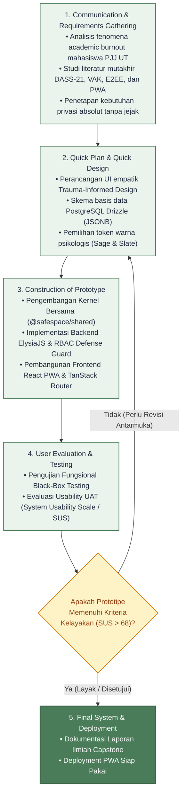

# Kajian Metodologi Penelitian (Bab III) & Teori Pendukung Desain UI/UX
## SafeSpace PWA — Sistem Informasi Pra-Konseling Anonim & Pemetaan Potensi Diri
**Program Studi Sistem Informasi — Fakultas Sains dan Teknologi — Universitas Terbuka (2026)**
*Standar Rujukan Akademis: Rentang Mutakhir 5 Tahun (2021–2026), Maksimal 10 Tahun (2018–2026)*

---

## 1. Analisis & Formulasi Metodologi Penelitian (Bab III)

### 1.1. Metodologi Penelitian: Research and Development (R&D)
Penelitian ini menggunakan pendekatan **Research and Development (R&D)** yang disesuaikan untuk bidang Sistem Informasi dan Rekayasa Perangkat Lunak (Sugiyono, 2021).

* **Justifikasi Pemilihan:**  
  R&D bukan sekadar penelitian observasional pasif, melainkan penelitian terapan yang bertujuan untuk **merancang, mengembangkan, dan memvalidasi kelayakan produk perangkat lunak** guna memecahkan masalah nyata. Dalam konteks ini, masalah yang diselesaikan adalah tingginya tingkat *academic burnout* pada mahasiswa Pendidikan Jarak Jauh (PJJ) Universitas Terbuka (Sadaria dkk., 2024; Anggraini & Chusairi, 2022) yang terhambat mencari bantuan formal akibat stigma sosial dan ketakutan rekam jejak akademik (Umsida, 2025).

---

### 1.2. Metode Pengembangan Sistem: Model Prototyping
Implementasi teknis rekayasa perangkat lunak mengadopsi siklus iteratif **Model Prototyping** (Pressman & Maxim, 2020).



#### Alasan Memilih Prototyping (Dibandingkan Waterfall atau Agile Murni):
1. **Sensitivitas Emosional Pengguna:** Aplikasi konseling dan pemetaan diri menuntut rasa aman psikologis yang tinggi. Prototyping memungkinkan calon pengguna mengevaluasi kenyamanan tata letak visual, keterbacaan, dan alur kuesioner sebelum kode sistem final dikunci (Eggleston & Noel, 2024).
2. **Klarifikasi Integrasi Intervensi:** Memastikan bahwa integrasi antara asesmen klinis DASS-21 dan pemetaan gaya belajar VAK disajikan secara intuitif tanpa memicu kelelahan kognitif (*cognitive overload*) (Puspitasari & Affandi, 2024).
3. **Validasi Aksesibilitas Perangkat Jamak (PWA):** Memastikan performa responsif dan kemampuan penyimpanan lokal (*caching*) berjalan optimal pada berbagai spesifikasi perangkat gawai mahasiswa (Raju Cherukuri, 2024; Samsyudin, 2025).

---

### 1.3. Metode Pengumpulan Data (Pembedaan Dua Dimensi Penelitian)

Dalam laporan Capstone, pengumpulan data dipisahkan secara tegas antara **Data Evaluasi Penelitian** dan **Data Operasional Sistem**:

```
                              ┌──────────────────────────────────────────────┐
                              │            PENGUMPULAN DATA PENELITIAN        │
                              └──────────────────────┬───────────────────────┘
                                                     │
             ┌───────────────────────────────────────┴───────────────────────────────────────┐
             ▼                                                                               ▼
┌──────────────────────────────┐                                            ┌──────────────────────────────┐
│  A. DATA EVALUASI PENELITIAN  │                                            │  B. DATA OPERASIONAL SISTEM  │
│  (Menguji Kelayakan Produk)  │                                            │  (Fitur Fungsional Aplikasi) │
├──────────────────────────────┤                                            ├──────────────────────────────┤
│ 1. Studi Literatur Kebutuhan │                                            │ 1. Instrumen DASS-21 Baku    │
│    (Kemendikbudristek, 2023) │                                            │    (Triage Skrining Stres)   │
│ 2. Uji Fungsional Black-Box  │                                            │ 2. Kuesioner VAK Dinamis     │
│    (Validasi Modul & E2EE)   │                                            │    (Exit Strategy Pedagogis) │
│ 3. UAT via Kuesioner SUS     │                                            │ 3. Mood Tracker Curhatan     │
│    (10 Item Skala Likert     │                                            │    (Sentimen AI Empati)      │
│     Lewis, 2018; Alfilaeni,  │                                            │                              │
│     2024; Skor Target > 68)  │                                            │                              │
└──────────────────────────────┘                                            └──────────────────────────────┘
```

#### A. Data Evaluasi Penelitian (Research Assessment Data)
1. **Studi Literatur & Observasi Kebutuhan:** Mengkaji karakteristik *working adult learners* UT, data retensi akademik, serta profil kejenuhan belajar (Kemendikbudristek, 2023; Sadaria dkk., 2024).
2. **Black-Box Testing:** Pengujian fungsionalitas rekayasa perangkat lunak untuk memastikan seluruh fungsionalitas (sanitasi Google auth, kalkulator DASS-21/VAK, enkripsi E2EE, dan RBAC) bebas dari cacat logika (*defects*).
3. **User Acceptance Testing (UAT) via System Usability Scale (SUS):**
   - Menggunakan instrumen baku 10 butir pertanyaan skala Likert (1–5) dengan metodologi evaluasi mutakhir (Lewis, 2018; Kusumaningrum dkk., 2023; Alfilaeni dkk., 2024).
   - Menghitung skor komposit 0–100 untuk mengukur *usability*, *learnability*, dan *user satisfaction*. Target penerimaan adalah skor SUS > 68 (*Good / Acceptable threshold*).

#### B. Data Operasional Sistem (Application Functional Data)
1. **DASS-21 (Depression Anxiety Stress Scale - 21 Butir):**
   - Instrumen psikometri baku yang telah teruji validitas dan reliabilitas konstruknya pada populasi mahasiswa Indonesia (Arjanto, 2022; Fitriana dkk., 2023).
   - Menggunakan kalkulasi matematis murni tanpa intervensi *black-box* kecerdasan buatan: $\text{Skor Subskala} = \sum(\text{Poin Jawaban}) \times 2$.
2. **VAK (Visual, Auditory, Kinesthetic):**
   - Mengidentifikasi modalitas penerimaan informasi dominan mahasiswa untuk mereduksi beban kognitif perkuliahan (Ramadhan dkk., 2024).
3. **Mood Tracker:**
   - Memfasilitasi curhatan bebas harian yang diproses LLM untuk pendampingan kalimat empati dan deteksi indikasi krisis.

---

## 2. Landasan Teori Desain UI/UX & Psikologi Warna

### 2.1. Psikologi Warna untuk Mental Health & Stres Akademik
Mahasiswa yang mengalami *academic burnout* mengalami kelelahan mental (*cognitive exhaustion*). Pemilihan palet antarmuka harus menstimulasi sistem saraf parasimpatis agar pengguna merasa tenang dan terlindungi (Liang, FNU, & Liang, 2025; Vaswani, 2025; Wilms & Oberfeld, 2018):

| Token Desain | Kode Hex | Peran Psikologis & Ergonomis |
| :--- | :--- | :--- |
| **Primary (Utama)** | `#4A7C59` / `#5B8A6E` *(Soft Sage Green)* | Menstimulasi ketenangan parasimpatis, melambangkan pemulihan emosional, stabilitas batin, dan relaksasi alami. |
| **Secondary (Kepercayaan)** | `#3B5998` / `#476A8A` *(Muted Slate Blue)* | Membangun rasa aman, privasi (*confidentiality*), dan kredibilitas sistem tanpa intimidasi birokrasi kampus. |
| **Background (Kanvas)** | `#F9F9F6` / `#F4F6F3` *(Warm Ivory Neutral)* | Mengurangi silau (*glare*) layar gawai dan kelelahan visual (*asthenopia*) bagi mahasiswa pekerja yang belajar malam hari (menghindari `#FFFFFF` murni). |
| **Surface (Kartu)** | `#FFFFFF` | Permukaan kartu konten dengan garis batas halus (`#E2E8F0`) untuk struktur hierarki yang teratur. |
| **Teks Utama** | `#1E293B` *(Deep Slate Charcoal)* | Memberikan rasio kontras tinggi berstandar WCAG 2.1 AA (> 7:1) tanpa ketajaman warna hitam pekat (`#000000`). |
| **Accent (Triage Alert)** | `#D97706` *(Warm Amber)* | Menggantikan warna merah alarm. Digunakan untuk menyoroti tingkat keparahan tinggi secara suportif tanpa memicu kepanikan pengguna. |

---

### 2.2. Trauma-Informed Design & Calm Technology

Penerapan prinsip *Trauma-Informed Design* dalam teknologi kesehatan digital (Eggleston, Jones, & Khan, 2025; Eggleston & Noel, 2024):
1. **Safety & Transparency:**
   - Menampilkan label keamanan privasi: *"Mode Anonim Aktif — Identitas Terlindungi Kriptografi"*.
   - Menyediakan fitur *Safe Exit* untuk menutup sesi seketika ke tab netral jika privasi fisik pengguna terganggu.
2. **Cognitive Load Reduction (Sweller dkk., 2019; Puspitasari & Affandi, 2024):**
   - **Chunking Kuesioner:** Membagi asesmen DASS-21 dan VAK menjadi format kartu bertahap (*wizard*) satu per satu, mengeliminasi kecemasan melihat puluhan pertanyaan sekaligus.
   - **Pill Icebreakers:** Tombol cepat pemantik topik curhatan (*"Saya merasa kewalahan tugas"*, *"Saya butuh teman bicara"*) guna mengatasi *blank canvas syndrome*.
   - **Expanding Textarea:** Bidang pengetikan yang melebar secara proporsional seiring bertambahnya teks curhatan.

---

## 3. Daftar Referensi Mutakhir (Rentang 2018–2026 / APA 7th Edition)

1. **Aini, A. N., Lestari, S. P., & Apriliyanti, R. (2024).** Hubungan Beban Tugas, Kontrol Diri, dan Komunitas terhadap Burnout Academic pada Mahasiswa selama Pembelajaran Daring. *Jurnal Keperawatan Jiwa*, 12(1), 49–60. https://doi.org/10.26714/jkj.12.1.2024.49-60
2. **Alfilaeni, V., Krisbiantoro, D., & Setyaningsih, G. (2024).** Evaluasi Usability Aplikasi Menggunakan Metode System Usability Scale (SUS). *CSRID (Computer Science Research and Its Development Journal)*, 16(3), 273–285. https://doi.org/10.22303/csrid-.16.3.2024.273-285
3. **Anggraini, D. P., & Chusairi, A. (2022).** Pengaruh Academic Self-Efficacy dan Student Engagement terhadap Academic Burnout Mahasiswa dalam Pembelajaran Daring. *Journal of Community Mental Health and Public Policy*, 4(2), 70–81. https://doi.org/10.51602/cmhp.v4i2.70
4. **Arjanto, P. (2022).** Uji Reliabilitas dan Validitas Depression Anxiety Stress Scales 21 (DASS-21) pada Mahasiswa. *Jurnal Psikologi Perseptual*, 7(1), 12–25. https://doi.org/10.24176/perseptual.v7i1.6196
5. **Boneh, D., & Shoup, V. (2020).** *A Graduate Course in Applied Cryptography (Version 0.5)*. Stanford University.
6. **Eggleston, M., Jones, E. P., & Khan, N. (2025).** A scoping review of trauma-informed care principles applied in design and technology. *DIGITAL HEALTH*, 11, 1–16. https://doi.org/10.1177/20552076251360925
7. **Eggleston, M., & Noel, L.-A. (2024).** Repairing the Harm of Digital Design Using a Trauma-informed Approach. *Revista Diseña*, 24, Article 7. https://doi.org/10.7764/disena.24.article.7
8. **Fitriana, T. S., dkk. (2023).** Uji Validitas dan Reliabilitas Konstruk DASS-21. *Jurnal Psikologi Ulayat: Indonesian Journal of Indigenous Psychology*, 10(2), 232–250.
9. **Kusumaningrum, A. S., Frobenius, A. C., & Shonta, A. A. (2023).** Evaluasi Usability Testing Aplikasi LMS Waskita dengan Metode System Usability Scale (SUS). *Melek IT: Information Technology Journal*, 9(1), 45–54. https://doi.org/10.30742/melekitjournal.v9i1.275
10. **Lewis, J. R. (2018).** The System Usability Scale: Past, Present, and Future. *International Journal of Human–Computer Interaction*, 34(7), 577–590. https://doi.org/10.1080/10447318.2018.1455307
11. **Liang, R., FNU, F., & Liang, Y. (2025).** Emotion-Aware Interface Adaptation in Mobile Applications Based on Color Psychology and Multimodal User State Recognition. *Frontiers in Artificial Intelligence Research*, 2(4), 1–12. https://doi.org/10.71465/fair241
12. **Maiyaroh, S., & Kholisna, T. (2023).** Perfeksionisme, Stres, dan Burnout Akademik pada Mahasiswa: Analisis Structural Equation Modeling. *Jurnal Counseling Care*, 7(1), 41–51.
13. **Pressman, R. S., & Maxim, B. R. (2020).** *Software Engineering: A Practitioner's Approach (9th ed.)*. McGraw-Hill Education.
14. **Puspitasari, E. I., & Affandi, G. R. (2024).** Pengaruh stres akademik dan cognitive load terhadap motivasi belajar siswa. *Jurnal Psikologi: Jurnal Ilmiah Fakultas Psikologi Universitas Yudharta Pasuruan*, 11(2), 374–388.
15. **Raju Cherukuri, B. (2024).** Progressive Web Apps (PWAs): Enhancing User Experience through Modern Web Development. *International Journal of Science and Research (IJSR)*, 13(10), 1540–1546. https://doi.org/10.21275/ms241022095359
16. **Ramadhan, F., dkk. (2024).** Implementasi Model Pembelajaran VAK di Pendidikan Kejuruan: Systematic Literature Review. *Jurnal Ilmiah Edutic: Pendidikan dan Informatika*, 10(2), 149–159.
17. **Sadaria, S. A., Razak, A., & Akmal, N. (2024).** Pengaruh Efikasi Diri terhadap Academic Burnout pada Mahasiswa yang Bekerja di Kota Makassar. *Socius: Jurnal Penelitian Ilmu-Ilmu Sosial*, 2(3), 24–30.
18. **Samsyudin, I. (2025).** Native Apps vs. Progressive Web Apps: A Comparative Analysis of User Experience and Development Costs. *SSRN Electronic Journal*, 1–14. https://doi.org/10.2139/ssrn.5042193
19. **Sugiyono. (2021).** *Metode Penelitian Kuantitatif, Kualitatif, dan R&D (Edisi Ke-3)*. Alfabeta, Bandung.
20. **Sweller, J., van Merriënboer, J. J., & Paas, F. (2019).** Cognitive architecture and instructional design: 20 years later. *Educational Psychology Review*, 31(1), 1–29. https://doi.org/10.1007/s10648-019-09465-5
21. **Vaswani, S. (2025).** The Psychology of Color: How Color Influences Human Thought, Emotion, and Behavior. *International Journal of Advanced Research*, 13(4), 102–115. https://doi.org/10.21474/ijar01/21974
22. **Wilms, L., & Oberfeld, D. (2018).** Color and emotion: Effects of hue, saturation, and brightness. *Psychological Research*, 82(5), 896–914. https://doi.org/10.1007/s00426-017-0880-8
