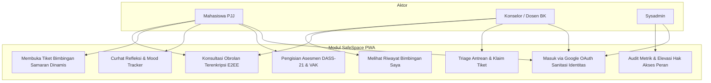
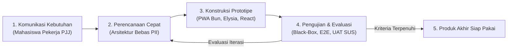

# BANK BAHAN DEVELOPMENT (UNTUK PEMBUATAN SLIDE PRESENTASI & LAPORAN)

Dokumen ini adalah **pusat aset dan data teknis (Asset & Metrics Bank)** yang dirangkum dari hasil rekayasa perangkat lunak SafeSpace PWA. Dokumen ini disiapkan khusus agar rekan tim yang bertugas membuat **slide presentasi sidang** atau menyusun **naskah laporan** dapat langsung mengambil poin penting, data pengujian, tabel spesifikasi, dan tangkapan layar tanpa perlu membongkar kode sumber.

---

## 1. Poin Inti untuk Slide "Latar Belakang & Solusi"

### A. Masalah Nyata Mahasiswa PJJ Universitas Terbuka (Problem Statement)
- **Beban Ganda (*Dual-Role Conflict*):** Mayoritas mahasiswa UT adalah pekerja (*working adults*) yang membagi waktu antara pekerjaan profesional, keluarga, dan tuntutan kuliah mandiri, memicu kerentanan kelelahan belajar (*academic burnout*).
- **Rasa Terisolasi (*Learning Isolation*):** Pola belajar jarak jauh minim interaksi tatap muka, sering kali membuat mahasiswa merasa berjuang sendiri saat menghadapi kesulitan materi kuliah.
- **Stigma Bimbingan Konseling & Takut Jejak Akademik:** Banyak mahasiswa enggan berkonsultasi ke dosen wali atau unit bimbingan konseling kampus karena cemas identitas aslinya tercatat dan memengaruhi penilaian akademik (*fear of academic paper trail*).

### B. Solusi: SafeSpace PWA
- Aplikasi *Progressive Web App* pra-konseling ramah trauma yang memberikan ruang skrining mandiri secara instan dan menghubungkan mahasiswa ke konselor sebaya/dosen BK secara **dua arah anonim penuh (*Two-Way Double-Blind Anonymity*)**.

---

## 2. Poin Inti untuk Slide "Fitur Unggulan & Nilai Inovasi (Novelty)"

Gunakan 5 poin ini sebagai bahan slide "Keunggulan Sistem" atau "Inovasi":

1. **Nama Samaran Dinamis per Sesi Tiket (*Unlinkable Ephemeral Pseudonymity*):**
   - Setiap kali mahasiswa membuka tiket konsultasi baru, sistem otomatis menerbitkan nama samaran unik acak (misal: `Sahabat Pelita-27`, `Sahabat Asa-91`).
   - Konselor tidak dapat menghubungkan riwayat tiket sebelumnya (*Unlinkability*), sehingga mahasiswa terbebas dari bias atau prasangka riwayat masa lalu.
2. **Penyimpanan Bebas Data Pribadi (*Zero-PII Storage*):**
   - Sistem login Google OAuth disanitasi di sisi server menggunakan *one-way cryptographic hash* (HMAC-SHA-256 + Server Pepper).
   - Database tidak pernah menyimpan nama asli, email asli, maupun foto profil mahasiswa.
3. **Enkripsi Obrolan Ujung-ke-Ujung (*End-to-End Encryption / E2EE*):**
   - Pesan konsultasi dienkripsi langsung di peramban pengguna menggunakan algoritma standar militer **AES-GCM-256**.
   - Admin database maupun server hanya melihat teks acak terenkripsi (*Zero-Knowledge*).
4. **Kalkulasi Psikometri Deterministik Murni (Bebas Halusinasi AI):**
   - Asesmen depresi, kecemasan, dan stres (DASS-21) serta preferensi modalitas belajar (VAK) dihitung menggunakan formula deterministik baku, bukan inferensi generatif yang rentan bias.
5. **Desain Ramah Trauma & Tombol Darurat (*Trauma-Informed UX & Safe Exit*):**
   - Palet warna lembut penenang jiwa (*Soft Sage Green*, *Slate Blue*).
   - Dilengkapi tombol darurat **Safe Exit** yang dapat diklik satu kali untuk langsung mengalihkan layar ke portal edukasi netral jika privasi mahasiswa di ruangan terancam.

---

## 3. Poin Inti untuk Slide "Arsitektur & Spesifikasi Teknologi"

| Komponen Arsitektur | Teknologi Terpilih | Alasan & Keunggulan |
| :--- | :--- | :--- |
| **Runtime & Package Manager** | **Bun v1.3** | Eksekusi TypeScript bawaan, waktu booting sangat cepat, dan manajemen paket monorepo efisien. |
| **Backend Framework** | **ElysiaJS (Ecosystem Bun)** | Performa throughput tinggi, validasi skema tipe TypeBox end-to-end, dan arsitektur modular. |
| **Frontend Framework** | **React 19 & Vite** | Rendering antarmuka reaktif berbasis komponen modern, cepat, dan ringan. |
| **Styling & Design System** | **Tailwind CSS v4** | Desain modern trauma-informed, responsif mobile/desktop, dan palet warna menenangkan. |
| **Database & ORM** | **PostgreSQL + Drizzle ORM** | Keandalan data relasional, migrasi skema ketat (*strict schema*), tanpa menyimpan PII. |
| **Keamanan Kriptografi** | **Web Crypto API (AES-GCM-256)** | Standar enkripsi bawaan peramban modern tanpa pustaka pihak ketiga yang berat. |
| **Kapabilitas Distribusi** | **Progressive Web App (PWA)** | Dapat dipasang (*installable*) di Android, iOS, Windows, dan MacOS tanpa biaya toko aplikasi. |

---

## 4. Poin Inti untuk Slide "Hasil Pengujian & Verifikasi Kinerja"

Bahan angka konkret yang sangat disukai dosen penguji saat sidang:

- **Pengujian Unit Otomatis (Unit Testing):**
  - **99 dari 99 Pengujian Lolos (100% PASS)**
  - Waktu eksekusi sangat cepat: **410 milidetik**
  - Mencakup: validasi kalkulasi DASS-21, kalkulasi VAK, sanitasi token HMAC, dan enkripsi E2EE.
- **Pengujian End-to-End Otomatis (E2E Testing):**
  - **10 dari 10 Skenario Lolos (100% PASS)**
  - Menggunakan kerangka kerja Playwright Chromium pada lingkungan browser sesungguhnya.
- **Kualitas & Kebersihan Kode Sumber (Code Quality):**
  - **0 Linter Errors, 0 Warnings** pada 100 berkas kode menggunakan Biome Linter.
- **Kompleksitas Graf Kode Sumber (Code Graph GitNexus):**
  - Terdiri dari **1.350 Nodes**, **2.409 Edges**, **41 Klaster Fungsional**, dan **49 Alur Eksekusi**.
- **Pengujian Fungsional Black-Box:**
  - **14 Skenario Pengujian Fungsional Inti:** Seluruh fitur (autentikasi, asesmen, tiket anonim, triage antrean, E2EE chat, dan panel sysadmin) berstatus **Valid (100%)**.

---

## 5. Bank Gambar Tangkapan Layar (Screenshots Gallery)

Semua berkas gambar di bawah ini beresolusi tinggi dan siap dimasukkan ke dalam slide PowerPoint atau bab laporan:

| No | Berkas Gambar | Nama Tampilan | Rekomendasi Penggunaan pada Slide |
| :---: | :--- | :--- | :--- |
| 1 | [`flow-01-public-landing.png`](file:///d:/ijplabs/capstone/docs/screenshots/flow-01-public-landing.png) | Beranda Publik SafeSpace | Slide perkenalan sistem antarmuka utama. |
| 2 | [`flow-02-public-about.png`](file:///d:/ijplabs/capstone/docs/screenshots/flow-02-public-about.png) | Halaman Edukasi & Privasi | Slide penjelasan transparansi dan prinsip anonimitas. |
| 3 | [`flow-03-public-auth-gate.png`](file:///d:/ijplabs/capstone/docs/screenshots/flow-03-public-auth-gate.png) | Gerbang Masuk Akun | Slide alur autentikasi Google OAuth & sanitasi identitas. |
| 4 | [`flow-04-mahasiswa-dashboard.png`](file:///d:/ijplabs/capstone/docs/screenshots/flow-04-mahasiswa-dashboard.png) | Dashboard Mahasiswa | Slide pembuktian nama samaran dinamis per tiket. |
| 5 | [`flow-05-mahasiswa-asesmen.png`](file:///d:/ijplabs/capstone/docs/screenshots/flow-05-mahasiswa-asesmen.png) | Asesmen DASS-21 & VAK | Slide proses skrining kondisi emosional & gaya belajar. |
| 6 | [`flow-06-mahasiswa-curhat.png`](file:///d:/ijplabs/capstone/docs/screenshots/flow-06-mahasiswa-curhat.png) | Ruang Curhat Reflektif | Slide fitur pemantik curhat (*icebreaker*) & mood tracker. |
| 7 | [`flow-07-konselor-antrean.png`](file:///d:/ijplabs/capstone/docs/screenshots/flow-07-konselor-antrean.png) | Antrean Triage Konselor | Slide antrean bimbingan berbasis tingkat urgensi klinis. |
| 8 | [`flow-07-b-konselor-riwayat.png`](file:///d:/ijplabs/capstone/docs/screenshots/flow-07-b-konselor-riwayat.png) | Riwayat Bimbingan Konselor | Slide portofolio dan riwayat sesi yang ditangani konselor. |
| 9 | [`flow-08-sysadmin-dashboard.png`](file:///d:/ijplabs/capstone/docs/screenshots/flow-08-sysadmin-dashboard.png) | Panel Sysadmin | Slide tata kelola hak akses dan elevasi peran pengguna. |
| 10 | [`09-e2ee-chat-room.png`](file:///d:/ijplabs/capstone/docs/screenshots/09-e2ee-chat-room.png) | Ruang Konseling E2EE | Slide demonstrasi obrolan terenkripsi AES-GCM-256. |

---

## 6. Diagram Alur & Pemodelan Sistem (Siap Salin / Render)

### A. Diagram Use Case (3 Aktor)

### B. Diagram Model Prototyping (R&D)

