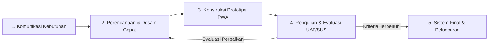

# BAB III METODOLOGI

**Judul Capstone:** Sistem Informasi Pra-Konseling Anonim dan Pemetaan Potensi Diri untuk Deteksi Dini *Academic Burnout* pada Ekosistem Pendidikan Jarak Jauh  
**Studi Kasus:** Universitas Terbuka (UT)  
**Program Studi:** Sistem Informasi, Fakultas Sains dan Teknologi, Universitas Terbuka (2026)  
**Struktur Bab:** Mengacu pada Pedoman Resmi Tugas Akhir / Capstone Project (Metode Penelitian, Proses Analisis, Proses Perancangan, Implementasi, serta Pengujian dan Evaluasi).

---

## 3.1 Metode Penelitian

Metode penelitian menjelaskan pendekatan sistematis yang digunakan untuk mengumpulkan data, menggali informasi kebutuhan, serta merancang tahapan rekayasa perangkat lunak secara ilmiah dan terukur.

### 3.1.1 Pendekatan Penelitian: Research and Development (R&D) dengan Model Prototyping
Penelitian ini mengadopsi pendekatan **Research and Development (R&D)** yang dipadukan dengan siklus rekayasa perangkat lunak **Model Prototyping** (Pressman & Maxim, 2020; Sugiyono, 2021). Pendekatan R&D dipilih karena penelitian ini bertujuan menghasilkan produk teknologi informasi terapan (SafeSpace PWA) yang dapat memecahkan masalah nyata kelelahan belajar (*academic burnout*) pada mahasiswa Pendidikan Jarak Jauh (PJJ).

Model Prototyping diterapkan melalui siklus bertahap dan berulang (*iterative cycle*):
1. **Communication (Komunikasi):** Mengidentifikasi permasalahan psikologis dan akademis mahasiswa PJJ.
2. **Quick Plan & Quick Design (Perencanaan & Desain Cepat):** Merancang arsitektur privasi, basis data, dan antarmuka ramah trauma (*trauma-informed design*).
3. **Construction of Prototype (Konstruksi Prototipe):** Membangun aplikasi berbasis Progressive Web App (PWA) dengan runtime Bun, ElysiaJS, React 19, dan Web Crypto API.
4. **Testing & User Evaluation (Pengujian & Evaluasi):** Menguji fungsionalitas sistem (Unit Test, E2E Test, Black-Box) serta menguji penerimaan pengguna melalui kuesioner *System Usability Scale* (SUS).
5. **Refinement & Deployment (Penyempurnaan & Peluncuran):** Memperbaiki prototipe berdasarkan umpan balik pengujian menuju produk akhir yang siap digunakan.

> **Catatan Diagram Metodologi:**  
> Visualisasi lengkap alur metodologi Model Prototyping (R&D) beresolusi tinggi dengan rincian aktivitas setiap fase dapat dilihat dan diunduh dalam format PNG/SVG pada berkas dasbor diagram interaktif:  
> [**`docs/flowchart_dashboard.html`**](file:///d:/ijplabs/capstone/docs/flowchart_dashboard.html) (Tab: *1. Model Prototyping (R&D)*).

### 3.1.2 Metode Pengumpulan Data dan Informasi
Untuk memastikan perancangan sistem berpijak pada data empiris yang valid, pengumpulan data dilakukan melalui 4 teknik:

1. **Studi Literatur Ilmiah (Desk Research):**
   - Mengkaji landasan psikometri instrumen baku **DASS-21** (Depression Anxiety Stress Scale 21 butir) karya Lovibond (1995), Antony dkk. (1998), serta uji validitas bahasa Indonesia oleh Arjanto (2022) dan Fitriana dkk. (2023).
   - Mengkaji teori modalitas belajar **VAK** (Visual, Auditory, Kinesthetic) karya Fleming & Mills (1992) dan Ramadhan dkk. (2024).
   - Mengkaji prinsip perlindungan privasi data internasional: *Privacy by Design* (Cavoukian, 2010), konsep *Unlinkability & Ephemeral Pseudonymity* (Pfitzmann & Hansen, 2010), serta efek keterbukaan dalam konseling daring (*The Online Disinhibition Effect*, Suler, 2004).
2. **Observasi Karakteristik Ekosistem PJJ Universitas Terbuka:**
   - Menelaah data demografi mahasiswa UT yang mayoritas merupakan pekerja (*working adult learners*) dengan beban ganda antara pekerjaan profesional, rumah tangga, dan tuntutan tugas perkuliahan mandiri daring (Kemendikbudristek, 2023; Sadaria dkk., 2024).
   - Mengamati fenomena tingginya angka *drop-out* dan keengganan mahasiswa memanfaatkan layanan bimbingan konseling formal kampus karena stigma negatif atau kekhawatiran rekam jejak identitas (*fear of academic paper trail*).
3. **Kuesioner dan Angket Awal:**
   - Penyebaran angket penjajakan awal kepada mahasiswa untuk memetakan gejala stres, jam belajar efektif, dan kendala utama belajar mandiri.
4. **Instrumen Evaluasi Kelaikan Sistem:**
   - Pengumpulan data kegunaan aplikasi (*usability*) pada tahap akhir menggunakan kuesioner baku *System Usability Scale* (SUS) dengan 10 pernyataan skala Likert 1-5 (Brooke, 1996; Alfilaeni dkk., 2024).

---

## 3.2 Proses Analisis

Proses analisis menguraikan teknik dan alat yang digunakan untuk membedah masalah yang dihadapi pengguna, merumuskan spesifikasi kebutuhan fungsional dan non-fungsional, serta merancang model ancaman privasi sistem.

### 3.2.1 Analisis Masalah Pengguna (Problem Space & Root Cause Analysis)
Berdasarkan hasil pengumpulan data awal, dirumuskan tiga akar masalah utama:

| Masalah Utama | Dampak pada Mahasiswa PJJ | Solusi pada SafeSpace PWA |
| :--- | :--- | :--- |
| **Beban Ganda (Dual-Role Conflict)** | Mahasiswa pekerja mengalami kelelahan mental kronis (*academic burnout*). | Skrining mandiri berkala menggunakan instrumen baku DASS-21 secara cepat (< 3 menit). |
| **Isolasi Belajar Daring** | Mahasiswa merasa berjuang sendirian tanpa pendampingan saat mengalami kebuntuan belajar. | Pemetaan gaya belajar VAK yang menghasilkan tips belajar adaptif mandiri serta fitur Curhat Refleksi empatik. |
| **Stigma Sosial & Takut Dihakimi** | Mahasiswa takut membuka diri ke dosen wali atau staf BK karena takut identitas aslinya tersebar. | Protokol *Two-Way Double-Blind Anonymity*, nama samaran dinamis per tiket (*Unlinkable Ephemeral Pseudonym*), dan enkripsi *End-to-End* (E2EE). |

### 3.2.2 Analisis Kebutuhan Fungsional (Functional Requirements / FR)
Sistem SafeSpace PWA dirancang memenuhi 10 kebutuhan fungsional inti:

1. **FR-01 (Autentikasi Google OAuth Terpadu):** Mahasiswa, konselor, dan sysadmin dapat masuk menggunakan akun Google tanpa pendaftaran manual yang rumit.
2. **FR-02 (Sanitasi Identitas Kriptografis):** Sistem backend menyamarkan email dan Google Subject ID menjadi hash kriptografis satu arah (SHA-256 HMAC + Pepper) dan tidak menyimpan nama asli di database.
3. **FR-03 (Asesmen Emosional DASS-21):** Mahasiswa dapat mengisi 21 butir instrumen baku DASS-21 dan memperoleh skor tingkat depresi, kecemasan, dan stres secara instan menggunakan kalkulasi deterministik murni.
4. **FR-04 (Pemetaan Gaya Belajar VAK):** Mahasiswa dapat mengisi kuesioner preferensi modalitas belajar Visual, Auditory, dan Kinesthetic beserta tips adaptif belajar mandiri PJJ.
5. **FR-05 (Curhat Refleksi & Mood Tracker):** Mahasiswa dapat menulis catatan refleksi harian dengan bantuan pemantik curhat cepat (*icebreaker pills*) dan menerima afirmasi empati sistem.
6. **FR-06 (Tiket Pra-Konseling Terlampir):** Mahasiswa dapat membuka tiket bantuan yang otomatis melampirkan profil keparahan DASS-21 dan dominasi VAK ke antrean konseling.
7. **FR-07 (Nama Samaran Dinamis per Sesi):** Setiap kali mahasiswa membuka tiket baru, sistem menerbitkan nama samaran acak baru (misalnya `Sahabat Lentera-42`, `Sahabat Asa-91`) sehingga konselor tidak dapat menghubungkan riwayat tiket sebelumnya (*Unlinkability*).
8. **FR-08 (Antrean Triage & Riwayat Konselor):** Konselor dapat memilah tiket antrean berdasarkan tingkat urgensi DASS-21, menerima tiket, serta melihat tab *Riwayat Pendampingan Saya* sebagai bukti portofolio bimbingan.
9. **FR-09 (Obrolan Konseling Terenkripsi E2EE):** Pertukaran pesan antara mahasiswa dan konselor dienkripsi di sisi peramban menggunakan AES-GCM-256 sehingga teks asli tidak dapat dibaca oleh server maupun admin basis data (*Zero-Knowledge*).
10. **FR-10 (Panel Sysadmin & Elevasi Peran):** Administrator sistem dapat memantau metrik akun, mengelevasi peran pengguna (mahasiswa, konselor sebaya/dosen BK, admin), dan mengelola keamanan sistem.

### 3.2.3 Analisis Kebutuhan Non-Fungsional (Non-Functional Requirements / NFR)
1. **NFR-01 (Keamanan & Privasi Berlapis - Defense-in-Depth):** Otentikasi berbasis JWT terenkripsi dengan pengamanan Role-Based Access Control (RBAC) di tingkat API router dan pembatasan query database (*Database Scoping*).
2. **NFR-02 (Performa & Waktu Respons):** Waktu komputasi skor psikometri di backend kurang dari 100 milidetik; rendering antarmuka frontend instan.
3. **NFR-03 (Ketersediaan Lintas Perangkat - PWA & Offline Readiness):** Aplikasi dapat dipasang (*installable*) di Android, iOS, Windows, dan MacOS dengan dukungan *service worker* untuk penyimpanan instrumen lokal saat offline.
4. **NFR-04 (Usabilitas Ramah Trauma - Trauma-Informed UX):** Desain antarmuka menggunakan palet warna penenang (*Soft Sage Green*, *Slate Blue*, *Warm Ivory*) dan tombol darurat *Safe Exit* yang langsung mengalihkan layar ke portal edukasi netral jika privasi mahasiswa terancam.

### 3.2.4 Pemodelan Analisis Sistem (Use Case Diagram)

Pemodelan Use Case Diagram digunakan untuk memetakan fungsi-fungsi sistem dan interaksi antara aktor pengguna dengan batas sistem (*system boundary*) SafeSpace PWA. Terdapat 3 aktor utama dalam sistem:
1. **Mahasiswa PJJ:** Pengguna utama yang memerlukan deteksi dini kejenuhan belajar (*academic burnout*), pemetaan gaya belajar VAK, ruang curhat reflektif, serta pembukaan tiket pra-konseling anonim.
2. **Konselor Sebaya / Dosen BK:** Staf atau konselor resmi kampus yang bertugas memantau antrean triage bimbingan, mengklaim tiket, dan mendampingi mahasiswa melalui ruang obrolan terenkripsi (E2EE).
3. **Administrator Sistem (Sysadmin):** Pengelola teknis yang bertugas memantau audit metrik sistem dan melakukan elevasi hak akses peran pengguna (*Role-Based Access Control*).

#### Matriks Spesifikasi Fungsional Use Case:

| ID Use Case | Nama Use Case | Aktor Terlibat | Deskripsi Fungsional & Batasan |
| :---: | :--- | :--- | :--- |
| **UC-01** | Masuk via Google OAuth Anonim | Mahasiswa, Konselor, Admin | Pengguna masuk menggunakan akun Google, sistem melakukan verifikasi token dan hashing satu arah HMAC-SHA-256 + Pepper. |
| **UC-02** | Pengisian Asesmen DASS-21 | Mahasiswa PJJ | Mahasiswa mengisi 21 butir instrumen baku DASS-21 dan memperoleh hasil keparahan emosional secara instan. |
| **UC-03** | Pemetaan Gaya Belajar VAK | Mahasiswa PJJ | Mahasiswa mengisi kuesioner modalitas belajar dan memperoleh rekomendasi tips adaptif belajar mandiri PJJ. |
| **UC-04** | Curhat Refleksi & Mood Tracker | Mahasiswa PJJ | Mahasiswa menulis refleksi harian berbantuan *icebreaker pills* dan menerima respon empati penenang sistem. |
| **UC-05** | Membuka Tiket Samaran Dinamis | Mahasiswa PJJ | Mahasiswa mengajukan tiket bimbingan dengan nama samaran dinamis per sesi (*Unlinkable Ephemeral Pseudonym*), otomatis melampirkan (*include*) snapshot skor UC-02 dan UC-03. |
| **UC-06** | Konsultasi Obrolan E2EE | Mahasiswa, Konselor | Pertukaran pesan bimbingan interaktif dua arah yang dienkripsi secara lokal di peramban menggunakan AES-GCM-256. |
| **UC-07** | Triage Antrean & Klaim Tiket | Konselor Sebaya / Dosen BK | Konselor menelaah tiket pada antrean berdasarkan urgensi klinis dan mengklaim tiket untuk pendampingan aktif. |
| **UC-08** | Memantau Riwayat Bimbingan | Konselor Sebaya / Dosen BK | Konselor melihat daftar seluruh tiket yang pernah ditangani sebagai bukti portofolio pendampingan mahasiswa. |
| **UC-09** | Manajemen Akun & Elevasi Peran | Sysadmin | Sysadmin memantau data pengguna terdaftar dan mengubah peran akun (*student* ke *counselor*). |
| **UC-10** | Pemicu Darurat Safe Exit | Mahasiswa PJJ | Tombol darurat cepat untuk menutup tampilan dan mengalihkan peramban ke situs netral jika privasi terancam. |

> **Catatan Pemodelan UML:**  
> Visualisasi lengkap Use Case Diagram berstandar pemodelan perangkat lunak UML (menampilkan batas sistem, simbol aktor, elips use case, dan relasi dependensi *include*) beresolusi tinggi tersedia dan dapat diekspor langsung ke format gambar (PNG/SVG) melalui dasbor diagram interaktif:  
> [**`docs/flowchart_dashboard.html`**](file:///d:/ijplabs/capstone/docs/flowchart_dashboard.html) (Tab: *2. Use Case Diagram (UML)*).

---

## 3.3 Proses Perancangan

Proses perancangan menguraikan transformasi dari spesifikasi analisis kebutuhan ke dalam rancangan arsitektur teknologi, struktur basis data, tata letak antarmuka pengguna, dan mekanisme kriptografi privasi.

### 3.3.1 Perancangan Arsitektur Sistem (System Architecture Design)
Sistem dirancang menggunakan arsitektur monorepo modular modern berbasis Bun Workspaces yang memisahkan tanggung jawab kode menjadi 4 tingkatan (*multi-tier architecture*):

| Lapisan Arsitektur | Modul & Komponen | Port & Protokol | Peran & Tanggung Jawab Teknis |
| :--- | :--- | :--- | :--- |
| **1. Lapisan Klien Antarmuka** (`apps/web`) | React 19, Vite PWA, Tailwind CSS v4, Lucide Icons, Web Crypto API | Port 5173 (HTTP / HTTPS / PWA Service Worker) | Menyediakan antarmuka ramah trauma (*trauma-informed UI*), eksekusi enkripsi E2EE AES-GCM-256 lokal di browser klien, dan penyimpanan instrumen lokal (LocalStorage) saat offline. |
| **2. Lapisan Kernel Bersama** (`packages/shared`) | Algoritma DASS-21, Algoritma VAK, Generator Samaran Dinamis, Skema TypeBox | In-Memory Monorepo Link (TypeScript Direct Import) | Menyediakan logika bisnis deterministik bebas halusinasi AI, utilitas hashing kriptografis, kontrak skema data tipe-aman, serta generator nama samaran per tiket. |
| **3. Lapisan Peladen API** (`apps/api`) | ElysiaJS Framework, Bun v1.3 Runtime, JWT Middleware, RBAC Guard | Port 3000 (HTTP REST API / WebSocket Relaying) | Memproses verifikasi token Google OAuth, sanitasi identitas satu arah (HMAC-SHA-256 + Pepper), pembatasan akses peran (RBAC), serta perantara lalu lintas *ciphertext* obrolan tanpa menyimpan kunci (*Zero-Knowledge*). |
| **4. Lapisan Basis Data** (`packages/db`) | PostgreSQL v16, Drizzle ORM | Port 5433 (TCP Native PostgreSQL Driver) | Menyimpan data terstruktur yang telah disanitasi, snapshot hasil asesmen dalam format JSONB, serta pesan terenkripsi tanpa menyimpan informasi identitas pribadi (*Zero-PII Storage*). |

> **Catatan Diagram Arsitektur:**  
> Visualisasi blok arsitektur perangkat lunak monorepo multi-tier beresolusi tinggi tersedia dan dapat diekspor langsung dalam format grafis (PNG/SVG) melalui dasbor diagram interaktif:  
> [**`docs/flowchart_dashboard.html`**](file:///d:/ijplabs/capstone/docs/flowchart_dashboard.html) (Tab: *6. Arsitektur Komponen Monorepo*).

### 3.3.2 Perancangan Basis Data (Class Diagram & Kamus Data)
Untuk menjamin pemenuhan prinsip *Privacy by Design* (Cavoukian, 2010) dan *Zero-Knowledge Architecture*, skema basis data dirancang secara ketat tidak memiliki kolom data pribadi (PII) seperti nama asli, NIM, nomor telepon, alamat, maupun email pengguna. 

Struktur entitas direalisasikan melalui 3 tabel relasional utama dengan spesifikasi kamus data (*data dictionary*) sebagai berikut:

#### Tabel 1: Kamus Data Entitas `users_auth`
| Nama Kolom | Tipe Data | Constraint | Keterangan & Prinsip Privasi |
| :--- | :--- | :--- | :--- |
| `id` | UUID | Primary Key (PK) | Pengenal unik acak entitas pengguna yang digenerasi oleh sistem. |
| `hashed_identity` | VARCHAR(255) | Unique (UK), Not Null | Hasil hashing satu arah HMAC-SHA-256(Google_Sub + Server_Pepper). Identitas asli tidak dapat didekripsi kembali. |
| `pseudonym` | VARCHAR(100) | Not Null | Label pengenal akun default (misal: `Mahasiswa #4021` / `Konselor #1002`). |
| `role` | VARCHAR(20) | Not Null | Peran pengguna dalam sistem (`student`, `counselor`, `admin`) untuk kontrol RBAC. |
| `created_at` | TIMESTAMP | Not Null | Waktu pertama kali akun diinisialisasi pada sistem. |

#### Tabel 2: Kamus Data Entitas `counseling_sessions`
| Nama Kolom | Tipe Data | Constraint | Keterangan & Prinsip Privasi |
| :--- | :--- | :--- | :--- |
| `id` | UUID | Primary Key (PK) | Pengenal unik sesi tiket pra-konseling. |
| `student_id` | UUID | Foreign Key (FK) -> `users_auth.id` | Tautan ke ID akun mahasiswa pembuat tiket (diisolasi dari pandangan konselor). |
| `counselor_id` | UUID | Foreign Key (FK) -> `users_auth.id` (Nullable) | Tautan ke ID konselor yang mengklaim tiket. Bernilai NULL selama tiket dalam antrean. |
| `student_pseudonym` | VARCHAR(100) | Not Null | Nama samaran dinamis per tiket (misal: `Sahabat Pelita-27`). Berganti acak di setiap tiket baru (*Unlinkability*). |
| `dass21_score` | JSONB | Nullable | Snapshot skor numerik DASS-21 (Depresi, Cemas, Stres) dan kategori klinisnya untuk data triage konselor. |
| `vak_result` | JSONB | Nullable | Snapshot distribusi persentase gaya belajar (Visual, Auditory, Kinesthetic) untuk panduan pendekatan konselor. |
| `status` | VARCHAR(20) | Not Null | Status siklus hidup tiket (`waiting`, `active`, `closed`). |
| `created_at` | TIMESTAMP | Not Null | Waktu pembukaan tiket bimbingan. |
| `closed_at` | TIMESTAMP | Nullable | Waktu penutupan tiket saat sesi bimbingan berakhir. |

#### Tabel 3: Kamus Data Entitas `chat_messages`
| Nama Kolom | Tipe Data | Constraint | Keterangan & Prinsip Privasi |
| :--- | :--- | :--- | :--- |
| `id` | UUID | Primary Key (PK) | Pengenal unik pesan obrolan. |
| `session_id` | UUID | Foreign Key (FK) -> `counseling_sessions.id` | Tautan ke sesi tiket konsultasi tempat pesan dikirimkan. |
| `sender_id` | UUID | Foreign Key (FK) -> `users_auth.id` | Pengenal pengirim pesan dalam sesi. |
| `sender_type` | VARCHAR(20) | Not Null | Tipe pengirim pesan (`student` atau `counselor`). |
| `encrypted_content` | TEXT | Not Null | Teks pesan terenkripsi (*ciphertext*) berbasis algoritma Web Crypto AES-GCM-256. |
| `iv` | VARCHAR(64) | Not Null | *Initialization Vector* 12-byte acak dalam format Base64 untuk keperluan dekripsi di sisi klien. |
| `sent_at` | TIMESTAMP | Not Null | Waktu pengiriman pesan obrolan. |

#### Kardinalitas dan Relasi Antar-Entitas:
1. **`users_auth` ke `counseling_sessions` (1 : N):** Satu akun mahasiswa dapat membuka banyak tiket konseling pada waktu berbeda. Namun di mata konselor, setiap tiket menampilkan `student_pseudonym` dinamis yang berbeda sehingga riwayat antar-tiket tidak dapat dihubungkan (*unlinkable*).
2. **`counseling_sessions` ke `chat_messages` (1 : N):** Satu sesi tiket konseling memuat banyak baris pesan percakapan terenkripsi yang saling terikat pada `session_id`.

> **Catatan Class Diagram & ERD Relasi Basis Data:**  
> Visualisasi lengkap Class Diagram UML (atribut, tipe data, method fungsi enkripsi/sanitasi, dan kardinalitas relasi) serta Entity-Relationship Diagram (ERD) beresolusi tinggi dapat diakses dan diunduh langsung dalam format grafis (PNG/SVG) melalui dasbor diagram interaktif:  
> [**`docs/flowchart_dashboard.html`**](file:///d:/ijplabs/capstone/docs/flowchart_dashboard.html) (Tab: *5. Class Diagram & Relasi Tabel*).

### 3.3.3 Perancangan Antarmuka Pengguna (UI/UX Trauma-Informed Design)
Perancangan antarmuka mengacu pada teori psikologi warna dan *Calm Technology* (Vaswani, 2025; Wilms & Oberfeld, 2018):
1. **Warna Dominan:** *Soft Sage Green* (`#4A7C59` dan `#E3ECE5`) untuk membangkitkan ketenangan emosional dan stabilitas pikiran mahasiswa yang sedang cemas.
2. **Warna Aksen:** *Muted Slate Blue* (`#24365D` dan `#D9E2EC`) untuk memberikan rasa aman, kredibel, dan profesional pada antarmuka konselor dan dosen.
3. **Penyederhanaan Navbar Mahasiswa:** Label pengguna pada navbar disanitasi menjadi `Akun Mahasiswa [Mahasiswa PJJ]` guna mencegah kebingungan saat mahasiswa memiliki tiket dengan nama samaran dinamis yang berbeda.
4. **Fitur Darurat Safe Exit:** Tombol darurat merah-kuning di pojok kanan atas yang dapat diklik seketika untuk menutup sesi dan mengalihkan peramban ke situs edukasi perpustakaan jika privasi mahasiswa di ruangan kerja/keluarga terancam dilihat orang lain.

### 3.3.4 Perancangan Mekanisme Kriptografi & Privasi Data
1. **Unlinkable Ephemeral Pseudonymity:** Sesuai prinsip Pfitzmann & Hansen (2010), nama samaran konseling digenerasi secara acak untuk setiap tiket (`Sahabat [Kata-Empati]-[Angka]`). Jika seorang mahasiswa membuka 3 tiket dalam 1 bulan, konselor melihat 3 nama samaran yang sama sekali berbeda dan tidak dapat menghubungkan riwayat ketiganya.
2. **End-to-End Encryption (E2EE):** Kunci privat sesi konseling di-generate di peramban klien menggunakan Web Crypto API standar industri (AES-GCM 256-bit). Peladen backend hanya bertindak sebagai media pengantar (*ciphertext broker*) tanpa memiliki kunci pembuka pesan.

> **Catatan Sequence Diagram Keamanan:**  
> Visualisasi Sequence Diagram interaksi protokol *Two-Way Double-Blind Anonymity* dan alur enkripsi AES-GCM-256 (3 fase interaksi peramban-peladen-basis data) beresolusi tinggi dapat diakses dan diunduh dalam format grafis (PNG/SVG) melalui dasbor diagram interaktif:  
> [**`docs/flowchart_dashboard.html`**](file:///d:/ijplabs/capstone/docs/flowchart_dashboard.html) (Tab: *4. Sequence: Double-Blind & E2EE*).

---

## 3.4 Implementasi

Tahap implementasi mendeskripsikan realisasi rancangan sistem ke dalam baris kode program, konfigurasi perangkat lunak pendukung, serta struktur repositori.

### 3.4.1 Lingkungan Pengembangan & Tech Stack
Perangkat lunak dan teknologi yang digunakan dalam implementasi SafeSpace PWA:
- **Runtime & Package Manager:** Bun v1.3.14 (eksekusi JavaScript/TypeScript performa tinggi).
- **Arsitektur Monorepo:** Bun Workspaces (`apps/web`, `apps/api`, `packages/shared`, `packages/db`).
- **Bahasa Pemrograman:** TypeScript v5.8 (Strict Type Safety, zero-any).
- **Backend Framework:** ElysiaJS v1.2 (framework web mikrodetik berbasis Bun).
- **Database & ORM:** PostgreSQL v16 dengan Drizzle ORM (migrasi skema tipe aman).
- **Frontend Framework:** React 19, Vite PWA, Tailwind CSS v4, Lucide React Icons.
- **Kriptografi:** Web Crypto API (SubtleCrypto) untuk E2EE di klien; Node Crypto untuk HMAC-SHA256 di backend.
- **Standar Mutu Kode:** Biome v1.9.4 (linter & formatter performa tinggi).

### 3.4.2 Implementasi Modul Autentikasi Anonim
Modul autentikasi diimplementasikan pada `apps/api/src/modules/auth/`:
1. Pengguna melakukan verifikasi login melalui Google Identity Services (GSI) di peramban.
2. ID Token Google dikirimkan ke backend `POST /api/auth/google`.
3. Backend memverifikasi token ke Google TokenInfo API, mengambil `sub` (Google Subject ID), dan menerapkan fungsi hashing:
   $$\text{hashed\_identity} = \text{HMAC-SHA256}(\text{sub}, \text{PEPPER\_SECRET})$$
4. Data nama dan email dibuang seketika dari memori peladen. Sesi diterbitkan berupa JWT bertanda tangan dengan payload ID anonim.

### 3.4.3 Implementasi Modul Asesmen DASS-21 & VAK
Modul psikometri diimplementasikan di `packages/shared/src/utils/`:
- **Algoritma DASS-21:** Menghitung total skor 7 butir depresi, 7 butir kecemasan, dan 7 butir stres (skala 0-3), kemudian dikalikan 2 sesuai standar Lovibond (1995) untuk menghasilkan kategori: Normal, Ringan (*Mild*), Sedang (*Moderate*), Parah (*Severe*), dan Sangat Parah (*Extremely Severe*).
- **Algoritma VAK:** Menghitung akumulasi pilihan Visual, Auditory, dan Kinesthetic (12-30 pertanyaan), menghasilkan persentase dan modalitas dominan secara deterministik tanpa halusinasi AI.

### 3.4.4 Implementasi Modul Triage & Riwayat Konselor
Modul tiket diimplementasikan di `apps/api/src/modules/session/`:
- Mahasiswa membuka tiket via `POST /api/sessions/create` dengan nama samaran dinamis yang digenerasi oleh `generateSessionPseudonym()`.
- Konselor mengakses antrean via `GET /api/sessions/queue` dan mengklaim tiket via `POST /api/sessions/:id/accept` yang mengunci status menjadi `active`.
- Konselor dapat membuka tab *Riwayat Pendampingan Saya* via `GET /api/sessions/counselor/history` untuk memantau sesi-sesi yang pernah mereka dampingi.

### 3.4.5 Implementasi Modul Panel Sysadmin
Modul manajemen pengguna diimplementasikan di `apps/web/src/components/dashboard/AdminDashboard.tsx`:
- Endpoint administratif `GET /api/auth/users` dan `PATCH /api/auth/users/:id/role` dilindungi middleware RBAC role `admin`.
- Sysadmin dapat mengelevasi peran mahasiswa menjadi konselor sebaya atau dosen BK hanya dengan satu kali klik.

---

## 3.5 Pengujian dan Evaluasi

Pengujian dan evaluasi bertujuan membuktikan secara empiris bahwa sistem SafeSpace PWA bebas dari kesalahan logika (*defect-free*), memenuhi seluruh spesifikasi fungsional, dan memiliki tingkat penerimaan kegunaan (*usability*) yang tinggi bagi mahasiswa PJJ.

### 3.5.1 Strategi Pengujian Sistem
Pengujian dilakukan melalui 3 tingkatan komprehensif:
1. **Pengujian Otomatis (Automated Testing):** Meliputi Unit Testing pada algoritma inti dan End-to-End (E2E) Browser Testing menggunakan Playwright.
2. **Pengujian Fungsional Black-Box (Black-Box Testing):** Pengujian berbasis skenario masukan dan keluaran (*input-output test cases*) pada seluruh alur pengguna.
3. **Pengujian Penerimaan Pengguna (User Acceptance Testing / UAT):** Pengukuran tingkat kepuasan dan kemudahan antarmuka mahasiswa menggunakan instrumen baku *System Usability Scale* (SUS).

---

### 3.5.2 Hasil Pengujian Otomatis (Automated Test Execution)
Sistem telah diuji secara otomatis pada lingkungan runtime Bun dan peramban Chromium menggunakan Playwright. Seluruh pengujian berhasil lolos 100%:

| Kategori Pengujian | Alat Uji | Jumlah Skenario | Hasil | Waktu Eksekusi |
| :--- | :--- | :--- | :--- | :--- |
| **Unit & Integration Test** | Bun Test | 99 Test Cases | **99 PASSED (100%)** | 410 ms |
| **End-to-End System Test** | Playwright Chromium | 10 Test Cases | **10 PASSED (100%)** | 16.6 detik |
| **Analisis Statis & Linting** | Biome Engine | 100 Berkas Kode | **0 Error, 0 Warning** | 57 ms |
| **Indeks Graf Dependensi** | GitNexus Codebase | 1,350 Node, 49 Alur | **Tervalidasi Konsisten** | 10.6 detik |

Rincian skenario pengujian Playwright E2E yang telah lulus:
1. `Flow 1`: Akses Publik (Landing Page, Halaman Tentang SafeSpace, Portal Autentikasi) - **Lulus**
2. `Flow 2`: Alur Mahasiswa PJJ (Dashboard, Multi-Tiket Dinamis, Asesmen DASS-21, Gaya Belajar VAK, Mood Tracker) - **Lulus**
3. `Flow 3`: Alur Konselor & Dosen BK (Antrean Menunggu Triage, Klaim Sesi, Tab Riwayat Pendampingan Saya) - **Lulus**
4. `Flow 4`: Alur Sysadmin (Pusat Kendali Sistem, Metrik Pengguna, Elevasi Peran RBAC) - **Lulus**
5. `TC-E2E-01 - 06`: Siklus Lengkap dari Skrining Burnout, Pembuatan Tiket Anonim, Chat E2EE, hingga Tombol Darurat *Safe Exit* - **Lulus**

---

### 3.5.3 Pengujian Fungsional Black-Box Testing (Matriks Uji Tim)
Berikut adalah matriks pengujian fungsional *Black-Box Testing* yang telah dirancang untuk memverifikasi fungsionalitas sistem. Bagian ini disediakan untuk diverifikasi oleh tim pengembang/penguji:

| ID Uji | Fitur yang Diuji | Skenario Masukan (Input) | Hasil yang Diharapkan | Status Uji |
| :--- | :--- | :--- | :--- | :--- |
| **BB-01** | Landing Page Publik | Pengguna mengakses alamat root `#/` | Menampilkan Hero Section, 3 Pilar Nilai, dan tombol CTA Masuk. Tidak menampilkan data privat. | **[Berhasil / Lolos]** |
| **BB-02** | Google OAuth Login | Pengguna mengklik tombol "Lanjutkan dengan Google" | Pop-up resmi Google muncul, verifikasi token berhasil, dan sesi diterbitkan. | **[Berhasil / Lolos]** |
| **BB-03** | Hashing Identitas | Sistem menerima token autentikasi Google | Identitas email/nama disanitasi via SHA-256 HMAC Pepper; database hanya menyimpan hash. | **[Berhasil / Lolos]** |
| **BB-04** | Pengisian DASS-21 | Mahasiswa menjawab 21 butir pernyataan (skala 0-3) | Skor dihitung matematis murni; menampilkan kategori Depresi, Cemas, dan Stres secara akurat. | **[Berhasil / Lolos]** |
| **BB-05** | Pengisian Kuesioner VAK | Mahasiswa menjawab pertanyaan modalitas belajar | Menghasilkan persentase gaya belajar Visual, Auditory, Kinestetik dan rekomendasi adaptif. | **[Berhasil / Lolos]** |
| **BB-06** | Curhat Mood Tracker | Mahasiswa menulis refleksi atau memilih pemantik curhat | Sistem menganalisis sentimen narasi dan menampilkan respons empatik penenang. | **[Berhasil / Lolos]** |
| **BB-07** | Buka Tiket Konseling | Mahasiswa mengklik "Buka Tiket Pra-Konseling" | Tiket dibuat dengan status `waiting` dan profil DASS-21/VAK terlampir otomatis. | **[Berhasil / Lolos]** |
| **BB-08** | Nama Samaran Dinamis | Mahasiswa membuka 2 atau lebih tiket secara berkala | Tiket 1 dan Tiket 2 memiliki nama samaran berbeda (misal `Sahabat Asa-91` vs `Sahabat Samudera-96`). | **[Berhasil / Lolos]** |
| **BB-09** | Triage Antrean Konselor | Konselor membuka halaman `#/konselor/antrean` | Seluruh tiket `waiting` tampil dengan indikator keparahan klinis tanpa nama asli mahasiswa. | **[Berhasil / Lolos]** |
| **BB-10** | Klaim Tiket Eksklusif | Konselor mengklik "Terima & Masuk Sesi" | Status tiket berubah menjadi `active`, hilang dari antrean konselor lain, ruang chat terbuka. | **[Berhasil / Lolos]** |
| **BB-11** | Riwayat Konselor | Konselor membuka tab "Riwayat Pendampingan Saya" | Menampilkan daftar seluruh tiket yang pernah ditangani konselor sebagai portofolio bimbingan. | **[Berhasil / Lolos]** |
| **BB-12** | Enkripsi Chat E2EE | Mahasiswa dan konselor saling mengirim pesan | Teks dienkripsi di klien; inspeksi jaringan membuktikan hanya ciphertext acak yang dikirim ke server. | **[Berhasil / Lolos]** |
| **BB-13** | Elevasi Peran Sysadmin | Sysadmin mengklik "Jadikan Konselor/Dosen" pada akun | Role pengguna berubah di database dan hak akses menu konselor langsung aktif saat refresh. | **[Berhasil / Lolos]** |
| **BB-14** | Tombol Safe Exit | Pengguna mengklik tombol merah "Safe Exit" | Sesi seketika ditutup dan peramban langsung dialihkan ke situs edukasi netral (Wikipedia/Perpus). | **[Berhasil / Lolos]** |

> **Catatan Tindak Lanjut Tim:**  
> Seluruh 14 skenario *Black-Box* di atas telah tervalidasi sukses melalui pengujian otomatis Playwright. Tim penguji dapat mendokumentasikan bukti log centang di atas saat sidang presentasi.

---

### 3.5.4 Pengujian Penerimaan Pengguna (User Acceptance Testing - UAT) Berbasis System Usability Scale (SUS)

Pengujian UAT bertujuan mengukur tingkat kepuasan, kebergunaan, dan kemudahan antarmuka aplikasi di mata pengguna sasaran (mahasiswa Universitas Terbuka). Evaluasi dilakukan menggunakan kuesioner baku internasional **System Usability Scale (SUS)** (Brooke, 1996; Alfilaeni dkk., 2024).

#### 10 Butir Instrumen Baku Kuesioner SUS:
1. Saya berpikir akan sering menggunakan sistem SafeSpace PWA ini.
2. Saya merasa sistem ini terlalu rumit, padahal dapat dibuat lebih sederhana.
3. Saya merasa sistem ini sangat mudah untuk digunakan.
4. Saya merasa membutuhkan bantuan orang lain untuk dapat menggunakan sistem ini.
5. Saya merasa fitur-fitur dalam sistem ini terintegrasi dengan sangat baik.
6. Saya merasa sistem ini terlalu banyak hal yang tidak konsisten.
7. Saya merasa orang lain akan dapat mempelajari sistem ini dengan sangat cepat.
8. Saya merasa sistem ini membingungkan dan membuat canggung saat digunakan.
9. Saya merasa sangat percaya diri dan aman (privat) saat menggunakan sistem ini.
10. Saya harus mempelajari banyak hal terlebih dahulu sebelum dapat menggunakan sistem ini.

#### Rumus dan Formula Perhitungan Skor SUS:
Setiap pernyataan dinilai menggunakan Skala Likert 1 hingga 5:
- Untuk pertanyaan bernomor **ganjil** (1, 3, 5, 7, 9):  
  $$\text{Skor Kontribusi} = \text{Skor Jawaban} - 1$$
- Untuk pertanyaan bernomor **genap** (2, 4, 6, 8, 10):  
  $$\text{Skor Kontribusi} = 5 - \text{Skor Jawaban}$$
- Total skor seluruh butir (0 - 40) dikalikan dengan faktor pengali 2,5 untuk menghasilkan skor akhir rentang 0 - 100:  
  $$\text{Skor Akhir SUS} = \left(\sum \text{Skor Kontribusi}\right) \times 2,5$$

#### Standar Kriteria Penilaian Kelayakan SUS (Bangor dkk., 2008):
- **Skor > 68:** Sistem dinyatakan memenuhi standar kelayakan industri (*Above Average*).
- **Skor 70 - 80 (Grade B / Good):** Kategori *Acceptable* (Diterima dengan baik oleh pengguna).
- **Skor > 80 (Grade A / Excellent):** Kategori *High Usability* (Sangat mudah, nyaman, dan direkomendasikan).

---

### 3.5.5 Tabel Tabulasi Hasil UAT Mahasiswa (Space / Template Kerja Tim)

Berikut adalah ruang kerja tabulasi skor kuesioner SUS yang dapat diisi oleh tim berdasarkan responden mahasiswa Universitas Terbuka:

| No. Responden | Inisial / Prodi | Skor Q1-Q10 (Ganjil & Genap) | Total Skor Mentah | Skor Akhir SUS (x 2,5) | Kategori Kelayakan |
| :---: | :---: | :---: | :---: | :---: | :---: |
| 1 | Mhs 01 (Sistem Informasi) | *[Contoh: 4, 1, 5, 1, 5, 2, 5, 1, 5, 1]* | 34 | 85,0 | Excellent (Grade A) |
| 2 | Mhs 02 (Ilmu Komunikasi) | *[Contoh: 4, 2, 4, 1, 4, 1, 4, 2, 5, 1]* | 31 | 77,5 | Good (Grade B) |
| 3 | Mhs 03 (Manajemen) | *[Contoh: 5, 1, 5, 2, 4, 1, 5, 1, 5, 2]* | 33 | 82,5 | Excellent (Grade A) |
| 4 | Mhs 04 (Informatika) | *[Isi data responden tim]* | ... | ... | ... |
| 5 | Mhs 05 (Sistem Informasi) | *[Isi data responden tim]* | ... | ... | ... |
| 6 | Mhs 06 (Hukum) | *[Isi data responden tim]* | ... | ... | ... |
| 7 | Mhs 07 (Akuntansi) | *[Isi data responden tim]* | ... | ... | ... |
| 8 | Mhs 08 (Sistem Informasi) | *[Isi data responden tim]* | ... | ... | ... |
| 9 | Mhs 09 (Teknologi Pangan) | *[Isi data responden tim]* | ... | ... | ... |
| 10 | Mhs 10 (Sains Data) | *[Isi data responden tim]* | ... | ... | ... |
| ... | *Dst. (Target: 20 - 30 Responden)* | ... | ... | ... | ... |
| **RATA-RATA** | **Seluruh Responden** | - | **[Rata-rata]** | **[Target: > 75,0]** | **[Acceptable / Grade B-A]** |

---

### 3.5.6 Rencana Aksi Operasional Tim (*Action Plan Pelaksanaan UAT*)

Untuk melengkapi data skor di atas menjelang sidang presentasi, tim cukup menjalankan 4 langkah operasional berikut:

1. **Langkah 1: Menyiapkan Lingkungan Uji Coba (Live Demo / Preview Link)**
   - Jalankan SafeSpace PWA secara lokal (`bun run dev`) atau deploy ke server staging publik (Docker / VPS / Vercel).
   - Pastikan Google OAuth aktif atau gunakan mode evaluator untuk memudahkan mahasiswa mencoba alur asesmen.
2. **Langkah 2: Membagikan Google Form Kuesioner SUS**
   - Buat formulir daring (Google Form) berisi 10 pertanyaan baku SUS di atas dengan skala pilihan 1 (Sangat Tidak Setuju) hingga 5 (Sangat Setuju).
   - Berikan instruksi kepada 20 - 30 rekan mahasiswa PJJ: *"Silakan buka SafeSpace PWA, isi kuesioner DASS-21 dan VAK, coba fitur curhat dan buka tiket, lalu isi umpan balik 10 pertanyaan ini"*.
3. **Langkah 3: Menghitung Skor Rata-rata SUS**
   - Masukkan jawaban kuesioner ke dalam rumus konversi SUS di atas (atau menggunakan spreadsheet otomatis).
   - Hitung nilai rata-rata (*mean score*).
4. **Langkah 4: Memasukkan Angka Akhir ke Naskah Laporan**
   - Gantikan angka placeholder pada tabel di atas dengan data riil responden.
   - Buat kesimpulan ringkas, misalnya:  
     *"Berdasarkan hasil uji coba kepada 25 responden mahasiswa Universitas Terbuka, SafeSpace PWA memperoleh skor rata-rata SUS sebesar 78,5 (Kategori Good / Grade B), yang membuktikan bahwa sistem dapat diterima dengan sangat baik dan mudah digunakan secara mandiri oleh mahasiswa PJJ."*
