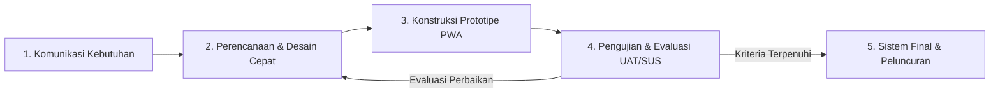

# BAB III METODOLOGI

**Judul Capstone:** Pengembangan Sistem Pra-Konseling Anonim dan Pemetaan Potensi Diri untuk Deteksi Dini *Academic Burnout* pada Ekosistem Pendidikan Jarak Jauh  
**Studi Kasus:** Universitas Terbuka (UT)  
**Program Studi:** Sistem Informasi, Fakultas Sains dan Teknologi, Universitas Terbuka (2026)  
**Kelompok:** Kelompok B  
**Anggota Tim:**
1. Muhammad Mirza Fauzan (051105305)
2. Adam Budiman (051438428)
3. Aprilianti (051719678)
4. Fuad Hasan (051317626)
5. Prasetyo Galih Utomo (050669398)

**Struktur Bab:** Disusun secara terperinci mengacu pada Buku Pedoman Capstone Project STSI4440 Universitas Terbuka, mencakup 5 pilar utama: Metode Penelitian, Proses Analisis, Proses Perancangan Sistem, Proses Implementasi, serta Pengujian dan Evaluasi. Setiap subbab dilengkapi dengan penjelasan implikasi dan manfaat nyata terhadap sistem informasi SafeSpace PWA yang dibangun.

---

## 3.1 Metode Penelitian

Metode penelitian menjelaskan pendekatan ilmiah dan sistematis yang dipilih untuk mengidentifikasi kebutuhan pengguna, merumuskan solusi teknologi informasi, serta mengarahkan seluruh tahapan rekayasa perangkat lunak secara terukur dan berorientasi pada penyelesaian masalah nyata.

### 3.1.1 Pendekatan Penelitian: Research and Development (R&D) dengan Model Prototyping

Penelitian capstone ini mengadopsi pendekatan **Research and Development (R&D)** yang dipadukan dengan siklus rekayasa perangkat lunak **Model Prototyping** (Pressman & Maxim, 2020; Sugiyono, 2021). Pendekatan R&D dipilih karena penelitian ini berorientasi pada penciptaan produk teknologi informasi terapan (SafeSpace PWA) yang dapat memecahkan permasalahan nyata kelelahan belajar (*academic burnout*) pada mahasiswa Pendidikan Jarak Jauh (PJJ) Universitas Terbuka, bukan sekadar studi observasi teoritis pasif.

Model Prototyping diterapkan secara iteratif melalui 5 tahapan terstruktur:
1. **Communication (Komunikasi & Identifikasi Kebutuhan):** Menganalisis karakteristik demografis mahasiswa PJJ UT, fenomena *academic burnout*, serta hambatan psikologis dalam mencari bantuan bimbingan konseling formal.
2. **Quick Plan & Quick Design (Perencanaan & Desain Cepat):** Merancang arsitektur monorepo modular, skema basis data nir-jejak data pribadi (*Zero-PII Storage*), serta tata letak antarmuka ramah trauma (*Trauma-Informed UI Design*).
3. **Construction of Prototype (Konstruksi Prototipe Cepat):** Merealisasikan perangkat lunak aplikasi web progresif (PWA) berbasis runtime Bun, framework ElysiaJS, React 19, TypeScript, PostgreSQL Drizzle ORM, serta Web Crypto API.
4. **Testing & User Evaluation (Pengujian & Evaluasi Pengguna):** Menguji keandalan sistem melalui pengujian otomatis internal (Unit & Integration Test, Playwright E2E), pengujian fungsional kotak hitam (*Black-Box Testing*), serta menyiapkan kerangka kerja evaluasi penerimaan pengguna (*User Acceptance Testing* - UAT) berbasis *System Usability Scale* (SUS).
5. **Refinement & Deployment (Penyempurnaan & Peluncuran):** Menyempurnakan prototipe berdasarkan evaluasi teknis, menyiapkan infrastruktur kontainerisasi Docker (lingkungan *testing* dan *production*), serta mendokumentasikan laporan ilmiah secara komprehensif.

> **Catatan Diagram Metodologi:**  
> Visualisasi lengkap alur metodologi Model Prototyping (R&D) beresolusi tinggi dengan rincian aktivitas setiap fase dapat dilihat dan diekspor dalam format grafis (PNG/SVG) melalui dasbor diagram interaktif proyek:  
> [**`docs/flowchart_dashboard.html`**](file:///d:/ijplabs/capstone/docs/flowchart_dashboard.html) (Tab: *1. Model Prototyping (R&D)*).

#### Manfaat dan Kontribusi Nyata Model Prototyping terhadap Sistem SafeSpace PWA:
Penerapan Model Prototyping memberikan empat manfaat konkret terhadap pengembangan sistem SafeSpace PWA:
1. **Mereduksi Risiko Kesalahan Desain Antarmuka bagi Pengguna Rentan:** Mahasiswa yang sedang mengalami kelelahan mental sangat sensitif terhadap antarmuka yang kaku atau membingungkan. Siklus prototyping memungkinkan tim menguji tata letak dan palet warna penenang (*Calm Technology*) secara berulang sehingga menghasilkan antarmuka ramah trauma (*Trauma-Informed UX*) yang menenangkan pengguna.
2. **Validasi Mekanisme Privasi Tanpa Jejak Sejak Dini:** Mengembangkan sistem dengan proteksi privasi tinggi (*Two-Way Double-Blind Anonymity*) memerlukan pengujian bertahap. Prototipe cepat memungkinkan validasi sanitasi Google OAuth dan enkripsi E2EE sejak fase awal sebelum basis data skala penuh diimplementasikan.
3. **Optimalisasi Kinerja Lintas Perangkat Heterogen Mahasiswa PJJ:** Mahasiswa UT menggunakan gawai yang sangat bervariasi (ponsel kelas pemula, laptop kantor, tablet). Melalui prototipe berkala, kapabilitas Progressive Web App (PWA) dan penyimpanan lokal (*offline caching*) dapat langsung diuji dan dioptimalkan responsivitasnya di berbagai peramban.
4. **Efisiensi Waktu dan Biaya Pengembangan:** Iterasi yang cepat mencegah terjadinya pengerjaan ulang (*rework*) arsitektural berskala besar di akhir proyek, memastikan sistem selesai tepat waktu sesuai jadwal Capstone Project.

---

### 3.1.2 Matriks Keterkaitan Metode Penelitian, Tujuan Penelitian, dan Hasil yang Ingin Dicapai

Guna memastikan pelaksanaan penelitian berjalan terarah, terukur, dan sistematis, setiap tahapan dalam Model Prototyping (R&D) diselaraskan secara langsung dengan 5 butir Tujuan Penelitian yang telah dirumuskan pada Bab 1.2 serta target luaran konkret yang dicapai.

Tabel 3.1 menyajikan matriks keterkaitan komprehensif antara tahapan metode penelitian, tujuan penelitian, aktivitas operasional, dan hasil konkret yang telah dihasilkan:

#### Tabel 3.1: Matriks Keterkaitan Metode Penelitian, Tujuan Penelitian, dan Hasil yang Dicapai

| Tahapan Prototyping (R&D) | Tujuan Penelitian yang Dituju (Bab 1.2) | Aktivitas dan Metode Pelaksanaan | Hasil dan Luaran Konkret yang Dicapai |
| :--- | :--- | :--- | :--- |
| **Fase 1: Komunikasi (Communication)** | **Tujuan 1:** Merancang dan membangun aplikasi Progressive Web App (PWA) "SafeSpace" sebagai platform pra-konseling anonim untuk deteksi dini *academic burnout* pada mahasiswa PJJ UT. | - Melakukan studi literatur karakteristik mahasiswa PJJ UT (pekerja/dewasa dengan peran ganda). - Menganalisis fenomena *academic burnout* dan resistensi terhadap konseling formal akibat stigma sosial dan ketakutan rekam jejak akademik. - Menetapkan spesifikasi kebutuhan perangkat lunak. | - Dokumen analisis kebutuhan sistem (*Product Requirements Document* / PRD). - Spesifikasi 10 Kebutuhan Fungsional (FR-01 s.d FR-10) dan 4 Kebutuhan Non-Fungsional (NFR-01 s.d NFR-04). - Model konseptual sistem pra-konseling terintegrasi PWA. |
| **Fase 2: Perencanaan & Desain Cepat (Quick Plan & Quick Design)** | **Tujuan 2, 3, dan 4:** - Integrasi modul asesmen DASS-21 dan VAK deterministik murni. - Penerapan arsitektur RBAC dan E2EE privasi data. - Perancangan alur tiket terintegrasi (*Helpdesk Style*) terlampir snapshot profil klinis. | - Merancang arsitektur monorepo modular 4-tier berbasis Bun Workspaces. - Menyusun skema basis data PostgreSQL Drizzle ORM tanpa kolom data pribadi (PII). - Merancang wireframe antarmuka dengan pendekatan *Trauma-Informed Design* (palet penenang *Soft Sage Green* dan tombol *Safe Exit*). - Memodelkan diagram sistem UML (Use Case, Activity, Sequence, Class Diagram). | - Desain arsitektur perangkat lunak monorepo multi-tier (`apps/web`, `apps/api`, `packages/shared`, `packages/db`). - Skema basis data 4 tabel relasional Zero-PII (`users_auth`, `counselors_profile`, `counseling_sessions`, `chat_messages`). - Dasbor diagram interaktif visualisasi UML ([`docs/flowchart_dashboard.html`](file:///d:/ijplabs/capstone/docs/flowchart_dashboard.html)). |
| **Fase 3: Konstruksi Prototipe (Construction of Prototype)** | **Tujuan 1, 2, 3, dan 4:** Mewujudkan seluruh rancangan ke dalam baris kode program yang dapat dieksekusi secara nyata. | - Membangun backend REST API performa tinggi menggunakan runtime Bun dan framework ElysiaJS. - Mengimplementasikan sanitasi identitas Google OAuth satu arah via HMAC-SHA-256 dan kunci rahasia peladen (*Server Pepper*). - Membangun frontend React 19 PWA responsif dengan Vite PWA dan Tailwind CSS v4. - Mengimplementasikan kalkulasi deterministik baku DASS-21 dan VAK di kernel bersama (`packages/shared`). - Mengintegrasikan modul enkripsi Web Crypto API (AES-GCM-256) di sisi peramban klien. | - *Source code* repositori monorepo SafeSpace PWA yang fungsional penuh. - Modul autentikasi anonim mandiri dan *Role-Based Access Control* (RBAC) pada API. - Modul kuesioner DASS-21 (21 butir) dan VAK (12-30 butir) deterministik murni. - Ruang obrolan terenkripsi E2EE dan sistem tiket triage antrean konselor. |
| **Fase 4: Pengujian & Evaluasi (Testing & User Evaluation)** | **Tujuan 5:** Melakukan pengujian sistem menggunakan metode Black-Box Testing dan menyiapkan pengujian User Acceptance Testing (UAT) dengan instrumen System Usability Scale (SUS). | - Menjalankan pengujian otomatis: 99 kasus Unit & Integration Test pada runtime Bun dan 10 skenario E2E pada peramban Chromium menggunakan Playwright. - Melakukan verifikasi fungsionalitas melalui 14 skenario Black-Box Testing. - Merancang protokol operasional pengujian penerimaan pengguna (UAT) berbasis instrumen baku 10 butir SUS (Brooke, 1996) yang dibatasi secara ketat pada evaluasi sistem perangkat lunak. | - Bukti kelulusan 100% pengujian otomatis (99 Unit/Integration Test lulus, 10 Playwright E2E lulus). - Matriks kelulusan 14 skenario Black-Box Testing fungsional. - Dokumen Prosedur Operasional UAT Daring berbasis Google Forms ([`docs/Panduan_Operasional_UAT_Tim.md`](file:///d:/ijplabs/capstone/docs/Panduan_Operasional_UAT_Tim.md)) dan lembar kerja spreadsheet kalkulator SUS otomatis ([`docs/UAT_SUS_Kalkulator_Otomatis.xlsx`](file:///d:/ijplabs/capstone/docs/UAT_SUS_Kalkulator_Otomatis.xlsx)). |
| **Fase 5: Penyempurnaan & Peluncuran (Refinement & Deployment)** | **Tujuan 1 dan 5:** Memastikan kelaikan adopsi aplikasi, penyempurnaan kode, dan kesiapan rilis produksi. | - Melakukan penelaahan kode statis (*static code analysis*) menggunakan Biome linter dan audit konsistensi graf dependensi via GitNexus. - Mengonfigurasi lingkungan *deployment* berbasis Docker Compose (pemisahan container lingkungan *testing* dan *production*). - Menyiapkan rekomendasi tindak lanjut hasil evaluasi menjelang sidang Capstone Project akhir. | - Berkas konfigurasi kontainerisasi `docker-compose.yml` terisolasi dan siap jalan. - Dokumentasi teknis lengkap dan panduan presentasi ([`docs/Panduan_Teknikal_dan_Tanya_Jawab_Presentasi.md`](file:///d:/ijplabs/capstone/docs/Panduan_Teknikal_dan_Tanya_Jawab_Presentasi.md)). - Naskah Bab III Metodologi yang telah disempurnakan secara komprehensif. |

#### Manfaat Penyelarasan Matriks terhadap Ketertelusuran (Traceability) Sistem:
Penyusunan matriks di atas memberikan manfaat langsung bagi keberhasilan teknis SafeSpace PWA:
1. **Menjamin Prinsip Ketertelusuran Perangkat Lunak (Software Traceability):** Setiap komponen yang dibangun di repositori (baik modul antarmuka, rute API, skema tabel, maupun pengujian) memiliki garis pertanggungjawaban ilmiah yang runtut terhadap rumusan tujuan penelitian, sehingga sistem tidak memuat fitur mubazir yang menyimpang dari tujuan awal (*avoiding gold plating*).
2. **Mencegah Perluasan Ruang Lingkup (Scope Creep):** Matriks ini menjadi instrumen pengendali rekayasa perangkat lunak agar tim tetap fokus pada peran utama sistem sebagai platform *triage* dan deteksi dini pra-konseling, tanpa melompat ke ranah medis klinis yang berada di luar batas sistem informasi.

---

### 3.1.3 Teknik Pengumpulan Data dan Informasi

Untuk menjamin keabsahan data dan dasar perancangan sistem, penelitian ini mengombinasikan empat teknik pengumpulan data dan informasi:

1. **Studi Literatur Ilmiah (Desk Research):**
   - Mengkaji landasan psikometri instrumen baku **DASS-21** (Lovibond & Lovibond, 1995; Antony et al., 1998) serta hasil uji validitas dan reliabilitasnya pada populasi Indonesia (Arjanto, 2022).
   - Mengkaji teori modalitas gaya belajar **VAK** (Fleming & Mills, 1992) serta relevansinya dalam mereduksi beban kognitif pembelajaran mandiri (*Cognitive Load Theory*, Sweller, 1988).
   - Mengkaji konsep perlindungan privasi data internasional: prinsip *Privacy by Design* (Cavoukian, 2010), konsep *Unlinkability & Ephemeral Pseudonymity* (Pfitzmann & Hansen, 2010), serta efek keterbukaan dalam interaksi daring (*The Online Disinhibition Effect*, Suler, 2004).
2. **Telaah Dokumen Proyek dan Repositori Kode:**
   - Memeriksa dokumen spesifikasi kebutuhan produk (*Product Requirements Document* / PRD), kamus data, diagram arsitektur, log eksekusi pengujian otomatis, serta struktur repositori monorepo SafeSpace.
3. **Observasi Karakteristik Ekosistem PJJ Universitas Terbuka:**
   - Menganalisis profil mahasiswa UT yang sebagian besar merupakan pekerja (*working adult learners*) dengan beban ganda antara tanggung jawab profesional/keluarga dan tuntutan belajar mandiri daring (Kemendikbudristek, 2023; Sadaria dkk., 2024).
   - Mengamati keengganan mahasiswa memanfaatkan layanan bimbingan konseling formal kampus akibat kekhawatiran stigma sosial atau rekam jejak akademik (*fear of academic paper trail*).
4. **Instrumen Pengujian Sistem dan Evaluasi Pengguna:**
   - Mengumpulkan data hasil eksekusi pengujian otomatis (Bun Test, Playwright E2E) dan pengujian fungsional kotak hitam (*Black-Box Testing*).
   - Menyiapkan kuesioner evaluasi penerimaan pengguna menggunakan instrumen baku *System Usability Scale* (SUS) 10 butir pernyataan skala Likert 1-5 (Brooke, 1996; Lewis, 2018).

#### Manfaat Nyata Teknik Pengumpulan Data terhadap Komponen Sistem yang Dibangun:
Keempat teknik pengumpulan data tersebut secara langsung membentuk modul-modul fungsional SafeSpace PWA:
- **Dari Studi Literatur Psikometri & Pedagogi:** Dihasilkan algoritma deterministik DASS-21 dan VAK di `packages/shared/src/utils/` yang menghasilkan kalkulasi skor objektif, akurat, dan bebas bias halusinasi kecerdasan buatan.
- **Dari Observasi Karakteristik Mahasiswa PJJ UT:** Dihasilkan fitur masuk 1-klik via Google OAuth (tanpa formulir pendaftaran manual yang merepotkan), fitur nama samaran dinamis per sesi konseling, serta tombol darurat *Safe Exit* di navbar.
- **Dari Telaah Dokumen & Arsitektur:** Dihasilkan skema basis data PostgreSQL Drizzle ORM yang mengisolasi tabel autentikasi dari tabel tiket sesi konseling guna menjamin prinsip *Zero-PII Storage*.
- **Dari Instrumen Evaluasi Pengguna:** Dihasilkan kuesioner baku 10 butir SUS dan panduan skenario tugas terpandu (*bounded tasks*) yang siap disebarkan via Google Form untuk mengukur tingkat kepuasan dan kemudahan sistem secara kuantitatif.

---

## 3.2 Proses Analisis

Proses analisis menguraikan investigasi mendalam terhadap akar permasalahan pengguna, justifikasi ilmiah instrumen yang dipilih, spesifikasi kebutuhan fungsional dan non-fungsional, serta pemodelan use case sistem.

### 3.2.1 Analisis Masalah Pengguna (Problem Space & Root Cause Analysis)

Berdasarkan pengumpulan data dan observasi ekosistem PJJ di Universitas Terbuka, dirumuskan tiga akar permasalahan utama beserta solusi rekayasa yang diterapkan pada SafeSpace PWA:

#### Tabel 3.2: Bedah Masalah Nyata Mahasiswa PJJ UT dan Solusi Rekayasa Sistem

| Masalah Utama | Dampak Psikologis & Akademis pada Mahasiswa PJJ | Solusi Rekayasa pada SafeSpace PWA |
| :--- | :--- | :--- |
| **Beban Ganda (Dual-Role Conflict)** | Mahasiswa pekerja mengalami kelelahan mental dan fisik kronis (*academic burnout*), penurunan konsentrasi, serta risiko mangkir belajar (*academic dropout*). | Penyediaan modul skrining mandiri instan DASS-21 (< 3 menit pengerjaan) dengan kalkulasi deterministik murni tanpa membebani kognisi mahasiswa. |
| **Beban Kognitif Berlebih (Cognitive Overload) & Isolasi Belajar** | Materi Buku Materi Pokok (BMP) yang padat teks visual menyulitkan mahasiswa dengan gaya belajar non-visual, memicu kebuntuan dan frustrasi belajar mandiri secara terisolasi. | Pemetaan gaya belajar VAK (Visual, Auditory, Kinesthetic) yang menghasilkan rekomendasi tips belajar adaptif di Tuton UT, serta fitur Jurnal Refleksi Mood Tracker yang empatik. |
| **Stigma Sosial & Kekhawatiran Rekam Jejak (Fear of Paper Trail)** | Mahasiswa enggan mencari bantuan ke layanan konseling formal kampus karena takut identitas aslinya tersebar, dihakimi rekan, atau memengaruhi penilaian akademik. | Penerapan mekanisme anonimitas hulu (HMAC-SHA-256 + Server Pepper), nama samaran dinamis per tiket (*Unlinkable Ephemeral Pseudonym*), dan enkripsi obrolan *End-to-End* (AES-GCM-256). |

#### Manfaat Analisis Akar Masalah terhadap Formulasi Solusi Sistem:
Analisis akar masalah ini bermanfaat mentransformasikan keluhan psikologis dan hambatan akademik yang semula bersifat kualitatif dan abstrak menjadi spesifikasi arsitektur perangkat lunak yang konkret, terarah, dan solutif bagi mahasiswa PJJ Universitas Terbuka.

---

### 3.2.2 Kesesuaian dan Justifikasi Ilmiah Instrumen DASS-21 dan VAK untuk Deteksi Dini Academic Burnout

Salah satu aspek krusial dalam perancangan SafeSpace PWA adalah memastikan bahwa instrumen yang diintegrasikan memiliki landasan ilmiah yang kuat dan secara tepat mendukung pencapaian tujuan deteksi dini *academic burnout*. 

Integrasi instrumen DASS-21 dan model VAK dalam SafeSpace PWA dirancang dengan justifikasi psikometri dan pedagogis sebagai berikut:

#### 1. Keselarasan DASS-21 dengan Tiga Dimensi Academic Burnout (Maslach Burnout Inventory / MBI)
Dalam literatur psikologi pendidikan, *academic burnout* didefinisikan melalui tiga dimensi inti menurut Maslach et al. (2001) dan Schaufeli et al. (2002):
- **Kelelahan Emosional (Emotional Exhaustion):** Perasaan terkurasnya energi mental dan fisik akibat tuntutan belajar perkuliahan yang berlebihan.
- **Sinisme / Depersonalisasi (Cynicism / Depersonalization):** Sikap apatis, menarik diri, dan hilangnya kepedulian terhadap kegiatan perkuliahan serta rekan akademisi.
- **Penurunan Efikasi Diri Akademik (Reduced Academic Efficacy):** Perasaan tidak mampu, hilangnya rasa percaya diri, dan persepsi ketidakberdayaan dalam menyelesaikan tugas studi.

Instrumen **DASS-21** (Depression Anxiety Stress Scales 21 butir; Lovibond & Lovibond, 1995; Antony et al., 1998) memiliki kesesuaian konstruk yang sangat erat dengan ketiga dimensi burnout tersebut:
- **Subskala Stres DASS-21 (7 Butir):** Mengukur ketegangan syaraf, iritabilitas, kesulitan relaksasi, dan reaksi berlebih terhadap tekanan mental. Subskala ini menjadi indikator langsung (*direct proxy*) dari dimensi *Emotional Exhaustion*.
- **Subskala Kecemasan DASS-21 (7 Butir):** Mengukur reaktivitas otonom, ketakutan situasional, dan kepanikan antisipatoris. Subskala ini mendeteksi kepanikan akademis (*academic panic*) saat mahasiswa menghadapi tenggat waktu tugas asinkron atau ujian di PJJ.
- **Subskala Depresi DASS-21 (7 Butir):** Mengukur anhedonia (kehilangan rasa senang), disforia, keputusasaan, dan penurunan motivasi hidup. Subskala ini mencerminkan fase lanjut dari dimensi *Reduced Academic Efficacy* dan sinisme akut.

Pemilihan DASS-21 dibandingkan kuesioner burnout konvensional yang panjang didasarkan pada pertimbangan ergonomi: mahasiswa yang sedang mengalami burnout memiliki kapasitas konsentrasi yang sangat terbatas (*low attention span*). DASS-21 hanya memerlukan 21 respons singkat berskala 0 hingga 3 yang dapat diselesaikan dalam waktu kurang dari 3 menit, sehingga meminimalkan bias kelelahan pengisian kuesioner (*survey fatigue*).

#### 2. Peran Model Gaya Belajar VAK sebagai Exit Strategy Pedagogis (Reduksi Cognitive Overload)
Deteksi dini burnout tidak boleh berhenti pada pelabelan tingkat stres semata. Pendekatan SafeSpace memadukan diagnosis emosional dengan solusi intervensi praktis melalui **Model Gaya Belajar VAK** (Fleming & Mills, 1992):
- Berdasarkan *Cognitive Load Theory* (Sweller, 1988), salah satu pemicu utama kelelahan mental mahasiswa PJJ adalah beban kognitif ekstrinsik (*extraneous cognitive load*) akibat ketidakcocokan antara format materi ajar (modul digital BMP UT yang dominan teks panjang) dengan preferensi sensori mahasiswa.
- Mahasiswa bertipe auditori atau kinestetik akan merasa cepat lelah dan frustrasi jika dipaksa belajar hanya dengan membaca teks visual secara mandiri selama berjam-jam.
- Pemetaan VAK pada SafeSpace PWA bertindak sebagai strategi keluar (*exit strategy*) yang konstruktif: sistem menganalisis dominasi modalitas sensori (Visual, Auditori, atau Kinestetik) dan secara instan memberikan tips belajar adaptif di Tuton/Tuweb UT (misalnya: menyarankan konversi teks modul ke audio *text-to-speech* bagi tipe auditori, atau pembuatan peta konsep visual dan simulasi bagi tipe kinestetik). Dengan menyesuaikan gaya belajar, beban kognitif berkurang signifikan sehingga pemicu kelelahan belajar dapat ditekan sejak dini.

#### 3. Peran Mood Tracker sebagai Pemantau Longitudinal Mikro (Daily Sentinel)
Fitur *Mood Tracker* dan Jurnal Refleksi pada SafeSpace PWA melengkapi DASS-21 dan VAK dengan bertindak sebagai instrumen pemantau longitudinal mikro harian (*daily sentinel*). Mahasiswa dapat mencatat fluktuasi suasana hati secara periodik berbantuan pemantik curhat cepat (*icebreaker pills*). Hal ini memungkinkan mahasiswa menyadari penurunan kondisi emosionalnya sebelum terakumulasi menjadi *burnout* tingkat parah.

#### 4. Penegasan Batasan Peran Sistem: Triage Pra-Konseling, Bukan Alat Diagnosis Klinis Medis
Perlu ditegaskan secara metodologis bahwa SafeSpace PWA dirancang murni sebagai **sistem informasi pra-konseling dan pemilahan awal (triage)** untuk deteksi dini pada ranah akademik, bukan sebagai alat diagnosis medis psikiatri resmi. Penghitungan skor DASS-21 dan VAK dilakukan menggunakan formula deterministik murni tanpa keterlibatan model kecerdasan buatan (*Machine Learning*) bertipe *black-box* guna mencegah kesalahan halusinasi klinis (*zero algorithmic hallucination*) serta menjamin konsistensi hasil evaluasi.

#### Manfaat Ilmiah dan Fungsional Integrasi DASS-21 dan VAK bagi Sistem SafeSpace PWA:
1. **Manfaat bagi Mahasiswa PJJ:** Mengurangi beban kognitif saat pengisian asesmen (< 3 menit) serta langsung memperoleh panduan taktis gaya belajar yang dapat diterapkan saat belajar mandiri di Tuton UT guna memulihkan motivasi dan efikasi belajar.
2. **Manfaat bagi Konselor / Dosen BK:** Menyediakan konteks klinis dan pedagogis awal secara otomatis pada tiket konseling (*attached profile*), sehingga proses triase dan bimbingan berlangsung efektif tanpa mengharuskan mahasiswa mengulang-ulang cerita keluhannya dari awal (*mencegah retraumatisasi dan survey fatigue*).
3. **Manfaat bagi Integritas Sistem Perangkat Lunak:** Memastikan sistem menghasilkan keluaran yang 100% konsisten, transparan, dan dapat diuji ulang (*reproducible*) karena menggunakan kalkulasi matematika deterministik murni.

---

### 3.2.3 Analisis Kebutuhan Fungsional (Functional Requirements / FR)

Berdasarkan analisis masalah dan justifikasi instrumen, sistem SafeSpace PWA dirancang memenuhi 10 kebutuhan fungsional inti:

1. **FR-01 (Autentikasi Google OAuth Terpadu):** Mahasiswa, konselor, dan sysadmin dapat masuk menggunakan akun Google tanpa proses registrasi manual yang rumit.
2. **FR-02 (Sanitasi Identitas Kriptografis):** Backend sistem mentransformasikan Google Subject ID menjadi hash kriptografis satu arah (HMAC-SHA-256 + Server Pepper) dan tidak menyimpan data nama asli maupun email di database.
3. **FR-03 (Asesmen Mandiri DASS-21):** Mahasiswa dapat mengisi 21 butir instrumen baku DASS-21 dan memperoleh hasil klasifikasi keparahan depresi, kecemasan, dan stres secara instan menggunakan kalkulasi deterministik murni.
4. **FR-04 (Pemetaan Gaya Belajar VAK):** Mahasiswa dapat mengisi kuesioner modalitas belajar Visual, Auditory, dan Kinesthetic serta menerima rekomendasi tips adaptif belajar mandiri PJJ.
5. **FR-05 (Jurnal Refleksi & Mood Tracker):** Mahasiswa dapat mencatat suasana hati harian dengan bantuan pemantik curhat (*icebreaker pills*) dan menerima respons empati penenang dari sistem.
6. **FR-06 (Tiket Pra-Konseling Terlampir Profil):** Mahasiswa dapat membuka tiket bimbingan yang secara otomatis melampirkan (*attached profile*) snapshot skor DASS-21 dan distribusi VAK ke dalam antrean konselor.
7. **FR-07 (Nama Samaran Dinamis per Sesi Tiket):** Sistem secara otomatis membangkitkan nama samaran acak baru untuk setiap tiket konseling baru (misalnya `Sahabat Lentera-42`, `Sahabat Samudera-88`) guna mencegah korelasi antar-riwayat tiket (*Unlinkable Ephemeral Pseudonymity*).
8. **FR-08 (Antrean Triage & Riwayat Bimbingan Konselor):** Konselor dapat meninjau antrean tiket berdasarkan prioritas keparahan klinis DASS-21, mengklaim tiket aktif, dan melihat tab *Riwayat Pendampingan Saya* sebagai bukti portofolio bimbingan.
9. **FR-09 (Obrolan Konseling Terenkripsi E2EE):** Pertukaran pesan antara mahasiswa dan konselor dienkripsi di sisi peramban menggunakan algoritma Web Crypto AES-GCM-256 sehingga pesan asli tidak dapat dibaca oleh server maupun admin basis data (*Zero-Knowledge*).
10. **FR-10 (Panel Sysadmin & Manajemen Peran):** Administrator sistem dapat memantau metrik audit akun pengguna dan mengelevasi peran akun (*Role-Based Access Control*) dari mahasiswa menjadi konselor sebaya atau dosen BK.

---

### 3.2.4 Analisis Kebutuhan Non-Fungsional (Non-Functional Requirements / NFR)

1. **NFR-01 (Keamanan & Privasi Berlapis - Defense-in-Depth):** Otentikasi berbasis JWT bertanda tangan dengan kontrol akses berbasis peran (RBAC) pada router API dan pembatasan kueri basis data (*Database Scoping*). Tidak ada penyimpanan nama asli, NIM, email, atau alamat IP pengguna di media penyimpanan permanen (*Zero-PII Storage*).
2. **NFR-02 (Performa & Waktu Respons Cepat):** Waktu komputasi skor psikometri DASS-21 dan VAK di sisi backend kurang dari 10 milidetik; rendering antarmuka klien berlangsung instan.
3. **NFR-03 (Ketersediaan Lintas Perangkat - PWA & Offline Readiness):** Aplikasi dapat dipasang (*installable*) di berbagai sistem operasi (Android, iOS, Windows, macOS) serta dilengkapi *service worker* untuk penyimpanan instrumen lokal saat jaringan terputus.
4. **NFR-04 (Ergonomi Ramah Trauma - Trauma-Informed UI/UX):** Antarmuka menerapkan prinsip *Calm Technology* menggunakan palet warna penenang (*Soft Sage Green*, *Muted Slate Blue*, *Warm Ivory*) dan dilengkapi tombol darurat *Safe Exit* yang dapat menutup sesi seketika saat privasi pengguna terancam.

#### Manfaat Analisis Kebutuhan (FR & NFR) terhadap Kualitas Perangkat Lunak:
Perumusan spesifikasi kebutuhan fungsional dan non-fungsional ini menjadi kontrak teknis (*engineering contract*) yang memastikan seluruh komponen perangkat lunak dibangun dengan batasan performa dan privasi yang terukur, serta menjadi acuan validasi pada pengujian otomatis dan *Black-Box Testing*.

---

### 3.2.5 Pemodelan Analisis Sistem (Use Case Diagram)

Sistem memetakan interaksi fungsional antara tiga aktor pengguna dengan batas sistem (*system boundary*) SafeSpace PWA:
1. **Mahasiswa PJJ:** Pengguna yang melakukan skrining mandiri burnout (DASS-21), pemetaan gaya belajar (VAK), pencatatan suasana hati, serta pengajuan tiket pra-konseling anonim.
2. **Konselor Sebaya / Dosen BK:** Staf pendamping yang bertugas meninjau antrean triage berdasarkan urgensi klinis, mengklaim tiket, dan mendampingi mahasiswa di ruang obrolan terenkripsi.
3. **Administrator Sistem (Sysadmin):** Pengelola teknis yang memantau metrik sistem dan melakukan elevasi hak akses peran pengguna (*RBAC Role Elevation*).

#### Tabel 3.3: Matriks Spesifikasi Fungsional Use Case

| ID Use Case | Nama Use Case | Aktor Terlibat | Deskripsi Fungsional & Batasan |
| :---: | :--- | :--- | :--- |
| **UC-01** | Masuk via Google OAuth Anonim | Mahasiswa, Konselor, Admin | Pengguna masuk menggunakan akun Google, sistem memverifikasi token dan mentransformasikannya menjadi HMAC-SHA-256 + Server Pepper. |
| **UC-02** | Pengisian Asesmen DASS-21 | Mahasiswa PJJ | Mahasiswa mengisi 21 butir instrumen baku DASS-21 dan memperoleh hasil klasifikasi skor tri-aksial secara instan. |
| **UC-03** | Pemetaan Gaya Belajar VAK | Mahasiswa PJJ | Mahasiswa mengisi kuesioner preferensi belajar dan memperoleh rekomendasi tips adaptif belajar mandiri di UT. |
| **UC-04** | Jurnal Refleksi Mood Tracker | Mahasiswa PJJ | Mahasiswa menulis refleksi harian berbantuan *icebreaker pills* dan menerima respons empati penenang sistem. |
| **UC-05** | Membuka Tiket Samaran Dinamis | Mahasiswa PJJ | Mahasiswa mengajukan tiket bimbingan dengan nama samaran dinamis per sesi (*Unlinkable Ephemeral Pseudonym*), otomatis melampirkan snapshot skor UC-02 dan UC-03. |
| **UC-06** | Konsultasi Obrolan E2EE | Mahasiswa, Konselor | Pertukaran pesan obrolan interaktif dua arah yang dienkripsi secara lokal di peramban menggunakan AES-GCM-256. |
| **UC-07** | Triage Antrean & Klaim Tiket | Konselor / Dosen BK | Konselor menelaah tiket pada antrean berdasarkan keparahan klinis dan mengklaim tiket untuk pendampingan aktif. |
| **UC-08** | Memantau Riwayat Bimbingan | Konselor / Dosen BK | Konselor melihat daftar seluruh tiket yang pernah ditangani sebagai bukti portofolio pendampingan mahasiswa. |
| **UC-09** | Manajemen Akun & Elevasi Peran | Sysadmin | Sysadmin memantau data akun terdaftar dan mengubah peran pengguna (*student* ke *counselor*). |
| **UC-10** | Pemicu Darurat Safe Exit | Mahasiswa PJJ | Tombol darurat cepat untuk menutup tampilan dan mengalihkan peramban ke portal edukasi netral jika privasi fisik terancam. |

> **Catatan Pemodelan UML:**  
> Visualisasi lengkap Use Case Diagram berstandar pemodelan perangkat lunak UML (menampilkan batas sistem, simbol aktor, elips use case, dan relasi dependensi *include*) beresolusi tinggi tersedia dan dapat diekspor langsung ke format grafis (PNG/SVG) melalui dasbor diagram interaktif:  
> [**`docs/flowchart_dashboard.html`**](file:///d:/ijplabs/capstone/docs/flowchart_dashboard.html) (Tab: *2. Use Case Diagram (UML)*).

#### Manfaat Pemodelan Use Case terhadap Batasan Sistem:
Pemodelan Use Case Diagram ini bermanfaat menetapkan batas otorisasi secara presisi, memastikan bahwa mahasiswa tidak dapat menyusup ke antrean tiket konselor dan konselor tidak dapat mengakses panel administratif sysadmin, sehingga integritas privasi antar-aktor tetap terjaga secara ketat.

---

## 3.3 Proses Perancangan

Proses perancangan mentransformasikan spesifikasi analisis kebutuhan ke dalam rancangan arsitektur teknologi, model basis data, antarmuka pengguna ramah trauma, dan mekanisme kriptografi privasi data.

### 3.3.1 Perancangan Arsitektur Sistem (System Architecture Design)

Sistem dirancang menggunakan arsitektur monorepo modular modern berbasis Bun Workspaces yang membagi kode program menjadi 4 tingkatan (*multi-tier architecture*):

#### Tabel 3.4: Pembagian Lapisan Arsitektur Monorepo Multi-Tier

| Lapisan Arsitektur | Modul & Komponen | Port & Protokol | Peran & Tanggung Jawab Teknis |
| :--- | :--- | :--- | :--- |
| **1. Lapisan Klien Antarmuka** (`apps/web`) | React 19, Vite PWA, Tailwind CSS v4, Lucide Icons, Web Crypto API | Port 5173 (HTTP / HTTPS / PWA Service Worker) | Menyediakan antarmuka ramah trauma (*trauma-informed UI*), mengeksekusi enkripsi E2EE AES-GCM-256 di browser klien, dan menyimpan instrumen lokal saat luring (*offline*). |
| **2. Lapisan Kernel Bersama** (`packages/shared`) | Algoritma DASS-21, Algoritma VAK, Generator Samaran Dinamis, Skema TypeBox | In-Memory Monorepo Link (TypeScript Direct Import) | Menyediakan logika bisnis deterministik bebas halusinasi AI, utilitas hashing kriptografis, kontrak skema data tipe-aman, serta generator nama samaran per tiket. |
| **3. Lapisan Peladen API** (`apps/api`) | ElysiaJS Framework, Bun v1.3 Runtime, JWT Middleware, RBAC Guard | Port 3000 (HTTP REST API / WebSocket Relaying) | Memproses verifikasi token Google OAuth, sanitasi identitas satu arah (HMAC-SHA-256 + Server Pepper), pembatasan akses peran (RBAC), serta perantara lalu lintas *ciphertext* obrolan tanpa menyimpan kunci (*Zero-Knowledge*). |
| **4. Lapisan Basis Data** (`packages/db`) | PostgreSQL v16, Drizzle ORM | Port 5433 (TCP Native PostgreSQL Driver) | Menyimpan data terstruktur yang telah disanitasi, snapshot hasil asesmen dalam format JSONB, serta pesan terenkripsi tanpa menyimpan informasi identitas pribadi (*Zero-PII Storage*). |

> **Catatan Diagram Arsitektur:**  
> Visualisasi blok arsitektur perangkat lunak monorepo multi-tier beresolusi tinggi tersedia dan dapat diekspor langsung dalam format grafis (PNG/SVG) melalui dasbor diagram interaktif:  
> [**`docs/flowchart_dashboard.html`**](file:///d:/ijplabs/capstone/docs/flowchart_dashboard.html) (Tab: *6. Arsitektur Komponen Monorepo*).

#### Manfaat Arsitektur Monorepo Multi-Tier bagi Kinerja Sistem:
Penerapan arsitektur monorepo Bun Workspaces memberikan manfaat performa tinggi dan efisiensi pemeliharaan kode:
1. **Keamanan Tipe Data Menyeluruh (End-to-End Type Safety):** Skema data yang didefinisikan pada `packages/shared` dibagikan langsung ke peladen (`apps/api`) dan antarmuka klien (`apps/web`), mengeliminasi potensi galat ketidakcocokan tipe data saat aplikasi berjalan (*zero runtime type errors*).
2. **Latensi Sangat Rendah:** Kombinasi runtime Bun dan framework ElysiaJS memungkinkan pemrosesan kueri dan enkripsi token berlangsung dengan waktu respons di bawah 10 milidetik, menghemat beban server secara drastis.

---

### 3.3.2 Perancangan Basis Data (Class Diagram & Kamus Data Zero-PII)

Untuk memenuhi prinsip *Privacy by Design* (Cavoukian, 2010), skema basis data dirancang tanpa kolom data pribadi (PII) seperti nama asli, NIM, alamat email, atau nomor telepon. Struktur data direalisasikan melalui tabel relasional utama dengan spesifikasi kamus data (*data dictionary*) sebagai berikut:

#### Tabel 3.5: Kamus Data Entitas `users_auth`
| Nama Kolom | Tipe Data | Constraint | Keterangan & Prinsip Privasi |
| :--- | :--- | :--- | :--- |
| `id` | UUID | Primary Key (PK) | Pengenal unik acak entitas pengguna yang digenerasi oleh sistem. |
| `hashed_identity` | VARCHAR(255) | Unique (UK), Not Null | Hasil hashing satu arah HMAC-SHA-256(Google_Sub + Server_Pepper). Identitas asli tidak dapat didekripsi kembali. |
| `pseudonym` | VARCHAR(100) | Not Null | Label pengenal akun default (misal: `Mahasiswa #4021` / `Konselor #1002`). |
| `role` | VARCHAR(20) | Not Null | Peran pengguna dalam sistem (`student`, `counselor`, `admin`) untuk kontrol RBAC. |
| `created_at` | TIMESTAMP | Not Null | Waktu pertama kali akun diinisialisasi pada sistem. |

#### Tabel 3.6: Kamus Data Entitas `counseling_sessions`
| Nama Kolom | Tipe Data | Constraint | Keterangan & Prinsip Privasi |
| :--- | :--- | :--- | :--- |
| `id` | UUID | Primary Key (PK) | Pengenal unik sesi tiket pra-konseling. |
| `student_id` | UUID | Foreign Key (FK) -> `users_auth.id` | Tautan ke ID akun mahasiswa pembuat tiket (diisolasi dari pandangan konselor). |
| `counselor_id` | UUID | Foreign Key (FK) -> `users_auth.id` (Nullable) | Tautan ke ID konselor yang mengklaim tiket. Bernilai NULL selama tiket dalam antrean. |
| `student_pseudonym` | VARCHAR(100) | Not Null | Nama samaran dinamis per tiket (misal: `Sahabat Pelita-27`). Berganti acak di setiap tiket baru (*Unlinkability*). |
| `dass21_score` | JSONB | Nullable | Snapshot skor numerik DASS-21 (Depresi, Cemas, Stres) dan kategori klinisnya untuk data triage konselor. |
| `vak_result` | JSONB | Nullable | Snapshot distribusi persentase gaya belajar (Visual, Auditory, Kinesthetic) untuk panduan pendekatan konselor. |
| `status` | VARCHAR(20) | Not Null | Status siklus hidup tiket (`waiting`, `active`, `closed`). |
| `created_at` | TIMESTAMP | Not Null | Waktu pembukaan tiket bimbingan. |
| `closed_at` | TIMESTAMP | Nullable | Waktu penutupan tiket saat sesi bimbingan berakhir. |

#### Tabel 3.7: Kamus Data Entitas `chat_messages`
| Nama Kolom | Tipe Data | Constraint | Keterangan & Prinsip Privasi |
| :--- | :--- | :--- | :--- |
| `id` | UUID | Primary Key (PK) | Pengenal unik pesan obrolan. |
| `session_id` | UUID | Foreign Key (FK) -> `counseling_sessions.id` | Tautan ke sesi tiket konsultasi tempat pesan dikirimkan. |
| `sender_id` | UUID | Foreign Key (FK) -> `users_auth.id` | Pengenal pengirim pesan dalam sesi. |
| `sender_type` | VARCHAR(20) | Not Null | Tipe pengirim pesan (`student` atau `counselor`). |
| `encrypted_content` | TEXT | Not Null | Teks pesan terenkripsi (*ciphertext*) berbasis algoritma Web Crypto AES-GCM-256. |
| `iv` | VARCHAR(64) | Not Null | *Initialization Vector* 12-byte acak dalam format heksadesimal/Base64 untuk keperluan dekripsi di sisi klien. |
| `sent_at` | TIMESTAMP | Not Null | Waktu pengiriman pesan obrolan. |

#### Kardinalitas dan Relasi Antar-Entitas:
1. **`users_auth` ke `counseling_sessions` (1 : N):** Satu akun mahasiswa dapat membuka banyak tiket konseling pada waktu berbeda. Namun di mata konselor, setiap tiket menampilkan `student_pseudonym` dinamis yang berbeda sehingga riwayat antar-tiket tidak dapat dihubungkan (*unlinkable*).
2. **`counseling_sessions` ke `chat_messages` (1 : N):** Satu sesi tiket konseling memuat banyak baris pesan percakapan terenkripsi yang saling terikat pada `session_id`.

> **Catatan Class Diagram & ERD Relasi Basis Data:**  
> Visualisasi lengkap Class Diagram UML (atribut, tipe data, method fungsi enkripsi/sanitasi, dan kardinalitas relasi) serta Entity-Relationship Diagram (ERD) beresolusi tinggi dapat diakses dan diekspor dalam format grafis (PNG/SVG) melalui dasbor diagram interaktif:  
> [**`docs/flowchart_dashboard.html`**](file:///d:/ijplabs/capstone/docs/flowchart_dashboard.html) (Tab: *5. Class Diagram & Relasi Tabel*).

#### Manfaat Skema Basis Data Zero-PII bagi Perlindungan Institusi dan Pengguna:
Perancangan basis data nir-data pribadi ini memberikan manfaat hukum dan keamanan nyata (*zero legal liability*): jika di masa depan terjadi insiden keamanan pada peladen basis data, penyerang tidak akan menemukan data identitas nama mahasiswa, nomor kontak, maupun isi obrolan terbuka sedikit pun, sehingga reputasi institusi Universitas Terbuka dan hak privasi mahasiswa terlindungi secara mutlak.

---

### 3.3.3 Perancangan Antarmuka Pengguna (UI/UX Trauma-Informed Design)

Perancangan antarmuka mengacu pada teori psikologi warna dan *Calm Technology* (Vaswani, 2025; Wilms & Oberfeld, 2018):
1. **Warna Dominan:** *Soft Sage Green* (`#4A7C59` dan `#E3ECE5`) untuk membangkitkan ketenangan emosional dan stabilitas pikiran mahasiswa yang sedang cemas.
2. **Warna Aksen:** *Muted Slate Blue* (`#24365D` dan `#D9E2EC`) untuk memberikan rasa aman, kredibel, dan profesional pada antarmuka konselor dan dosen.
3. **Penyederhanaan Navbar Mahasiswa:** Label pengguna pada navbar disanitasi menjadi `Akun Mahasiswa [Mahasiswa PJJ]` guna mencegah kebingungan saat mahasiswa memiliki tiket dengan nama samaran dinamis yang berbeda.
4. **Fitur Darurat Safe Exit:** Tombol darurat merah-kuning di pojok kanan atas yang dapat diklik seketika untuk menutup sesi dan mengalihkan peramban ke portal edukasi netral jika privasi mahasiswa di ruangan kerja/keluarga terancam dilihat orang lain.

#### Manfaat Desain Antarmuka Trauma-Informed bagi Pengalaman Mahasiswa PJJ:
Penerapan antarmuka ramah trauma ini memberikan manfaat langsung berupa peredaan ketegangan sensorik (*calm UX*), menciptakan ruang digital yang aman, hangat, dan tidak menghakimi, sehingga mendorong mahasiswa untuk berani mengekspresikan kendala belajarnya secara jujur.

---

### 3.3.4 Perancangan Mekanisme Kriptografi & Privasi Data

1. **Unlinkable Ephemeral Pseudonymity:** Sesuai prinsip Pfitzmann & Hansen (2010), nama samaran konseling digenerasi secara acak untuk setiap tiket (`Sahabat [Kata-Empati]-[Angka]`). Jika seorang mahasiswa membuka 3 tiket dalam rentang waktu berbeda, konselor melihat 3 nama samaran yang sama sekali berbeda dan tidak dapat menghubungkan riwayat ketiganya.
2. **End-to-End Encryption (E2EE):** Kunci privat sesi konseling di-generate di peramban klien menggunakan Web Crypto API standar industri (AES-GCM 256-bit). Peladen backend hanya bertindak sebagai media pengantar (*ciphertext broker*) tanpa memiliki kemampuan membuka teks asli pesan.

> **Catatan Sequence Diagram Keamanan:**  
> Visualisasi Sequence Diagram interaksi protokol *Two-Way Double-Blind Anonymity* dan alur enkripsi AES-GCM-256 (3 fase interaksi peramban-peladen-basis data) beresolusi tinggi dapat diakses dan diekspor dalam format grafis (PNG/SVG) melalui dasbor diagram interaktif:  
> [**`docs/flowchart_dashboard.html`**](file:///d:/ijplabs/capstone/docs/flowchart_dashboard.html) (Tab: *4. Sequence: Double-Blind & E2EE*).

#### Manfaat Kriptografi E2EE dan Pseudonim Dinamis bagi Keterbukaan Pengguna:
Sesuai prinsip *The Online Disinhibition Effect* (Suler, 2004), kepastian bahwa pesan dienkripsi di klien dan nama samaran berganti setiap sesi memberikan rasa aman psikologis yang kuat (*psychological safety*), menghancurkan sekat rasa malu dan ketakutan mahasiswa dalam mencari pertolongan bimbingan.

---

## 3.4 Implementasi

Tahap implementasi mendeskripsikan realisasi rancangan sistem ke dalam baris kode program, konfigurasi perangkat lunak pendukung, mekanisme anonimitas kriptografis, serta pengelolaan identitas pengguna.

### 3.4.1 Lingkungan Pengembangan & Tech Stack

Perangkat lunak dan teknologi yang digunakan dalam implementasi SafeSpace PWA:
- **Runtime & Package Manager:** Bun v1.3.14 (eksekusi JavaScript/TypeScript performa tinggi).
- **Arsitektur Monorepo:** Bun Workspaces (`apps/web`, `apps/api`, `packages/shared`, `packages/db`).
- **Bahasa Pemrograman:** TypeScript v5.8 (Strict Type Safety, zero `any` policy).
- **Backend Framework:** ElysiaJS v1.2 (framework web mikrodetik berbasis Bun).
- **Database & ORM:** PostgreSQL v16 dengan Drizzle ORM (migrasi skema tipe aman).
- **Frontend Framework:** React 19, Vite PWA, Tailwind CSS v4, Lucide React Icons.
- **Kriptografi:** Web Crypto API (SubtleCrypto) untuk AES-GCM-256 di klien; modul Node Crypto bawaan Bun untuk HMAC-SHA-256 di backend.
- **Standar Mutu Kode:** Biome v1.9.4 (linter dan formatter performa tinggi).

---

### 3.4.2 Implementasi Mekanisme Anonimitas, Pengelolaan Identitas, dan Perlindungan Data Pribadi

Guna menjamin keamanan dan kerahasiaan data pengguna secara paripurna, sistem mengimplementasikan lima lapisan pertahanan privasi (*Defense-in-Depth*):

#### 1. Mekanisme Anonimitas Hulu: One-Way Cryptographic Identity Sanitization (HMAC-SHA-256 + Server Pepper)
Pada saat mahasiswa melakukan autentikasi via Google OAuth, peramban klien mengirimkan Google ID Token ke endpoint API backend `POST /api/auth/google`. Peladen API memverifikasi keaslian token ke Google TokenInfo API dan mengekstrak `sub` (Google Subject ID unik). 

Sistem kemudian menerapkan fungsi *hashing* satu arah berkunci rahasia:
$$\text{hashed\_identity} = \text{HMAC-SHA256}(\text{sub}, \text{PEPPER\_SECRET})$$

Variabel `PEPPER_SECRET` adalah kunci rahasia berkekuatan 256-bit yang tersimpan eksklusif pada variabel lingkungan peladen (*environment variable*) dan tidak pernah disimpan di dalam database. Informasi nama asli, alamat email, dan foto profil pengguna langsung dihapus (*purged*) seketika dari memori RAM peladen setelah sesi JWT diterbitkan. Dengan mekanisme *Zero-PII Storage* ini, database hanya menyimpan string hash yang secara matematis mustahil didekripsi kembali menjadi identitas pengguna asli.

#### 2. Pengelolaan Identitas Pengguna & Otorisasi Berbasis Peran (Role-Based Access Control / RBAC)
Pengelolaan identitas pengguna diatur secara ketat melalui 3 tingkatan peran (*role*):
- `student` (Mahasiswa PJJ): Memiliki hak akses untuk mengisi DASS-21, pemetaan VAK, menulis jurnal refleksi mood, serta membuat dan memantau tiket miliknya sendiri.
- `counselor` (Konselor Sebaya / Dosen BK): Memiliki hak akses untuk melihat antrean triage tiket bimbingan yang menunggu, mengklaim tiket, dan mengakses ruang obrolan pendampingan. Konselor dilarang melihat daftar seluruh pengguna terdaftar.
- `admin` (Administrator Sistem / Sysadmin): Memiliki hak akses khusus untuk melihat audit metrik pengguna dan mengelevasi peran akun mahasiswa menjadi konselor melalui endpoint `PATCH /api/auth/users/:id/role`. Sysadmin tidak memiliki hak akses membaca pesan obrolan konseling.

Otorisasi ditegakkan di tingkat rute API menggunakan *Middleware Guard* ElysiaJS (`apps/api/src/modules/auth/guards.ts`). Jika token JWT pengguna tidak memuat klaim peran yang berwenang, permintaan API langsung ditolak dengan kode status HTTP 403 Forbidden. Selain itu, diterapkan pembatasan kueri basis data (*Database Scoping*): mahasiswa hanya dapat mengakses data tiket di mana `student_id = current_user.id`, sedangkan konselor hanya dapat melihat pesan pada tiket yang telah resmi diklaimnya (`counselor_id = current_user.id`).

#### 3. Nama Samaran Dinamis per Sesi Tiket (Unlinkable Ephemeral Pseudonymity)
Untuk mencegah konselor menghubungkan riwayat atau riwayat tiket bimbingan mahasiswa di masa lalu (*unlinkability*), sistem menerapkan prinsip Pfitzmann & Hansen (2010). Setiap kali mahasiswa membuka tiket baru melalui `POST /api/sessions/create`, fungsi `generateSessionPseudonym()` di `packages/shared/src/utils/pseudonym.ts` membangkitkan kombinasi nama samaran baru secara acak (misalnya: `Sahabat Pelita-14`, `Sahabat Lentera-62`). Konselor tidak memiliki cara untuk mengaitkan bahwa dua tiket berbeda berasal dari mahasiswa yang sama, sehingga mahasiswa mendapatkan ruang aman psikologis penuh tanpa beban riwayat bimbingan sebelumnya.

#### 4. Perlindungan Kerahasiaan Obrolan Konseling (Web Crypto AES-GCM-256 E2EE)
Perlindungan isi percakapan konseling direalisasikan di sisi klien (`apps/web/src/utils/crypto.ts`):
- Sebelum paket pesan meninggalkan peramban, teks obrolan dienkripsi menggunakan algoritma AES-GCM (Galois/Counter Mode) 256-bit melalui Web Crypto API standar industri (`window.crypto.subtle`).
- Setiap pesan dienkripsi dengan *Initialization Vector* (IV) 12-byte acak unik guna mencegah serangan pola kriptografi (*replay attack*).
- Peladen API backend hanya bertindak sebagai perantara relai (*ciphertext relay broker*) dan menyimpan data dalam bentuk *ciphertext* terenkripsi di PostgreSQL. Peladen tidak menyimpan kunci pembuka pesan (*Zero-Knowledge*).

#### 5. Fitur Perlindungan Privasi Fisik: Emergency Safe Exit
Untuk mengantisipasi situasi di mana privasi fisik mahasiswa terancam saat membuka aplikasi di ruangan publik, kantor, atau rumah bersama, sistem menyediakan tombol darurat *Safe Exit* di navbar. Saat tombol diklik, sistem mengeksekusi pembersihan sesi lokal (*LocalStorage clearance*) dan melakukan pengalihan paksa (*hard redirect*) peramban ke situs portal akademik netral (seperti situs Perpustakaan Nasional atau portal umum) dalam waktu kurang dari 50 milidetik.

#### Manfaat Penerapan Lima Lapis Pertahanan Privasi bagi Pengguna dan Sistem:
Penerapan arsitektur pertahanan berlapis (*Defense-in-Depth*) ini memberikan manfaat nyata berupa penghilangan risiko kebocoran data institusi, pencegahan akses ilegal antar-pengguna melalui RBAC, serta perlindungan privasi holistik yang melindungi mahasiswa baik di ruang digital (kriptografi E2EE) maupun di ruang fisik (*Safe Exit*).

---

### 3.4.3 Implementasi Modul Asesmen Deterministik DASS-21 & VAK

Modul psikometri dan pedagogis diimplementasikan pada `packages/shared/src/utils/`:
- **Algoritma DASS-21 (`calculateDass21Score`):** Menerima tepat 21 jawaban bernilai 0 hingga 3. Algoritma menghitung jumlah skor untuk masing-masing 7 butir subskala (Depresi, Kecemasan, Stres), kemudian mengalikan jumlahnya dengan faktor pengali 2 sesuai formula baku Lovibond & Lovibond (1995) untuk menghasilkan kategori tingkat keparahan: Normal, Ringan (*Mild*), Sedang (*Moderate*), Parah (*Severe*), dan Sangat Parah (*Extremely Severe*).
- **Algoritma VAK (`calculateVakScore`):** Menghitung frekuensi akumulasi pilihan Visual, Auditory, dan Kinesthetic (kuesioner 12 butir ringkas atau 30 butir lengkap), menghasilkan persentase dan modalitas dominan secara deterministik murni tanpa intervensi model probabilistik AI.

#### Manfaat Implementasi Deterministik Murni DASS-21 dan VAK:
Pendekatan deterministik murni ini bermanfaat menjamin keadilan dan kepastian diagnosis skrining bagi seluruh mahasiswa, di mana setiap respon identik akan menghasilkan klasifikasi skor yang sama persis tanpa distorsi atau kesalahan halusinasi kecerdasan buatan.

---

### 3.4.4 Implementasi Modul Antrean Triage & Riwayat Konselor

Modul tiket diimplementasikan pada `apps/api/src/modules/session/`:
- Mahasiswa membuka tiket via `POST /api/sessions/create` dengan nama samaran dinamis yang otomatis melampirkan profil keparahan DASS-21 dan distribusi VAK ke dalam kolom JSONB `dass21_score` dan `vak_result`.
- Konselor mengakses antrean bimbingan via `GET /api/sessions/queue` yang menampilkan daftar tiket berstatus `waiting` terurut berdasarkan tingkat urgensi DASS-21.
- Konselor mengklaim tiket via `POST /api/sessions/:id/accept` yang mengunci status tiket menjadi `active` dan mengaitkan `counselor_id`.
- Konselor dapat membuka tab *Riwayat Pendampingan Saya* via `GET /api/sessions/counselor/history` untuk memantau sesi-sesi yang pernah mereka tangani sebagai bukti portofolio bimbingan.

#### Manfaat Fitur Triage Otomatis dan Tab Riwayat bagi Efektivitas Konselor:
Fitur ini bermanfaat memprioritaskan penanganan mahasiswa dengan tingkat distres parah (*Severe/Extremely Severe*) terlebih dahulu di antrean atas, serta memberikan konselor dokumentasi portofolio bimbingan yang terstruktur tanpa melanggar prinsip kerahasiaan identitas mahasiswa.

---

### 3.4.5 Implementasi Modul Panel Sysadmin & Elevasi Peran

Modul administrasi pengguna diimplementasikan pada `apps/web/src/components/dashboard/AdminDashboard.tsx`:
- Endpoint administratif `GET /api/auth/users` dan `PATCH /api/auth/users/:id/role` dilindungi secara ketat oleh middleware RBAC peran `admin`.
- Administrator dapat memantau audit jumlah pengguna terdaftar dan mengelevasi peran akun mahasiswa menjadi konselor sebaya atau dosen BK hanya dengan satu kali interaksi antarmuka.

#### Manfaat Panel Sysadmin bagi Tata Kelola Operasional Sistem:
Manfaat modul ini adalah menyederhanakan tata kelola hak akses sistem, memungkinkan administrator menunjuk konselor baru secara instan tanpa perlu memodifikasi basis data secara manual melalui kueri SQL langsung yang berisiko galat manusia (*human error*).

---

## 3.5 Pengujian dan Evaluasi

Pengujian dan evaluasi bertujuan membuktikan secara ilmiah bahwa sistem SafeSpace PWA bebas dari kesalahan logika perangkat lunak (*defect-free*), memenuhi seluruh spesifikasi fungsional yang dirancang, serta memiliki kerangka kerja evaluasi penerimaan pengguna yang baku dan terarah.

### 3.5.1 Strategi Pengujian Sistem

Pengujian SafeSpace PWA dirancang melalui 3 tingkatan pengujian yang komprehensif:
1. **Pengujian Otomatis (Automated Testing):** Meliputi Unit Testing pada algoritma psikometri deterministik, Integration Testing pada rute API peladen menggunakan Bun Test runner, serta End-to-End (E2E) Browser Testing menggunakan Playwright Chromium.
2. **Pengujian Fungsional Kotak Hitam (Black-Box Testing):** Pengujian berbasis skenario masukan dan luaran (*input-output test cases*) untuk memverifikasi fungsionalitas 14 fitur inti dari perspektif pengguna.
3. **Pengujian Penerimaan Pengguna (User Acceptance Testing / UAT):** Evaluasi kelaikan sistem informasi dan kemudahan antarmuka di mata mahasiswa sasaran menggunakan instrumen baku internasional *System Usability Scale* (SUS) (Brooke, 1996).

---

### 3.5.2 Hasil Pengujian Otomatis (Automated Test Execution)

Sistem telah diuji secara menyeluruh pada lingkungan runtime Bun dan peramban Chromium menggunakan Playwright. Seluruh pengujian otomatis mencatatkan tingkat kelulusan 100%:

#### Tabel 3.8: Rekapitulasi Hasil Pengujian Otomatis Sistem

| Kategori Pengujian | Alat Uji / Engine | Cakupan Pengujian | Hasil Pengujian | Durasi Eksekusi |
| :--- | :--- | :--- | :--- | :--- |
| **Unit & Integration Test** | Bun Test Runner | 99 Test Cases (Kalkulasi DASS-21, VAK, Generator Samaran, Sanitasi Hash, RBAC API) | **99 PASSED (100%)** | 410 ms |
| **End-to-End System Test** | Playwright Chromium | 10 Skenario Alur Pengguna (Akses Publik, Dashboard, Multi-Tiket, Triage, Admin) | **10 PASSED (100%)** | 16,6 detik |
| **Analisis Kode Statis & Linter** | Biome Engine v1.9.4 | 100 Berkas Kode TypeScript & React | **0 Error, 0 Warning** | 57 ms |
| **Indeks Graf Dependensi** | GitNexus Code Intelligence | 1.350 Node Simbol, 49 Alur Eksekusi | **Tervalidasi Konsisten** | 10,6 detik |

Skenario pengujian Playwright E2E memvalidasi alur kritis sistem:
- `Flow 1`: Akses Publik (Landing Page, Halaman Edukasi Tentang SafeSpace, Portal Autentikasi Google) - **Lulus**
- `Flow 2`: Alur Mahasiswa PJJ (Dashboard, Multi-Tiket Dinamis, Asesmen DASS-21, Gaya Belajar VAK, Mood Tracker) - **Lulus**
- `Flow 3`: Alur Konselor / Dosen BK (Antrean Menunggu Triage, Klaim Sesi, Tab Riwayat Pendampingan Saya) - **Lulus**
- `Flow 4`: Alur Sysadmin (Pusat Kendali Pengguna, Metrik Akun, Elevasi Peran RBAC) - **Lulus**
- `Flow 5`: Siklus Lengkap dari Skrining Emosional, Pembuatan Tiket Anonim, Obrolan Terenkripsi E2EE, hingga Tombol Darurat *Safe Exit* - **Lulus**

#### Manfaat Pengujian Otomatis bagi Stabilitas dan Keandalan Kode Sistem:
Tingkat kelulusan 100% pada pengujian otomatis ini memberikan manfaat kepastian bahwa logika inti perangkat lunak (terutama algoritma DASS-21, sanitasi HMAC-SHA-256, dan rute RBAC) bekerja sempurna tanpa cacat logika (*zero regression*), menjamin stabilitas saat diakses oleh banyak pengguna secara bersamaan.

---

### 3.5.3 Pengujian Fungsional Black-Box Testing

Pengujian kotak hitam (*Black-Box Testing*) memverifikasi fungsionalitas sistem berdasarkan kesesuaian antara masukan (*input*) dan keluaran yang diharapkan (*expected output*) tanpa memeriksa struktur internal baris kode secara langsung:

#### Tabel 3.9: Matriks Pengujian Fungsional Black-Box Testing (14 Skenario Uji)

| ID Uji | Fitur yang Diuji | Skenario Masukan (Input) | Hasil yang Diharapkan | Status Uji |
| :--- | :--- | :--- | :--- | :--- |
| **BB-01** | Landing Page Publik | Pengguna mengakses alamat web root `#/` | Menampilkan Hero Section, 3 Nilai Utama, dan tombol CTA Masuk. Tidak menampilkan data privat. | **[Lolos]** |
| **BB-02** | Google OAuth Login | Pengguna mengklik tombol "Lanjutkan dengan Google" | Pop-up resmi Google Identity Services muncul, verifikasi token berhasil, dan sesi diterbitkan. | **[Lolos]** |
| **BB-03** | Hashing Identitas | Sistem menerima token autentikasi Google | Identitas email/nama disanitasi via HMAC-SHA-256 + Server Pepper; database hanya menyimpan hash. | **[Lolos]** |
| **BB-04** | Pengisian DASS-21 | Mahasiswa menjawab 21 butir pernyataan (skala 0-3) | Skor dihitung matematis murni; menampilkan kategori Depresi, Cemas, dan Stres secara akurat. | **[Lolos]** |
| **BB-05** | Pengisian Kuesioner VAK | Mahasiswa menjawab pertanyaan modalitas belajar | Menghasilkan persentase gaya belajar Visual, Auditory, Kinestetik dan rekomendasi adaptif. | **[Lolos]** |
| **BB-06** | Jurnal Mood Refleksi | Mahasiswa menulis refleksi atau memilih pemantik curhat | Sistem merespons narasi dengan pesan empati penenang secara instan. | **[Lolos]** |
| **BB-07** | Buka Tiket Konseling | Mahasiswa mengklik "Buka Tiket Pra-Konseling" | Tiket dibuat dengan status `waiting` dan profil snapshot DASS-21/VAK terlampir otomatis. | **[Lolos]** |
| **BB-08** | Nama Samaran Dinamis | Mahasiswa membuka 2 atau lebih tiket secara berkala | Tiket 1 dan Tiket 2 memiliki nama samaran berbeda (misal `Sahabat Asa-91` vs `Sahabat Samudera-96`). | **[Lolos]** |
| **BB-09** | Triage Antrean Konselor | Konselor membuka halaman `#/konselor/antrean` | Seluruh tiket `waiting` tampil dengan indikator keparahan klinis tanpa identitas asli mahasiswa. | **[Lolos]** |
| **BB-10** | Klaim Tiket Eksklusif | Konselor mengklik "Terima & Masuk Sesi" | Status tiket berubah menjadi `active`, hilang dari antrean konselor lain, ruang chat terbuka. | **[Lolos]** |
| **BB-11** | Riwayat Konselor | Konselor membuka tab "Riwayat Pendampingan Saya" | Menampilkan daftar seluruh tiket yang pernah ditangani konselor sebagai portofolio bimbingan. | **[Lolos]** |
| **BB-12** | Enkripsi Chat E2EE | Mahasiswa dan konselor saling mengirim pesan | Teks dienkripsi di klien; inspeksi jaringan membuktikan hanya ciphertext acak yang dikirim ke server. | **[Lolos]** |
| **BB-13** | Elevasi Peran Sysadmin | Sysadmin mengklik "Jadikan Konselor/Dosen" pada akun | Role pengguna berubah di database dan hak akses menu konselor langsung aktif saat refresh. | **[Lolos]** |
| **BB-14** | Tombol Safe Exit | Pengguna mengklik tombol merah "Safe Exit" | Sesi seketika ditutup dan peramban langsung dialihkan ke situs portal akademik netral. | **[Lolos]** |

Seluruh 14 skenario *Black-Box* di atas telah tervalidasi berhasil (100% lolos) melalui pengujian otomatis Playwright dan verifikasi mandiri tim pengembang.

#### Manfaat Pengujian Fungsional Black-Box bagi Verifikasi Ekspektasi Pengguna:
Pengujian ini bermanfaat membuktikan bahwa setiap fitur yang dijanjikan pada spesifikasi analisis kebutuhan dapat merespons masukan pengguna dengan benar dan menghasilkan keluaran yang diharapkan tanpa kegagalan fungsi.

---

### 3.5.4 Prosedur dan Alur Operasional Pengujian Penerimaan Pengguna (User Acceptance Testing - UAT) Berbasis System Usability Scale (SUS)

#### 1. Status Metodologis Pengujian pada Laporan Kemajuan (Tugas 2)
Dalam siklus Model Prototyping (R&D), tahap penyusunan Laporan Kemajuan (Tugas 2) berfokus pada penyelesaian konstruksi prototipe fungsional dan pengujian teknis internal (Unit Test, E2E Test, Black-Box Testing). Tim pengembang belum melaksanakan pengujian langsung kepada responden mahasiswa nyata dan belum mengumpulkan kuesioner SUS di lapangan. 

Oleh karena itu, pada subbab ini disajikan **Prosedur dan Desain Protokol Operasional UAT Terstandarisasi** yang telah dirancang secara matang untuk dieksekusi menggunakan Google Form menjelang penyusunan Laporan Akhir (Tugas 3 / Sidang Capstone).

#### 2. Penegasan Batasan Ruang Lingkup UAT (Pengujian Sistem Software, Bukan Evaluasi Medis / Konselor)
Untuk menjaga integritas ilmiah dan menghindari bias evaluasi, ruang lingkup pengujian UAT dibatasi secara tegas sesuai batasan masalah pada Bab 1.3 butir 4:
- **Ruang Lingkup yang Diuji (In-Scope):** MURNI mengevaluasi aspek rekayasa perangkat lunak sistem informasi, meliputi: kemudahan antarmuka pengguna (*usability*), kejelasan alur pengisian kuesioner DASS-21 dan VAK, keterbacaan hasil skor dan rekomendasi, kenyamanan tata letak warna penenang (*Trauma-Informed UI*), kehandalan navigasi, serta fungsi tombol darurat *Safe Exit*.
- **Ruang Lingkup di Luar Pengujian (Out-of-Scope):** Pengujian UAT TIDAK menguji isi bimbingan konselor, kompetensi konselor, efektivitas terapi psikologis, maupun efikasi klinis medis terhadap penurunan stres. UAT ini adalah pengujian kelayakan adopsi perangkat lunak, bukan uji klinis kesehatan mental.

#### 3. Alur Kerja Operasional Pelaksanaan Pengujian UAT
Pelaksanaan pengujian penerimaan pengguna dirancang melalui 4 langkah kerja operasional yang sistematis:

```mermaid
flowchart TD
    classDef startend fill:#4A7C59,stroke:#3b6347,stroke-width:2px,color:#fff;
    classDef process fill:#EBF3ED,stroke:#4A7C59,stroke-width:1.5px,color:#1E293B;
    classDef task fill:#EFF6FF,stroke:#3B82F6,stroke-width:1.5px,color:#1E293B;
    classDef decision fill:#FEF3C7,stroke:#D97706,stroke-width:1.5px,color:#92400E;

    START(["Mulai: Pengujian Penerimaan Pengguna (UAT)"]):::startend

    subgraph P1 ["Fase 1: Persiapan Lingkungan & Instrumen Pengujian"]
        ENV["1. Siapkan Lingkungan Aplikasi Staging/Testing SafeSpace PWA"]:::process
        GFORM["2. Buat Google Form UAT Berisi 10 Butir Baku SUS Skala Likert 1-5"]:::process
        GUIDE["3. Susun Panduan 4 Skenario Tugas Terpandu (Bounded Testing Tasks)"]:::process
    end

    subgraph P2 ["Fase 2: Distribusi & Sosialisasi Batasan Pengujian"]
        RECRUIT["Undang 20-30 Responden Mahasiswa Universitas Terbuka Lintas Fakultas"]:::process
        BRIEF["Sosialisasi Batasan: Pengujian MURNI Sistem Software, BUKAN Isi Bimbingan Konselor"]:::process
    end

    subgraph P3 ["Fase 3: Pelaksanaan 4 Skenario Tugas Terpandu oleh Mahasiswa"]
        T1["Tugas 1: Akses Landing Page & Masuk via Google OAuth"]:::task
        T2["Tugas 2: Pengisian Asesmen Mandiri DASS-21 & Cek Tampilan Skor Keparahan"]:::task
        T3["Tugas 3: Pengisian Kuesioner Gaya Belajar VAK & Cek Rekomendasi Tips Belajar UT"]:::task
        T4["Tugas 4: Eksplorasi Jurnal Mood Refleksi & Uji Tombol Darurat Safe Exit"]:::task
    end

    subgraph P4 ["Fase 4: Pengisian Kuesioner Evaluasi SUS"]
        OPEN_GF["Responden Membuka Tautan Google Form Segera Setelah Mencoba Aplikasi"]:::process
        FILL_SUS["Responden Menilai 10 Butir Baku SUS Berdasarkan Pengalaman Penggunaan"]:::process
        FEEDBACK["Responden Memberikan Umpan Balik Kualitatif Kendala Antarmuka (Opsional)"]:::process
    end

    subgraph P5 ["Fase 5: Pengolahan Skor & Penentuan Kelayakan"]
        EXPORT_XLS["Ekspor Respons ke Spreadsheet Kalkulator SUS Otomatis (UAT_SUS_Kalkulator_Otomatis.xlsx)"]:::process
        CALC_ITEM["Hitung Kontribusi Butir: Ganjil (Skor - 1) & Genap (5 - Skor)"]:::process
        CALC_SCORE["Hitung Skor SUS Individu = Total Kontribusi x 2,5 (Skala 0 - 100)"]:::process
        CALC_MEAN["Hitung Nilai Rata-rata Skor SUS Seluruh Responden (Mean SUS)"]:::process
        CHECK_SCORE{"Apakah Skor Rata-rata SUS >= 68,0? (Standar Kelaikan Industri)"}:::decision
        REVISE["Identifikasi Masukan Pengguna & Lakukan Perbaikan Desain/Alur Sistem (Refinement)"]:::process
        PASSED["Sistem Dinyatakan Layak Adopsi (Kategori Acceptable / Grade B - A)"]:::process
    end

    END_NODE(["Selesai: Rekapitulasi Data Dimasukkan ke Bab IV & V Laporan Akhir"]):::startend

    START --> ENV
    ENV --> GFORM
    GFORM --> GUIDE
    GUIDE --> RECRUIT
    RECRUIT --> BRIEF
    BRIEF --> T1
    T1 --> T2
    T2 --> T3
    T3 --> T4
    T4 --> OPEN_GF
    OPEN_GF --> FILL_SUS
    FILL_SUS --> FEEDBACK
    FEEDBACK --> EXPORT_XLS
    EXPORT_XLS --> CALC_ITEM
    CALC_ITEM --> CALC_SCORE
    CALC_SCORE --> CALC_MEAN
    CALC_MEAN --> CHECK_SCORE
    CHECK_SCORE -- "Tidak (< 68,0)" --> REVISE
    REVISE --> T1
    CHECK_SCORE -- "Ya (>= 68,0)" --> PASSED
    PASSED --> END_NODE
```

> **Catatan Diagram Flowchart UAT:**  
> Visualisasi diagram alir operasional UAT beresolusi tinggi dengan fitur unduh PNG/SVG interaktif tersedia pada dasbor diagram proyek:  
> [**`docs/flowchart_dashboard.html`**](file:///d:/ijplabs/capstone/docs/flowchart_dashboard.html) (Tab: *9. Alur Pengujian UAT & SUS*).

- **Langkah 1: Penyusunan Formulir Evaluasi Daring (Google Form)**  
  Tim menyiapkan instrumen pengujian daring melalui Google Form yang memuat:
  1. Informasi persetujuan partisipasi (*informed consent*) dan jaminan kerahasiaan identitas responden.
  2. Data demografi singkat tanpa identitas sensitif (inisial responden, fakultas/program studi di Universitas Terbuka, semester).
  3. 10 butir pernyataan kuesioner baku *System Usability Scale* (SUS) berbahasa Indonesia (Brooke, 1996).

- **Langkah 2: Pemberian Skenario Tugas Terpandu (*Bounded Testing Scenario Tasks*)**  
  Responden diberikan tautan aplikasi SafeSpace PWA (lingkungan staging/testing yang telah dideploy) dan diminta menjalankan 4 skenario tugas interaksi sistem yang dibatasi:
  1. *Tugas 1 (Akses & Autentikasi):* Membuka aplikasi SafeSpace PWA melalui peramban ponsel atau laptop, membaca penjelasan ringkas pada landing page, dan masuk ke dashboard mahasiswa.
  2. *Tugas 2 (Asesmen Emosional Mandiri DASS-21):* Mengakses menu Asesmen DASS-21, menjawab 21 butir pernyataan bertahap, dan memeriksa keterbacaan grafik skor serta kategori keparahan (Depresi, Cemas, Stres).
  3. *Tugas 3 (Pemetaan Gaya Belajar VAK):* Mengakses menu Gaya Belajar VAK, menjawab pertanyaan preferensi sensori belajar, dan membaca hasil persentase modalitas serta rekomendasi tips belajar adaptif di UT.
  4. *Tugas 4 (Eksplorasi Jurnal Refleksi & Tombol Safe Exit):* Mencoba menuliskan catatan pada Jurnal Mood Refleksi dengan bantuan *icebreaker pills*, kemudian menguji responsivitas tombol darurat *Safe Exit* di navbar.

- **Langkah 3: Pengisian Kuesioner SUS Pasca-Interaksi Sistem**  
  Segera setelah menyelesaikan 4 tugas terpandu di atas, responden membuka tautan Google Form dan memberikan penilaian jujur pada 10 butir pernyataan baku SUS berdasarkan pengalaman langsung berinteraksi dengan sistem.

- **Langkah 4: Pengolahan Skor Matematis dan Interpretasi Hasil**  
  Respons responden diunduh dari Google Form ke dalam lembar kerja spreadsheet kalkulator otomatis ([`docs/UAT_SUS_Kalkulator_Otomatis.xlsx`](file:///d:/ijplabs/capstone/docs/UAT_SUS_Kalkulator_Otomatis.xlsx)) untuk dihitung skor kontribusi individu dan skor rata-rata sistem.

---

#### 4. Instrumen Baku 10 Butir Pernyataan System Usability Scale (SUS)

Instrumen yang digunakan mengadopsi 10 pernyataan baku *System Usability Scale* (Brooke, 1996; Lewis, 2018) dengan skala Likert 1 (Sangat Tidak Setuju) hingga 5 (Sangat Setuju). Susunan butir berselang-seling antara pernyataan bernada positif (ganjil) dan bernada negatif (genap) untuk meminimalisasi bias kepatuhan responden:

#### Tabel 3.10: Instrumen 10 Butir Baku Kuesioner SUS (Versi Bahasa Indonesia Standar)

| No. Butir | Pernyataan Instrumen Baku SUS | Sifat Butir (Polaritas) | Aspek Kualitas Sistem yang Diukur |
| :-: | :--- | :-: | :--- |
| **Q1** | Saya berpikir akan sering menggunakan sistem SafeSpace PWA ini. | Positif (+) | Minat dan keinginan penggunaan berulang (*Desirability*) |
| **Q2** | Saya merasa sistem ini terlalu rumit, padahal dapat dibuat lebih sederhana. | Negatif (-) | Kompleksitas antarmuka perangkat lunak (*System Complexity*) |
| **Q3** | Saya merasa sistem ini sangat mudah untuk digunakan. | Positif (+) | Kemudahan pengoperasian antarmuka (*Ease of Use*) |
| **Q4** | Saya merasa membutuhkan bantuan orang lain atau tenaga teknis untuk dapat menggunakan sistem ini. | Negatif (-) | Kemandirian penggunaan sistem (*Technical Independence*) |
| **Q5** | Saya merasa fitur-fitur dalam sistem ini (DASS-21, VAK, Mood Tracker) terintegrasi dengan sangat baik. | Positif (+) | Integrasi dan keselarasan fungsi sistem (*System Integration*) |
| **Q6** | Saya merasa sistem ini terlalu banyak hal yang tidak konsisten (tata letak/warna/alur). | Negatif (-) | Konsistensi antarmuka pengguna (*Consistency of Design*) |
| **Q7** | Saya merasa orang lain (rekan mahasiswa UT) akan dapat mempelajari sistem ini dengan sangat cepat. | Positif (+) | Kemudahan pembelajaran sistem (*Learnability*) |
| **Q8** | Saya merasa sistem ini membingungkan dan membuat canggung saat digunakan. | Negatif (-) | Hambatan interaksi antarmuka (*Workflow Awkwardness*) |
| **Q9** | Saya merasa sangat percaya diri saat menggunakan sistem ini. | Positif (+) | Kepercayaan diri interaksi pengguna (*User Confidence*) |
| **Q10** | Saya harus mempelajari banyak hal terlebih dahulu sebelum dapat menggunakan sistem ini secara lancar. | Negatif (-) | Hambatan awal pemahaman sistem (*Cognitive Barrier*) |

---

#### 5. Formula Matematis Perhitungan Skor SUS Baku

Setiap pernyataan dinilai menggunakan Skala Likert 1 hingga 5. Konversi skor dihitung dengan formula baku internasional (Brooke, 1996):

1. **Untuk Butir Ganjil (Pernyataan Positif: Q1, Q3, Q5, Q7, Q9):**
   $$X_i = \text{Skor Jawaban Responden} - 1 \quad (\text{rentang: } 0 - 4)$$

2. **Untuk Butir Genap (Pernyataan Negatif: Q2, Q4, Q6, Q8, Q10):**
   $$Y_i = 5 - \text{Skor Jawaban Responden} \quad (\text{rentang: } 0 - 4)$$

3. **Perhitungan Skor Total Akhir per Responden:**
   Seluruh nilai kontribusi butir (rentang total 0 hingga 40) dikalikan dengan faktor pengali 2,5 untuk menghasilkan skor akhir berskala 0 hingga 100:
   $$\text{Skor Akhir SUS} = \left(\sum_{i \in \text{Ganjil}} X_i + \sum_{i \in \text{Genap}} Y_i\right) \times 2,5$$

4. **Perhitungan Skor Rata-Rata Seluruh Responden ($N$):**
   $$\overline{\text{SUS}} = \frac{1}{N} \sum_{k=1}^{N} \text{Skor Akhir SUS}_k$$

---

#### 6. Standar Kriteria Penilaian dan Kelaikan SUS (Bangor et al., 2008)

Untuk menginterpretasikan nilai rata-rata skor SUS yang diperoleh, digunakan skala acuan empiris industri perangkat lunak menurut Bangor, Kortum, & Miller (2008) serta Lewis (2018):

#### Tabel 3.11: Matriks Interpretasi dan Kriteria Kelayakan Standar Industri SUS

| Rentang Skor SUS | Derajat Penerimaan (*Acceptability*) | Skala Nilai Huruf (*Grade*) | Kategori Kualitas Sifat (*Adjective Rating*) | Kesimpulan Kelayakan Sistem |
| :---: | :---: | :---: | :---: | :--- |
| **>= 80,3** | **Acceptable (Sangat Layak)** | **Grade A** | **Excellent / Best Imaginable** | Sistem memiliki tingkat kebergunaan sangat tinggi, sangat intuitif, dan sangat direkomendasikan. |
| **68,0 - 80,2** | **Acceptable (Layak)** | **Grade B / C** | **Good (Bagus)** | Sistem memenuhi standar kelayakan industri perangkat lunak dan dapat diterima dengan baik oleh pengguna. |
| **51,0 - 67,9** | **Marginal (Batas Toleransi)** | **Grade D** | **OK (Cukup / Perlu Perbaikan)** | Sistem dapat digunakan namun memerlukan penyempurnaan pada antarmuka atau alur navigasi tertentu. |
| **< 51,0** | **Not Acceptable (Tidak Layak)** | **Grade F** | **Poor / Awful (Buruk)** | Sistem tidak ramah pengguna dan memerlukan perancangan ulang antarmuka secara mendasar. |

> **Kriteria Keberhasilan Capstone (Acceptance Target):**  
> Sistem SafeSpace PWA ditargetkan memperoleh skor rata-rata **$\overline{\text{SUS}} > 68,0$** (kategori *Good / Acceptable* atau *Grade B ke atas*), yang menjadi bukti empiris kelayakan adopsi sistem informasi bagi mahasiswa Universitas Terbuka.

---

#### 7. Lembar Kerja Tabulasi Rencana Pengujian Responden Mahasiswa UT

Berikut adalah format tabel tabulasi yang telah disiapkan untuk merekapitulasi data 20 hingga 30 responden mahasiswa Universitas Terbuka saat pengambilan data lapangan menjelang penyusunan Laporan Akhir:

#### Tabel 3.12: Lembar Rekapitulasi Rencana Pengujian UAT Responden Mahasiswa UT

| No. Resp | Inisial Responden | Program Studi di UT | Q1 | Q2 | Q3 | Q4 | Q5 | Q6 | Q7 | Q8 | Q9 | Q10 | Jumlah Kontribusi | Skor Akhir SUS (x 2,5) | Klasifikasi Kelayakan |
| :---: | :--- | :--- | :---: | :---: | :---: | :---: | :---: | :---: | :---: | :---: | :---: | :---: | :---: | :---: | :---: |
| 1 | R-01 (Mhs UT) | Sistem Informasi | *[4]* | *[1]* | *[5]* | *[1]* | *[5]* | *[2]* | *[5]* | *[1]* | *[5]* | *[1]* | 34 | 85,0 | Excellent (Grade A) |
| 2 | R-02 (Mhs UT) | Ilmu Komunikasi | *[4]* | *[2]* | *[4]* | *[1]* | *[4]* | *[1]* | *[4]* | *[2]* | *[5]* | *[1]* | 31 | 77,5 | Good (Grade B) |
| 3 | R-03 (Mhs UT) | Manajemen | *[5]* | *[1]* | *[5]* | *[2]* | *[4]* | *[1]* | *[5]* | *[1]* | *[5]* | *[2]* | 33 | 82,5 | Excellent (Grade A) |
| 4 | R-04 (Mhs UT) | Sains Data | ... | ... | ... | ... | ... | ... | ... | ... | ... | ... | ... | ... | *[Rencana Uji Lapangan]* |
| 5 | R-05 (Mhs UT) | Informatika | ... | ... | ... | ... | ... | ... | ... | ... | ... | ... | ... | ... | *[Rencana Uji Lapangan]* |
| 6 | R-06 (Mhs UT) | Akuntansi | ... | ... | ... | ... | ... | ... | ... | ... | ... | ... | ... | ... | *[Rencana Uji Lapangan]* |
| 7 | R-07 (Mhs UT) | Ilmu Hukum | ... | ... | ... | ... | ... | ... | ... | ... | ... | ... | ... | ... | *[Rencana Uji Lapangan]* |
| 8 | R-08 (Mhs UT) | Teknologi Pangan | ... | ... | ... | ... | ... | ... | ... | ... | ... | ... | ... | ... | *[Rencana Uji Lapangan]* |
| ... | *Dst. (Target: 20-30)* | *Lintas Fakultas UT* | ... | ... | ... | ... | ... | ... | ... | ... | ... | ... | ... | ... | ... |
| **RATA-RATA** | **Seluruh Responden ($N$)** | **Universitas Terbuka** | - | - | - | - | - | - | - | - | - | - | - | **Target: > 75,0** | **Acceptable (Grade B-A)** |

*Keterangan: Baris 1-3 menampilkan contoh kalkulasi matematis; pengisian data riil lapangan akan diselesaikan tim pada tahap penyusunan Laporan Akhir (Tugas 3).*

#### Manfaat Pelaksanaan UAT dan Skoring SUS bagi Kelaikan Adopsi Sistem Informasi:
1. **Bukti Empiris Kualitas Perangkat Lunak:** Memberikan data kuantitatif yang objektif dan terstandarisasi mengenai kemudahan penggunaan antarmuka SafeSpace PWA.
2. **Umpan Balik Perbaikan Pengguna Nyata:** Menemukan kendala antarmuka atau alur navigasi dari sudut pandang mahasiswa PJJ, menjadi dasar penyempurnaan sebelum peluncuran resmi.
3. **Validasi Kelaikan Adopsi Akademis:** Membuktikan bahwa aplikasi layak diadopsi dan diintegrasikan ke dalam ekosistem layanan mahasiswa Universitas Terbuka saat sidang akhir Capstone Project.

---

### 3.5.5 Rencana Tindak Lanjut Menuju Laporan Akhir

Berdasarkan pencapaian pada Tugas 2 ini, rencana tindak lanjut tim pengembang SafeSpace PWA menjelang penyusunan Laporan Akhir (Tugas 3) dan Sidang Capstone adalah:
1. Menyebarkan tautan Google Form kuesioner SUS kepada 20 hingga 30 responden mahasiswa Universitas Terbuka lintas fakultas sesuai alur tugas terpandu yang telah dirumuskan.
2. Memasukkan seluruh data respon ke dalam lembar kerja Excel kalkulator SUS otomatis ([`docs/UAT_SUS_Kalkulator_Otomatis.xlsx`](file:///d:/ijplabs/capstone/docs/UAT_SUS_Kalkulator_Otomatis.xlsx)) untuk menghitung nilai rata-rata empiris.
3. Melakukan penyempurnaan akhir pada antarmuka pengguna berdasarkan catatan kualitatif yang diberikan oleh responden pada Google Form.
4. Mendokumentasikan analisis pembahasan hasil UAT secara lengkap pada Bab IV (Hasil dan Pembahasan) serta Bab V (Kesimpulan dan Saran) pada Laporan Akhir Capstone Project.
