# PANDUAN OPERASIONAL TIM: UJI COBA PENGGUNA (UAT) BERBASIS SUS

Dokumen ini ditujukan untuk anggota tim yang bertugas membuat Google Form, mengumpulkan data responden, dan menghitung skor kelayakan sistem **SafeSpace PWA** menggunakan metode baku **System Usability Scale (SUS)**.

Telah disediakan berkas lembar kerja spreadsheet Excel otomatis:  
📁 [**UAT_SUS_Kalkulator_Otomatis.xlsx**](file:///d:/ijplabs/capstone/docs/UAT_SUS_Kalkulator_Otomatis.xlsx)

---

## 1. Ringkasan Singkat (Apa yang Perlu Dilakukan?)

Tugas rekan tim sangat terstruktur dalam 5 fase pengujian:
1. **Siapkan Google Form** menggunakan teks 10 pertanyaan baku SUS yang sudah disiapkan di bawah.
2. **Sebarkan ke 20 - 30 rekan mahasiswa Universitas Terbuka (UT)** lintas fakultas beserta tautan aplikasi SafeSpace PWA.
3. **Sosialisasikan batasan pengujian:** Pengujian MURNI mengevaluasi sistem perangkat lunak (kemudahan antarmuka, kejelasan alur asesmen DASS-21 dan VAK, responsivitas, dan tombol safe exit), BUKAN menguji isi konseling atau efektivitas medis.
4. **Responden mengisi Google Form** segera setelah menyelesaikan 4 tugas terpandu (*bounded testing tasks*).
5. **Salin nilai respon ke berkas Excel `UAT_SUS_Kalkulator_Otomatis.xlsx`** (rumus di Excel akan menghitung skor individu dan rata-rata secara otomatis).

---

### Flowchart Prosedur Operasional Pengujian UAT & SUS:

```mermaid
flowchart TD
    classDef startend fill:#4A7C59,stroke:#3b6347,stroke-width:2px,color:#fff;
    classDef process fill:#EBF3ED,stroke:#4A7C59,stroke-width:1.5px,color:#1E293B;
    classDef task fill:#EFF6FF,stroke:#3B82F6,stroke-width:1.5px,color:#1E293B;
    classDef decision fill:#FEF3C7,stroke:#D97706,stroke-width:1.5px,color:#92400E;

    START(["Mulai: Pengujian Penerimaan Pengguna (UAT)"]):::startend

    subgraph P1 ["Fase 1: Persiapan Lingkungan & Instrumen Pengujian"]
        ENV["1. Siapkan Lingkungan Aplikasi Staging/Testing SafeSpace PWA"]:::process
        GFORM["2. Buat Google Form UAT Berisi 10 Butir Baku SUS Skala Likert 1-5"]:::process
        GUIDE["3. Susun Panduan 4 Skenario Tugas Terpandu (Bounded Testing Tasks)"]:::process
    end

    subgraph P2 ["Fase 2: Distribusi & Sosialisasi Batasan Pengujian"]
        RECRUIT["Undang 20-30 Responden Mahasiswa Universitas Terbuka Lintas Fakultas"]:::process
        BRIEF["Sosialisasi Batasan: Pengujian MURNI Sistem Software, BUKAN Isi Bimbingan Konselor"]:::process
    end

    subgraph P3 ["Fase 3: Pelaksanaan 4 Skenario Tugas Terpandu oleh Mahasiswa"]
        T1["Tugas 1: Akses Landing Page & Masuk via Google OAuth"]:::task
        T2["Tugas 2: Pengisian Asesmen Mandiri DASS-21 & Cek Tampilan Skor Keparahan"]:::task
        T3["Tugas 3: Pengisian Kuesioner Gaya Belajar VAK & Cek Rekomendasi Tips Belajar UT"]:::task
        T4["Tugas 4: Eksplorasi Jurnal Mood Refleksi & Uji Tombol Darurat Safe Exit"]:::task
    end

    subgraph P4 ["Fase 4: Pengisian Kuesioner Evaluasi SUS"]
        OPEN_GF["Responden Membuka Tautan Google Form Segera Setelah Mencoba Aplikasi"]:::process
        FILL_SUS["Responden Menilai 10 Butir Baku SUS Berdasarkan Pengalaman Penggunaan"]:::process
        FEEDBACK["Responden Memberikan Umpan Balik Kualitatif Kendala Antarmuka (Opsional)"]:::process
    end

    subgraph P5 ["Fase 5: Pengolahan Skor & Penentuan Kelayakan"]
        EXPORT_XLS["Ekspor Respons ke Spreadsheet Kalkulator SUS Otomatis (UAT_SUS_Kalkulator_Otomatis.xlsx)"]:::process
        CALC_ITEM["Hitung Kontribusi Butir: Ganjil (Skor - 1) & Genap (5 - Skor)"]:::process
        CALC_SCORE["Hitung Skor SUS Individu = Total Kontribusi x 2,5 (Skala 0 - 100)"]:::process
        CALC_MEAN["Hitung Nilai Rata-rata Skor SUS Seluruh Responden (Mean SUS)"]:::process
        CHECK_SCORE{"Apakah Skor Rata-rata SUS >= 68,0? (Standar Kelaikan Industri)"}:::decision
        REVISE["Identifikasi Masukan Pengguna & Lakukan Perbaikan Desain/Alur Sistem (Refinement)"]:::process
        PASSED["Sistem Dinyatakan Layak Adopsi (Kategori Acceptable / Grade B - A)"]:::process
    end

    END_NODE(["Selesai: Rekapitulasi Data Dimasukkan ke Bab IV & V Laporan Akhir"]):::startend

    START --> ENV
    ENV --> GFORM
    GFORM --> GUIDE
    GUIDE --> RECRUIT
    RECRUIT --> BRIEF
    BRIEF --> T1
    T1 --> T2
    T2 --> T3
    T3 --> T4
    T4 --> OPEN_GF
    OPEN_GF --> FILL_SUS
    FILL_SUS --> FEEDBACK
    FEEDBACK --> EXPORT_XLS
    EXPORT_XLS --> CALC_ITEM
    CALC_ITEM --> CALC_SCORE
    CALC_SCORE --> CALC_MEAN
    CALC_MEAN --> CHECK_SCORE
    CHECK_SCORE -- "Tidak (< 68,0)" --> REVISE
    REVISE --> T1
    CHECK_SCORE -- "Ya (>= 68,0)" --> PASSED
    PASSED --> END_NODE
```

> **Catatan Unduh Gambar:**  
> Flowchart di atas juga dapat diakses dan diunduh dalam format gambar resolusi tinggi (PNG/SVG) melalui dasbor diagram:  
> [**`docs/flowchart_dashboard.html`**](file:///d:/ijplabs/capstone/docs/flowchart_dashboard.html) (Tab: *9. Alur Pengujian UAT & SUS*).

---

## 2. Draf Teks Siap Salin untuk Google Form

### A. Judul & Deskripsi Formulir
- **Judul Formulir:**  
  *Kuesioner Uji Kelaikan Pengguna (UAT) SafeSpace PWA - Universitas Terbuka*
- **Deskripsi Formulir:**  
  *Halo rekan-rekan mahasiswa Universitas Terbuka! Kami mengundang Anda untuk memberikan umpan balik terhadap prototipe aplikasi SafeSpace PWA (Sistem Informasi Pra-Konseling Anonim & Pemetaan Potensi Diri Mahasiswa PJJ). Mohon coba fitur asesmen DASS-21, VAK, dan curhat terlebih dahulu, kemudian berikan penilaian jujur pada 10 pernyataan di bawah ini. Pengisian hanya membutuhkan waktu sekitar 2-3 menit. Terima kasih atas partisipasi Anda!*

### B. Bagian 1: Data Responden (Singkat)
1. **Inisial / Nama Panggilan:** (Jawaban Singkat - Wajib)
2. **Program Studi / Fakultas di UT:** (Pilihan Ganda / Dropdown / Jawaban Singkat - Wajib)
3. **Semester / Angkatan:** (Jawaban Singkat - Opsional)

### C. Bagian 2: 10 Pertanyaan Baku SUS
*Petunjuk untuk Google Form: Gunakan tipe soal **Skala Linier** dari rentang **1** (Sangat Tidak Setuju) hingga **5** (Sangat Setuju) untuk setiap pertanyaan di bawah ini.*

1. **Pertanyaan 1 (Positif):**  
   *Saya berpikir akan sering menggunakan sistem SafeSpace PWA ini.*  
   (Skala 1: Sangat Tidak Setuju | Skala 5: Sangat Setuju)

2. **Pertanyaan 2 (Negatif):**  
   *Saya merasa sistem ini terlalu rumit, padahal dapat dibuat lebih sederhana.*  
   (Skala 1: Sangat Tidak Setuju | Skala 5: Sangat Setuju)

3. **Pertanyaan 3 (Positif):**  
   *Saya merasa sistem ini sangat mudah untuk digunakan.*  
   (Skala 1: Sangat Tidak Setuju | Skala 5: Sangat Setuju)

4. **Pertanyaan 4 (Negatif):**  
   *Saya merasa membutuhkan bantuan orang lain untuk dapat menggunakan sistem ini.*  
   (Skala 1: Sangat Tidak Setuju | Skala 5: Sangat Setuju)

5. **Pertanyaan 5 (Positif):**  
   *Saya merasa fitur-fitur dalam sistem ini terintegrasi dengan sangat baik.*  
   (Skala 1: Sangat Tidak Setuju | Skala 5: Sangat Setuju)

6. **Pertanyaan 6 (Negatif):**  
   *Saya merasa sistem ini terlalu banyak hal yang tidak konsisten.*  
   (Skala 1: Sangat Tidak Setuju | Skala 5: Sangat Setuju)

7. **Pertanyaan 7 (Positif):**  
   *Saya merasa orang lain akan dapat mempelajari sistem ini dengan sangat cepat.*  
   (Skala 1: Sangat Tidak Setuju | Skala 5: Sangat Setuju)

8. **Pertanyaan 8 (Negatif):**  
   *Saya merasa sistem ini membingungkan dan membuat canggung saat digunakan.*  
   (Skala 1: Sangat Tidak Setuju | Skala 5: Sangat Setuju)

9. **Pertanyaan 9 (Positif):**  
   *Saya merasa sangat percaya diri dan aman (privat) saat menggunakan sistem ini.*  
   (Skala 1: Sangat Tidak Setuju | Skala 5: Sangat Setuju)

10. **Pertanyaan 10 (Negatif):**  
    *Saya harus mempelajari banyak hal terlebih dahulu sebelum dapat menggunakan sistem ini.*  
    (Skala 1: Sangat Tidak Setuju | Skala 5: Sangat Setuju)

---

## 3. Cara Pengolahan Nilai Menggunakan Berkas Excel

1. Buka berkas [**`UAT_SUS_Kalkulator_Otomatis.xlsx`**](file:///d:/ijplabs/capstone/docs/UAT_SUS_Kalkulator_Otomatis.xlsx) di Microsoft Excel atau Google Sheets.
2. Buka sheet kedua yang berjudul **"Kalkulator Skor SUS"**.
3. Masukkan inisial responden dan angka jawaban kuesioner (angka 1 sampai 5) ke kolom **Q1** sampai **Q10**.
4. Rumus di Excel akan otomatis:
   - Menghitung kontribusi tiap soal ganjil `(X - 1)` dan genap `(5 - X)`.
   - Mengalikan total kontribusi dengan faktor pengali `2,5`.
   - Menampilkan skor akhir responden (rentang 0 - 100).
   - Menampilkan kategori kelayakan (*Excellent / Good / Marginal*).
   - Menghitung nilai rata-rata (*average*) pada baris paling bawah.

---

## 4. Standar Penilaian untuk Laporan Akhir

| Rentang Skor SUS | Predikat Kelayakan | Keterangan untuk Laporan |
| :---: | :---: | :--- |
| **> 80,3** | **Grade A (Excellent)** | Sistem sangat unggul, sangat mudah digunakan, dan sangat direkomendasikan. |
| **68,0 - 80,3** | **Grade B / C (Good / Acceptable)** | Sistem memenuhi standar industri dan dapat diterima dengan baik oleh pengguna. |
| **< 68,0** | **Marginal / Below Average** | Perlu perbaikan antarmuka atau alur penggunaan. |

> **Target Capstone Kita:** Rata-rata skor SUS **di atas 75,0** (Kategori *Good* hingga *Excellent*).

---

## 5. Draf Kalimat Siap Pakai untuk Rekan Tim Penulis Laporan / Slide

Setelah angka rata-rata di Excel didapatkan, rekan tim cukup menyalin teks kesimpulan berikut:

> *"Berdasarkan hasil pengujian User Acceptance Testing (UAT) menggunakan instrumen System Usability Scale (SUS) kepada **[Isi Jumlah: misal 25]** responden mahasiswa Universitas Terbuka, SafeSpace PWA memperoleh skor rata-rata SUS sebesar **[Isi Skor: misal 78,5]** dari skala 100. Hasil ini menempatkan aplikasi pada predikat **[Good / Grade B]** dengan kategori Acceptable, yang membuktikan bahwa antarmuka SafeSpace PWA ramah pengguna, mudah dipelajari secara mandiri, dan fitur privasi anonimitasnya memberikan rasa aman bagi mahasiswa PJJ."*
