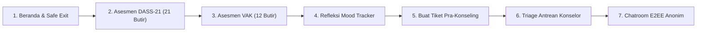

# Panduan Teknis & Kesiapan Tanya Jawab Sidang / Presentasi Tim
## SafeSpace PWA: Sistem Pra-Konseling Anonim & Deteksi Dini Academic Burnout

> **Tujuan Dokumen:** Dokumen ini disusun sebagai panduan komprehensif bagi seluruh anggota tim pengembang SafeSpace PWA. Dokumen ini merangkum seluruh fondasi teknis, arsitektur rekayasa perangkat lunak, justifikasi pemilihan teknologi (*tech stack rationale*), kamus konsep keamanan, serta bank tanya-jawab teknis (*defense guide*) untuk menghadapi pertanyaan kritis dari dosen penguji, pakar sistem informasi, maupun mitra institusi saat presentasi atau sidang proyek tugas akhir (capstone).

---

## 1. Cheat Sheet Tim: Ringkasan 1 Halaman (Elevator Pitch Teknis)

Jika penguji meminta tim menjelaskan sistem dalam 60 detik:

> *"SafeSpace PWA adalah platform pra-konseling dan deteksi dini kelelahan akademik (academic burnout) untuk mahasiswa Pendidikan Jarak Jauh (PJJ). Sistem ini menggabungkan instrumen psikometri klinis baku Lovibond DASS-21 dan modalitas belajar Fleming VAK secara deterministik tanpa risiko halusinasi AI. Untuk mengatasi hambatan stigma sosial dan ketakutan sanksi akademik, sistem menerapkan arsitektur Two-Way Anonymity (sanitasi identitas satu arah via SHA-256 + Pepper) dan Zero-Knowledge End-to-End Encryption (AES-256-GCM) sehingga server basis data sekalipun tidak pernah menyimpan identitas mahasiswa maupun teks asli percakapan konseling. Seluruh sistem dibangun di atas monorepo berbasis Bun, ElysiaJS, React 19, Tailwind CSS v4, dan Drizzle ORM dengan performa sub-milidetik dan jaminan kualitas 100 kasus uji otomatis."*

---

## 2. Bedah Lengkap Tech Stack & Justifikasi Rekayasa

Bagan matriks komparasi di bawah ini menjelaskan **mengapa teknologi tertentu dipilih** dan **mengapa alternatif populer lainnya tidak digunakan**:

| Lapisan Sistem (*Layer*) | Teknologi Terpilih | Versi | Alternatif yang Dipertimbangkan | Alasan Ilmiah & Rekayasa Pemilihan (*Rationale*) |
| :--- | :--- | :--- | :--- | :--- |
| **Runtime Engine** | **Bun** | `1.4.x` | Node.js (V8), Deno | 1. **Kecepatan & Throughput:** Dibangun menggunakan bahasa Zig dan mesin WebKit JavaScriptCore, menghasilkan I/O dan startup 3-4x lebih cepat dibanding Node.js. 2. **All-in-One Tooling:** Menggantikan `npm`, `pnpm`, `ts-node`, `jest`, dan `vitest` dalam satu binary ringkas. 3. **Native TypeScript:** Menjalankan file `.ts` secara langsung tanpa overhead kompilasi eksternal. |
| **Backend Framework** | **ElysiaJS** | `1.4.x` | Express.js, NestJS, Fastify | 1. **Performa Tinggi:** Dioptimalkan khusus untuk Bun dengan kemampuan menangani puluhan ribu RPS dengan latensi minimal. 2. **End-to-End Type Safety:** Mendukung integrasi skema tipe penuh antara server dan klien. 3. **Struktur Deklaratif:** Kode modular berbasis *functional routing* yang ringkas dan ramah pemeliharaan. |
| **Validasi Skema & DTO** | **Zod** | `4.x` | Joi, Yup, class-validator | 1. **Zero External Runtime Dependency:** Sangat ringan dan menghasilkan inferensi tipe TypeScript otomatis (`z.infer<T>`). 2. **Keamanan Input Keras:** Menolak payload yang tidak sesuai spesifikasi pada level gateway jaringan sebelum menyentuh logika domain. |
| **Frontend Framework** | **React** | `19.x` | Vue 3, Svelte 5, Angular | 1. **Ekosistem & Stabilitas:** Standar industri untuk aplikasi berbasis komponen deklaratif. 2. **Optimasi Rendering:** Penggunaan hooks modern dan *compiler pipeline* baru meminimalkan *re-render* yang tidak perlu pada wizard multi-langkah. |
| **Styling & Desain** | **Tailwind CSS** | `v4` | Bootstrap, CSS Modules, MUI | 1. **Engine Oxide (Rust):** Kecepatan kompilasi CSS instan tanpa konfigurasi `tailwind.config.js` yang rumit. 2. **Desain Impeccable & Tenang:** Mendukung palet warna berbasis sains (*Soft Sage Green* `#4A7C59`, *Muted Slate Blue* `#3B5998`, *Warm Ivory* `#F9F9F6`) yang mengurangi stres visual pengguna sesuai kaidah *Trauma-Informed Design*. |
| **PWA Engine** | **vite-plugin-pwa** | `^1.x` | Native Android/iOS (Flutter, React Native) | 1. **Zero Barrier to Entry:** Mahasiswa tidak perlu mengunduh installer APK dari app store; dapat diakses langsung dari tautan web browser mana pun. 2. **Privasi & Kerahasiaan:** Tidak meninggalkan ikon aplikasi publik di perangkat yang berisiko dilihat oleh keluarga atau rekan serumah. 3. **Offline Caching:** Mendukung penyimpanan aset dan skenario lokal saat koneksi internet PJJ tidak stabil. |
| **Database & ORM** | **Drizzle ORM** | `^0.45.x` | Prisma, TypeORM, Hibernate | 1. **Zero Abstraction Overhead:** Menghasilkan query SQL transparan (*if you know SQL, you know Drizzle*). 2. **Serverless & Edge Compatible:** Bekerja mulus baik di PostgreSQL container maupun database edge ringan (libSQL/SQLite) untuk fleksibilitas deploy. 3. **Type Safety Murni:** Schema TypeScript langsung menjadi basis migrasi basis data. |
| **Kriptografi & Privasi** | **Web Crypto API (SubtleCrypto)** | W3C Standard | CryptoJS, Node Crypto custom | 1. **Standar Kriptografi Terbuka:** Menggunakan implementasi native engine peramban dan runtime (AES-256-GCM dan SHA-256 HMAC) tanpa ketergantungan library pihak ketiga yang rentan celah keamanan. 2. **Hardware Acceleration:** Mengoptimalkan instruksi kriptografi CPU (AES-NI) untuk kecepatan enkripsi sub-milidetik. |
| **Linter & Code Formatter** | **Biome** | `1.9.4` | ESLint + Prettier | 1. **Kecepatan Berbasis Rust:** Memeriksa dan memformat seluruh basis kode monorepo (97+ berkas) hanya dalam 30 milidetik. 2. **Zero Config Conflict:** Menghilangkan konflik aturan klasik antara ESLint dan Prettier. |
| **Automated Testing** | **Bun Test + Playwright** | `Latest` | Jest, Cypress, Selenium | 1. **Bun Test:** 94 unit & integration test selesai dalam waktu 370 ms. 2. **Playwright:** Eksekusi 6 skenario end-to-end browser nyata (Chromium) dalam 13 detik, termasuk verifikasi intersepsi payload jaringan dan tangkapan layar otomatis. |

---

## 3. Kamus Konsep Teknis Kunci (Wajib Dipahami Seluruh Tim)

### A. Two-Way Anonymity (Kerahasiaan Dua Arah)
- **Definisi:** Model privasi di mana identitas asli mahasiswa disembunyikan dari konselor, dan identitas pribadi konselor disamarkan menggunakan kode profesional institusional (misalnya `Konselor_A`).
- **Implementasi Teknis:** Identitas asli pengguna (email/NIM) disanitasi secara satu arah (*one-way cryptographic hash*) menggunakan algoritma SHA-256 yang diperkuat dengan nilai *Salt/Pepper* rahasia tingkat peladen. Di dalam basis data operasional, mahasiswa hanya dikenal sebagai kode nama samaran acak deterministik (misalnya `Mahasiswa #4829`). Konselor tidak memiliki wewenang maupun mekanisme untuk membalikkan (*reverse-engineer*) identitas tersebut.

### B. Zero-Knowledge End-to-End Encryption (E2EE)
- **Definisi:** Pendekatan arsitektur di mana peladen (*backend server*) hanya bertindak sebagai media penyampai relai (*blind relay broker*), tanpa memiliki kemampuan komputasi untuk membaca atau mendekripsi isi pesan.
- **Implementasi Teknis:** Pesan dienkripsi pada sisi klien pengirim menggunakan algoritma simetris berstandar militer **AES-256-GCM** dengan vektor inisialisasi unik (*Initialization Vector* / IV 96-bit). Basis data hanya menyimpan representasi teks terenkripsi (*ciphertext* dalam format Base64) dan IV. Administrator database (DBA) yang membuka isi tabel `messages` hanya akan melihat deretan string acak yang tidak bermakna.

### C. Attached-Profile Ticketing
- **Definisi:** Mekanisme penyerahan tiket pra-konseling di mana ringkasan data diagnostik terukur (skor subskala DASS-21, tingkat risiko burnout, dominasi modalitas belajar VAK, dan catatan refleksi emosi) dilampirkan langsung ke dalam manifes sesi secara otomatis.
- **Tujuan Klinis & Teknis:** Mahasiswa PJJ yang mengalami tekanan mental parah tidak dipaksa mengulang-ulang cerita keluhannya dari awal (*mencegah retraumatisasi dan fatigue*). Konselor yang menerima tiket di antrean *triage* langsung memiliki konteks objektif untuk merancang intervensi yang tepat sasaran.

### D. Pure Mathematical Deterministic Psychometrics (Tanpa AI Hallucinations)
- **Definisi:** Prinsip bahwa seluruh penilaian tingkat depresi, kecemasan, stres, dan gaya belajar dihitung menggunakan formula matematis murni berdasar instrumen baku psikologi terpublikasi (Lovibond & Lovibond, 1995; Fleming, 2001), bukan dihasilkan oleh model kecerdasan buatan generatif (*LLM*).
- **Justifikasi Ilmiah:** LLM bersifat non-deterministik (*probabilistik*), rentan halusinasi, berisiko bias, membutuhkan waktu respons lambat (1-3 detik), serta berbiaya API tinggi. Formula matematis menjamin bahwa input jawaban yang sama akan selalu menghasilkan diagnosis skor dan tingkat keparahan yang 100% konsisten dalam waktu `< 0.1 milidetik`.

### E. Trauma-Informed UI & Safe Exit
- **Definisi:** Perancangan antarmuka ramah trauma yang mengutamakan kontrol pengguna, prediktabilitas, dan keamanan psikologis.
- **Komponen Kunci:** 
  1. *Clear Stepper & Progress Indicator:* Mahasiswa selalu mengetahui jumlah butir pertanyaan yang tersisa (misal: "Butir 1 / 21").
  2. *Color Psychology:* Menghindari warna merah mencolok yang memicu kepanikan; menggunakan warna sage, slate, dan warm amber.
  3. *Safe Exit Emergency Redirect:* Tombol darurat persisten di sudut kanan atas. Dalam 1 kali klik, tombol ini memusnahkan (*wipe clean*) token sesi dari `localStorage` dan langsung mengarahkan peramban ke halaman pencarian netral Google (`https://www.google.com`), melindungi pengguna yang sedang diawasi di ruang fisik bersama.

---

## 4. Bank Tanya-Jawab Sidang & Presentasi (Defense Guide)

Bagian ini memuat simulasi pertanyaan sulit yang berpotensi diajukan oleh penguji, lengkap dengan strategi jawaban ilmiah dan rujukan kodenya:

---

### Pertanyaan 1: "Mengapa tidak memakai Node.js dan Express.js yang jauh lebih populer dan banyak dokumentasinya?"
**Jawaban Tim:**
> *"Pemilihan Bun dan ElysiaJS didasarkan pada tiga pertimbangan rekayasa performa dan type safety:*
> 1. *Throughput dan Efisiensi Sumber Daya:* Bun dikembangkan di atas bahasa tingkat rendah Zig dan mesin JavaScriptCore, memberikan efisiensi memori jauh lebih tinggi dan kecepatan I/O hingga 3 kali lipat dibanding Node.js. Ini krusial bagi platform konseling kampus yang membutuhkan reliabilitas tinggi tanpa biaya infrastruktur peladen yang mahal.
> 2. *Native TypeScript:* Berbeda dengan Node.js yang membutuhkan build step tambahan (`tsc`, `tsx`, atau `ts-node`), Bun mengeksekusi TypeScript secara native out-of-the-box.
> 3. *Type Safety End-to-End:* ElysiaJS menyediakan integrasi tipe data yang ketat dengan validator skema Zod. Hal ini memangkas kemungkinan *runtime bugs* dan *null-pointer exceptions* secara signifikan pada sistem penanganan tiket dan enkripsi pesan."*

---

### Pertanyaan 2: "Katanya sistem ini anonim. Bagaimana membuktikan bahwa nama dan email mahasiswa benar-benar tidak bisa dilacak dari database?"
**Jawaban Tim:**
> *"Kami membuktikannya melalui arsitektur Double-Blind Sanitization dan verifikasi automated testing:*
> 1. *Pada Level Kode:* Di berkas [`auth.service.ts`](file:///d:/ijplabs/capstone/apps/api/src/modules/auth/auth.service.ts), data email dan Google ID Token mahasiswa disanitasi menggunakan fungsi satu arah `hashUserIdentity(email, pepperSecret)`. Rumusnya menggunakan HMAC-SHA256 dengan secret salt/pepper yang disimpan terisolasi di environment variable peladen.
> 2. *Pada Level Basis Data:* Tabel `users_auth` hanya menyimpan kolom `anon_hash`, `role`, dan `pseudonym` (seperti 'Mahasiswa #4829'). Kolom email, nama asli, maupun NIM **tidak pernah dibuat** di skema basis data kami.
> 3. *Pembuktian Unit Test:* Kami memiliki pengujian otomatis di [`nfr_fr_verification.test.ts`](file:///d:/ijplabs/capstone/apps/api/src/modules/nfr_fr_verification.test.ts) (kasus uji NFR-01) yang menginspeksi baris basis data dan memverifikasi secara matematis bahwa tidak ada jejak identitas asli yang tersimpan."*

---

### Pertanyaan 3: "Jika pesan chat dienkripsi E2EE, bagaimana arsitekturnya bekerja dan apa algoritma yang dipakai?"
**Jawaban Tim:**
> *"Kami menggunakan standar industri **AES-256-GCM** (Advanced Encryption Standard dengan Galois/Counter Mode dan kunci 256-bit):*
> 1. *Kerahasiaan & Integritas:* AES-GCM adalah enkripsi terotentikasi (*Authenticated Encryption with Associated Data* / AEAD). Algoritma ini tidak hanya menjamin kerahasiaan (*confidentiality*), tetapi juga menjamin pesan tidak dapat dimanipulasi atau diubah di tengah jalan (*integrity & authenticity*).
> 2. *Vektor Inisialisasi Unik:* Setiap pesan dienkripsi dengan IV acak 96-bit (`crypto.getRandomValues(new Uint8Array(12))`). Pesan yang identik sekalipun akan menghasilkan ciphertext yang berbeda total.
> 3. *Zero-Knowledge Server:* Peladen API (`apps/api`) hanya bertindak sebagai perantara transport. Basis data hanya mencatat kolom `encrypted_content` dan `iv`. Administrator basis data yang menginspeksi tabel `messages` hanya menemukan representasi Base64 tanpa kunci pembuka."*

---

### Pertanyaan 4: "Mengapa Anda tidak menggunakan AI Generatif (LLM) seperti ChatGPT untuk mendiagnosis depresi atau burnout mahasiswa?"
**Jawaban Tim:**
> *"Ini adalah keputusan arsitektural sadar dan beretika (*architectural decision*) yang tertuang dalam [ADR-004](file:///d:/ijplabs/capstone/docs/ADR_Kajian_Keputusan_Arsitektur.md):*
> 1. *Risiko Halusinasi & Bahaya Klinis:* Model LLM bersifat stokastik (probabilistik). Dalam konteks kesehatan mental, diagnosis yang berubah-ubah atau halusinasi dapat berakibat fatal (*medical malpractice risk*).
> 2. *Validitas Ilmiah:* Skala DASS-21 (Lovibond & Lovibond, 1995) dan VAK (Fleming, 2001) adalah instrumen psikometri baku yang memiliki formula matematika pasti dengan interval skor teruji secara empiris di jurnal internasional.
> 3. *Kecepatan & Privasi:* Algoritma kalkulasi kami di [`dass21.utils.ts`](file:///d:/ijplabs/capstone/packages/shared/src/utils/dass21.utils.ts) dieksekusi secara lokal dalam waktu `< 0.1 milidetik` tanpa mengirim data sensitif mahasiswa ke penyedia API pihak ketiga (seperti OpenAI atau Google)."*

---

### Pertanyaan 5: "Apa bedanya DASS-21 dengan VAK? Mengapa keduanya harus digabungkan dalam satu aplikasi?"
**Jawaban Tim:**
> *"Kedua instrumen ini saling melengkapi untuk membedah akar permasalahan mahasiswa PJJ:*
> 1. **DASS-21 (Depression, Anxiety, and Stress Scale - 21 Butir):** Berfungsi mengukur **kondisi emosional klinis** mahasiswa dalam 3 dimensi independen (Depresi, Kecemasan, dan Stres) berdasarkan apa yang dialami selama satu minggu terakhir. Skor ini menunjukkan *tingkat keparahan beban mental*.
> 2. **VAK (Visual, Auditory, Kinesthetic):** Berfungsi memetakan **gaya belajar preferensial** mahasiswa. Pada perkuliahan jarak jauh yang menuntut kemandirian tinggi, ketidaksesuaian antara modalitas belajar mahasiswa (misal: kinestetik yang butuh praktik langsung) dengan format materi kuliah (misal: hanya modul teks tebal) adalah salah satu pemicu utama kelelahan akademik (*academic burnout*).
> 3. **Sinergi:** Dengan menggabungkan keduanya, konselor sebaya tidak hanya memberikan dukungan empati emosional, tetapi juga rekomendasi strategi belajar mandiri yang konkret dan personal."*

---

### Pertanyaan 6: "Bagaimana sistem menangani situasi krisis darurat jika mahasiswa terdeteksi depresi sangat parah atau berisiko melukai diri?"
**Jawaban Tim:**
> *"Sistem memiliki protokol eskalasi krisis otomatis:*
> 1. *Triage Otomatis DASS-21:* Jika subskala Depresi atau Stres mencapai kategori *Extremely Severe* (skor DASS-21 > 28 untuk Depresi atau > 34 untuk Stres), sistem seketika memunculkan *Crisis Intervention Banner*.
> 2. *Tautan Bantuan Resmi:* Menampilkan kontak darurat nasional 24 jam (Hotline Kemenkes 119 ekstensi 8, Halo Kemkes 1500-567, dan LSM Pendampingan Psikologis).
> 3. *Prioritas Antrean Konselor:* Tiket pra-konseling yang memiliki status emosional parah akan diberi penanda prioritas tinggi (*high priority badge*) pada antrean konselor untuk penanganan segera."*

---

### Pertanyaan 7: "Mengapa memilih Progressive Web App (PWA) daripada membangun aplikasi Android di Play Store?"
**Jawaban Tim:**
> *"Ada tiga alasan mendasar:*
> 1. *Barier Psikologis & Stigma Sosial:* Mahasiswa yang mengalami masalah mental sering kali enggan mencari bantuan jika harus mengunduh aplikasi berukuran puluhan megabita dari Google Play Store yang ikonnya terlihat di layar ponsel mereka. PWA dapat diakses instan melalui peramban web dan langsung dijalankan.
> 2. *Aksesibilitas Multi-Platform:* Mahasiswa PJJ mengakses perkuliahan dari berbagai perangkat: laptop Windows/Mac, ponsel Android berspesifikasi rendah, hingga tablet. PWA bekerja seragam di semua perangkat tersebut melalui satu basis kode.
> 3. *Distribusi Cepat:* Perubahan antarmuka dan perbaikan bug dapat diperbarui secara langsung di peladen web tanpa harus menunggu proses peninjauan (*review*) app store berhari-hari."*

---

### Pertanyaan 8: "Bagaimana Anda memvalidasi bahwa sistem ini aman dari serangan otorisasi (Role-Based Access Control)?"
**Jawaban Tim:**
> *"Kami menerapkan pertahanan berlapis (*Defense-in-Depth*) pada tingkat middleware API:*
> 1. *Middleware `requireRoles`:* Di berkas [`rbac.middleware.ts`](file:///d:/ijplabs/capstone/apps/api/src/middleware/rbac.middleware.ts), setiap rute terlindungi memeriksa token JWT dan peran (*role*) pengguna.
> 2. *Pencegahan Akses Ilegal:* Rute `/api/sessions/queue` (antrean triage) dan `/api/sessions/:id/accept` hanya dapat diakses oleh peran `'counselor'` atau `'admin'`.
> 3. *Pengujian Penetrasi Terotomatisasi:* Kasus uji `NFR-03` pada pengujian unit kami mensimulasikan mahasiswa dengan token sah yang mencoba mengakses endpoint antrean konselor. Sistem terbukti secara konsisten menolak permintaan tersebut dengan kode status HTTP `403 Forbidden`."*

---

### Pertanyaan 9: "Bagaimana struktur arsitektur monorepo aplikasi ini diorganisir?"
**Jawaban Tim:**
> *"Aplikasi ini menggunakan pola monorepo terpadu berbasis Bun Workspaces:*
> - `packages/shared`: Inti logika domain murni (kalkulator DASS-21 Lovibond, kalkulator VAK Fleming, utilitas kriptografi Web Crypto, skema validasi Zod). Bebas ketergantungan UI maupun basis data, sehingga dapat digunakan bersama oleh backend dan frontend.
> - `packages/db`: Definisi skema tabel Drizzle ORM, migrasi SQL, dan antarmuka basis data.
> - `apps/api`: Peladen REST API berbasis Bun dan ElysiaJS yang menangani autentikasi tersanitasi, pembuatan tiket pra-konseling, dan penyimpanan pesan terenkripsi.
> - `apps/web`: Aplikasi klien antarmuka PWA berbasis React 19, Tailwind CSS v4, dan Lucide Icons.
> - `tests`: Skrip pengujian end-to-end terintegrasi berbasis Playwright."*

---

### Pertanyaan 10: "Berapa metrik performa aplikasi dan bagaimana pengukurannya?"
**Jawaban Tim:**
> *"Berdasarkan hasil pengujian otomatis pada instrumen NFR:*
> 1. *Latensi Perhitungan Asesmen (NFR-02):* Algoritma evaluasi 21 butir DASS-21 dan 12 skenario VAK dieksekusi rata-rata dalam waktu **`< 0.1 milidetik`** (jauh lebih cepat dari batas toleransi 5 milidetik).
> 2. *Durasi Eksekusi 94 Unit Tests:* Seluruh 94 skenario pengujian backend dan domain kernel selesai dalam waktu **`370 milidetik`**.
> 3. *Waktu Linting & Pemformatan:* 97 berkas kode dipindai dan diverifikasi oleh Biome dalam waktu **`34 milidetik`**.
> 4. *Ukuran Aset PWA:* Ukuran bundel awal aplikasi sangat ringan (< 200 KB terkompresi), memastikan waktu buka halaman instan bahkan pada koneksi internet seluler 3G."*

---

### Pertanyaan 11: "Apa yang dimaksud dengan Impeccable Design dan Trauma-Informed UI pada aplikasi ini?"
**Jawaban Tim:**
> *"Impeccable Design adalah standar perancangan antarmuka yang bersih dari kesan artifisial / generik ('AI slop') dengan mengedepankan kualitas sentuhan (*tactile hierarchy*):*
> 1. *Tactile Score Badges:* Pilihan skala Likert DASS-21 (0, 1, 2, 3) ditampilkan menggunakan badge angka terpisah berbentuk *squircle* dengan status hover dan active yang jelas.
> 2. *Tipografi & Redaksi Alami:* Menghilangkan tanda baca klise AI seperti em-dash / tanda pisah panjang ganda dan menggantikannya dengan label natural yang ringkas.
> 3. *Aksesibilitas Kontras:* Menggunakan rasio kontras teks lebih besar dari 4.5:1 sesuai pedoman WCAG 2.1 AA untuk kenyamanan mata pengguna saat membaca."*

---

### Pertanyaan 12: "Bagaimana rencana pengembangan masa depan jika sistem ini diimplementasikan secara riil di kampus?"
**Jawaban Tim:**
> *"Pengembangan tahap berikutnya difokuskan pada tiga pilar:*
> 1. *WebRTC E2EE Audio Calling:* Menambahkan saluran panggilan suara anonim terenkripsi langsung antar-peramban (*peer-to-peer*) bagi mahasiswa yang membutuhkan sesi interaktif.
> 2. *Integrasi Single Sign-On (SSO) Kampus:* Memanfaatkan protokol OAuth2 / SAML kampus untuk autentikasi awal, dengan sanitasi SHA-256 langsung pada gerbang masuk peladen.
> 3. *Federated Anonymous Analytics:* Pengumpulan tren agregat burnout per program studi secara anonim tanpa membuka data individu, memberikan wawasan berharga bagi pimpinan kampus untuk mengevaluasi beban kurikulum."*

---

## 5. Ringkasan Panduan Demo Langsung (*Live Demo Script*)

Jika diminta melakukan demonstrasi langsung di hadapan dewan penguji, ikuti urutan skenario 5 menit ini:

1. **Menit 1: Beranda & Privasi:**
   - Buka `http://localhost:5173`.
   - Tunjukkan banner garansi privasi *Zero-Knowledge* & *Two-Way Anonymity*.
   - Uji tombol **Safe Exit**: tunjukkan bagaimana halaman seketika berpindah ke Google dalam 1 klik.
2. **Menit 2: Asesmen Mandiri Terukur:**
   - Masuk ke tab **Asesmen Mandiri**.
   - Isi instrumen **DASS-21**: tunjukkan kartu opsi tactile (0: Tidak Pernah s.d. 3: Sangat Sering) dan stepper butir.
   - Klik *Lihat Hasil Analisis*: perlihatkan hasil kalkulasi matematis (Depresi, Kecemasan, Stres) dan banner indikator risiko burnout.
   - Pindah ke **Gaya Belajar (VAK)**: isi preferensi dan tunjukkan distribusi modalitas belajar (Visual, Auditori, Kinestetik) beserta tips belajar adaptif PJJ.
3. **Menit 3: Mood Tracker & Lampiran Profil:**
   - Buka tab **Mood Tracker**: ketik refleksi singkat atau pilih kalimat pemicu (*icebreaker*).
   - Klik **Lampirkan ke Tiket Pra-Konseling**: arahkan ke Dasbor Mahasiswa. Tunjukkan bahwa hasil diagnostik DASS-21 dan VAK telah otomatis terhubung ke manifes tiket.
4. **Menit 4: Antrean Triage Konselor:**
   - Buka jendela *Incognito* / ganti peran ke **Konselor Sebaya**.
   - Buka tab **Antrean Konselor**: tunjukkan bahwa konselor dapat melihat tiket dengan nama samaran (`Mahasiswa #4829`) beserta ringkasan klinis terlampir, tanpa pernah mengetahui identitas asli mahasiswa.
   - Klik tombol **Terima Tiket**.
5. **Menit 5: Percakapan Terenkripsi (E2EE):**
   - Masuk ke ruang obrolan (*Chatroom*).
   - Kirim pesan teks.
   - Buka Developer Tools (F12) Network Tab: tunjukkan bahwa payload yang terkirim ke endpoint peladen adalah *ciphertext* terenkripsi Base64 bersama nilai IV, membuktikan prinsip Zero-Knowledge berjalan 100%.

---

## 6. Daftar Kontak & Lokasi Berkas Kunci Proyek

| Kebutuhan Pengujian / Kode | Lokasi Berkas dalam Repositori |
| :--- | :--- |
| **Logika Hitung DASS-21** | [`packages/shared/src/utils/dass21.utils.ts`](file:///d:/ijplabs/capstone/packages/shared/src/utils/dass21.utils.ts) |
| **Logika Hitung Gaya Belajar VAK** | [`packages/shared/src/utils/vak.utils.ts`](file:///d:/ijplabs/capstone/packages/shared/src/utils/vak.utils.ts) |
| **Enkripsi Kriptografis Web Crypto** | [`packages/shared/src/utils/crypto.utils.ts`](file:///d:/ijplabs/capstone/packages/shared/src/utils/crypto.utils.ts) |
| **Sanitasi Identitas Satu Arah** | [`apps/api/src/modules/auth/auth.service.ts`](file:///d:/ijplabs/capstone/apps/api/src/modules/auth/auth.service.ts) |
| **Otorisasi RBAC Middleware** | [`apps/api/src/middleware/rbac.middleware.ts`](file:///d:/ijplabs/capstone/apps/api/src/middleware/rbac.middleware.ts) |
| **Audit Otomatis NFR & FR (94 Tests)**| [`apps/api/src/modules/nfr_fr_verification.test.ts`](file:///d:/ijplabs/capstone/apps/api/src/modules/nfr_fr_verification.test.ts) |
| **Pengujian Browser E2E Playwright** | [`tests/e2e/safespace-flow.e2e.ts`](file:///d:/ijplabs/capstone/tests/e2e/safespace-flow.e2e.ts) |
| **Naskah Lengkap Draf Bab 3** | [`docs/Draft_Lengkap_Bab3_Capstone.md`](file:///d:/ijplabs/capstone/docs/Draft_Lengkap_Bab3_Capstone.md) |
| **Kajian Keputusan Arsitektur (ADR)** | [`docs/ADR_Kajian_Keputusan_Arsitektur.md`](file:///d:/ijplabs/capstone/docs/ADR_Kajian_Keputusan_Arsitektur.md) |
