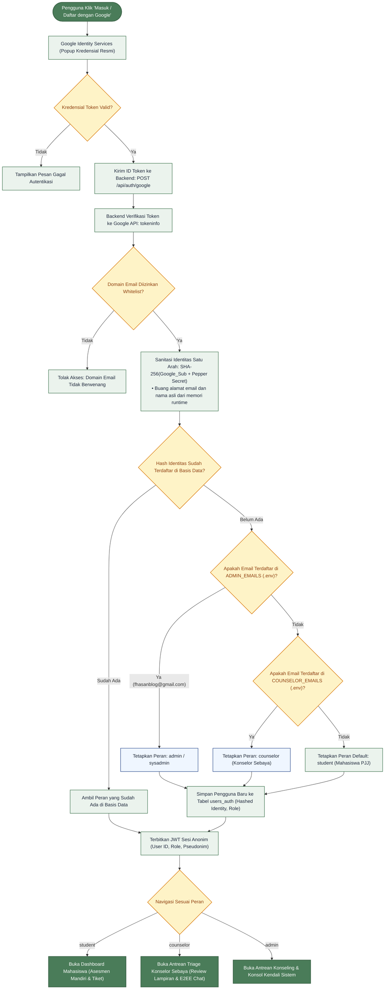

# DOKUMENTASI SPESIFIKASI ALUR AUTENTIKASI, RBAC, DAN SINKRONISASI LURING (OFFLINE SYNC)
## SafeSpace PWA - Sistem Informasi Pra-Konseling Anonim dan Deteksi Dini Academic Burnout
**Studi Kasus:** Universitas Terbuka (UT)  
**Mata Kuliah:** STSI4401 Capstone Project (2026)  
**Tujuan Dokumen:** Bahan Rujukan Arsitektur dan Alur Sistem untuk Penyusunan Bab III (Perancangan Sistem) dan Bab IV (Hasil dan Pembahasan) Laporan Capstone  

---

## 1. Prinsip Dasar Arsitektur & Keamanan Identitas

SafeSpace PWA dibangun di atas prinsip **Two-Way Anonymity** dan **Zero-Knowledge Architecture**. Tujuan utamanya adalah memberikan rasa aman psikologis penuh kepada mahasiswa Pendidikan Jarak Jauh (PJJ) yang mengalami *academic burnout* agar berani berkonsultasi tanpa takut terstigma, dihakimi, atau datanya bocor ke pihak kampus maupun sesama rekan.

### 1.1 Mengapa Menggunakan Google OAuth 2.0 Live?
- **Validasi Keabsahan Sivitas Akademika:** Menggunakan Google Identity Services (GIS) memastikan bahwa pengguna yang mengakses sistem adalah manusia asli dengan akun email valid (bukan bot otomatis atau pengguna fiktif).
- **Label Tombol Dwifungsi:** Tombol autentikasi menggunakan frasa dwifungsi: **"Masuk / Daftar dengan Google (Sign In / Sign Up)"**, sehingga pengguna baru yang belum pernah mendaftar maupun pengguna lama yang sudah terdaftar tidak mengalami kebingungan tata cara masuk.
- **Sanitasi Privasi Satu Arah (One-Way Sanitization):** Begitu token ID Google diverifikasi oleh peladen backend (`https://oauth2.googleapis.com/tokeninfo`), subjek identitas Google (`sub`) langsung disanitasi menggunakan algoritma **SHA-256 HMAC** yang dicampur dengan *Pepper Secret* acak dari variabel lingkungan peladen.
- **Pembersihan Memori Runtime:** Alamat email asli, nama lengkap, dan NIM mahasiswa **dibuang seketika dari memori peladen**. Basis data konseling hanya menyimpan representasi acak (*hashed identity*) dan menerbitkan pseudonim acak ramah (misalnya `Mahasiswa #4861` atau `Konselor #2632`).

---

## 2. Manajemen Peran (RBAC) & Elevasi Konselor oleh Sysadmin

### 2.1 Default Role: Mahasiswa (Student)
Secara *default*, setiap akun yang melakukan login menggunakan Google OAuth 2.0 akan menerima peran sebagai **Mahasiswa** (`student`). Mahasiswa memiliki hak akses untuk:
1. Melakukan asesmen psikometri mandiri DASS-21 dan pemetaan modalitas belajar VAK.
2. Menuliskan catatan refleksi harian pada Mood Tracker.
3. Membuka tiket pra-konseling anonim dan melampirkan hasil asesmen (*Attached Profile*).
4. Melakukan obrolan terenkripsi *End-to-End* (E2EE) dengan konselor sebaya setelah tiket diterima.

### 2.2 Elevasi Peran Konselor & Sysadmin via `.env` (Pre-approved Whitelist)
Untuk menjaga integritas etis konseling dan mencegah sembarang pengguna melihat antrean tiket mahasiswa, elevasi peran konselor dan administrator dikunci melalui **Metode A (Pre-approved List di `.env`)**:

```env
# RBAC Configuration (Pre-approved Sysadmin & Counselor List)
ADMIN_EMAILS=fhasanblog@gmail.com
COUNSELOR_EMAILS=konselor@ecampus.ac.id
```

- **Mekanisme Kerja:**
  1. Pengguna melakukan login via Google OAuth dengan email `fhasanblog@gmail.com`.
  2. Peladen memvalidasi keabsahan email.
  3. Peladen mencocokkan email terhadap daftar `ADMIN_EMAILS`.
  4. Karena email cocok, peladen secara otomatis menetapkan peran `admin` dan menerbitkan pseudonim berawalan `Admin #XXXX`.
  5. Jika email terdaftar di `COUNSELOR_EMAILS` atau berdomain konselor resmi, sistem menetapkan peran `counselor` dan pseudonim `Konselor #XXXX`.
  6. Seluruh pengguna selain daftar di atas otomatis menjadi `student`.

### 2.3 Diagram Alur Autentikasi Google OAuth 2.0 & RBAC



---

## 3. Desain Keamanan Mode Sandbox (Pengujian & Evaluator)

### 3.1 Masalah Keamanan pada Mode Sandbox
Tombol akses instan tanpa login (sandbox/mock) sangat berguna saat pengujian otomatis atau saat penguji sidang ingin mencoba sistem tanpa internet kampus. Namun, jika tombol tersebut terbuka untuk umum di lingkungan produksi (*production*), sembarang pengunjung dapat mengakses antrean konselor tanpa otentikasi.

### 3.2 Solusi: Penguncian Bertingkat
1. **Konfigurasi Lingkungan (`.env`)**:
   - `ENABLE_SANDBOX=true` pada mode development/test.
   - `SANDBOX_PASSPHRASE="safespace-evaluator-2026"` sebagai kunci pembuka modal.
2. **Kondisi Produksi (Docker / Rilis Final)**:
   - Jika `NODE_ENV=production` atau `ENABLE_SANDBOX=false`, blok sandbox **dihapus total dari antarmuka (DOM)**. Layar murni hanya menampilkan tombol resmi Google OAuth.
   - Endpoint peladen backend `/api/auth/google` akan langsung menolak token sandbox `dev_token_*` dengan kode galat `403 Forbidden`.
3. **Kondisi Development / Sidang (Terkunci Default)**:
   - Pada mode pengembangan, sandbox tidak terbuka langsung. Pengguna melihat status tombol gembok: *"Buka Mode Sandbox Evaluator (Terkunci)"*.
   - Saat diklik, peramban menampilkan modal yang mewajibkan memasukkan *passphrase* evaluator.
4. **Bypass Otomatis untuk Agent & Testing (Playwright)**:
   - Tool pengujian otomatis (Playwright E2E) membuka kunci secara otomatis melalui parameter URL `/?sandbox_key=safespace-evaluator-2026` atau `sessionStorage`, sehingga pengujian integrasi tetap 100% *automated* tanpa intervensi manual.

---

## 4. Batasan Ruang Lingkup Mode Luring (Offline Boundaries)

Sebagai aplikasi Progressive Web App (PWA) yang ditujukan bagi mahasiswa PJJ di berbagai pelosok daerah dengan kualitas sinyal internet fluktuatif, SafeSpace dirancang dengan prinsip *offline-first* pada modul refleksi diri. Namun, untuk mencegah kerancuan fungsional (*scope sprawl*), batasan fitur offline diatur secara tegas:

| Fungsionalitas | Status Mode Offline | Rasional Teknis & Etis |
| :--- | :--- | :--- |
| **PWA App Shell & Navigasi** | **Bisa (Aktif)** | Aset antarmuka (HTML, CSS, JS, font) di-cache via Service Worker. |
| **Pengisian DASS-21 (21 Butir)** | **Bisa (Aktif)** | Rumus pembobotan skala DASS-21 dieksekusi secara matematis di sisi klien (*client-side deterministic calculation*). |
| **Pengisian Gaya Belajar VAK** | **Bisa (Aktif)** | 12 skenario modalitas dihitung langsung di peramban tanpa memerlukan koneksi server. |
| **Pencatatan Mood Tracker** | **Bisa (Aktif)** | Curhatan harian disimpan di `localStorage` peramban klien. |
| **Melihat Skor & Histori Lokal** | **Bisa (Aktif)** | Skor stres, kecemasan, depresi, dan modalitas belajar dapat dilihat langsung di layar hasil. |
| **Membuka Tiket Konseling Baru** | **Terkunci (Offline Locked)** | Membuka tiket memerlukan transmisi data ke antrean terpusat di server agar konselor sebaya dapat menerima notifikasi antrean. |
| **Sesi Chat Konseling (E2EE)** | **Terkunci (Offline Locked)** | Komunikasi dua arah secara real-time antar manusia membutuhkan koneksi jaringan aktif untuk bertukar kunci enkripsi dan ciphertext. |

---

## 5. Alur Sinkronisasi Luring ke Daring (Offline-to-Online Sync)

### 5.1 Siklus Sinkronisasi Otomatis
1. **Penyimpanan Lokal:** Ketika pengguna mengerjakan asesmen dalam kondisi sinyal terputus, data hasil asesmen disimpan di `localStorage` dengan penanda status metadata `is_synced: false`.
2. **Deteksi Konektivitas:** Sistem PWA memantau status jaringan menggunakan event peramban bawaan `window.addEventListener('online', ...)`.
3. **Pemberitahuan Halus (*Trauma-Informed*):** Begitu jaringan kembali terdeteksi, PWA menampilkan bilah status hijau lembut: *"Koneksi Anda telah kembali terhubung. Menyinkronkan data asesmen..."*.
4. **Pengiriman Payload:** PWA mengirimkan data asesmen tertunda ke endpoint backend `POST /api/assessment/sync`.
5. **Pembaruan Status:** Setelah backend merespons dengan status 200 OK, status di `localStorage` diperbarui menjadi `is_synced: true`.
6. **Aktivasi Tiket Konseling (*Attached Profile*):** Tombol **"Buka Tiket Pra-Konseling"** yang tadinya terkunci otomatis menjadi aktif. Jika mahasiswa mengklik tombol tersebut, hasil DASS-21 dan VAK yang baru saja disinkronkan langsung dilampirkan ke dalam tiket konselor.

### 5.2 Diagram Alur Mode Offline & Sinkronisasi Asesmen

```mermaid
flowchart TD
    classDef startend fill:#4A7C59,stroke:#3b6347,stroke-width:2px,color:#fff;
    classDef process fill:#EBF3ED,stroke:#4A7C59,stroke-width:1.5px,color:#1E293B;
    classDef decision fill:#FEF3C7,stroke:#D97706,stroke-width:1.5px,color:#92400E;
    classDef locked fill:#FEE2E2,stroke:#DC2626,stroke-width:1.5px,color:#991B1B;

    INIT(["Pengguna Membuka SafeSpace PWA"]):::startend
    CHECK_NET{"Status Koneksi Jaringan (navigator.onLine)?"}:::decision

    SHOW_OFFLINE["Tampilkan Banner: 'Mode Hemat Sinyal / Offline Aktif'"]:::process
    FILL_OFFLINE["Pengguna Mengerjakan Asesmen DASS-21 atau Gaya Belajar VAK"]:::process
    CALC_CLIENT["Kalkulasi Skor Psikometri Deterministik 100% di Sisi Klien"]:::process
    SAVE_LOCAL["Simpan Skor & Hasil di LocalStorage Peramban: is_synced = false"]:::process
    LOCK_CHAT["Kunci Fitur Konseling Langsung: 'Memerlukan Koneksi Internet untuk Hubungkan ke Konselor'"]:::locked

    ONLINE_NORMAL["Akses Seluruh Fitur Online secara Penuh"]:::process

    WAIT_ONLINE["Sistem Mendengarkan Event Peramban: window.addEventListener('online')"]:::process
    DETECT_ONLINE(["Jaringan Internet Kembali Terhubung"]):::startend
    CHECK_PENDING{"Apakah Ada Data Asesmen di LocalStorage dengan is_synced == false?"}:::decision

    CHECK_AUTH{"Apakah Pengguna Sudah Terotentikasi (JWT Ada)?"}:::decision
    PROMPT_AUTH["Tampilkan Banner Empatik: 'Masuk dengan Akun Google untuk Mengamankan Riwayat & Konseling'"]:::process

    SYNC_API["Kirim Payload Asesmen ke Peladen: POST /api/assessment/sync"]:::process
    UPDATE_LOCAL["Perbarui Status di LocalStorage: is_synced = true"]:::process
    UNLOCK_TICKET["Buka Kunci Tombol 'Buka Tiket Pra-Konseling'"]:::process
    ATTACH_TICKET["Lampirkan Profil DASS-21 & VAK ke Tiket Konseling (Attached Profile)"]:::process
    TO_QUEUE["Tiket Masuk ke Antrean Konselor Sebaya untuk Ditelaah"]:::startend

    INIT --> CHECK_NET
    CHECK_NET -- "Offline" --> SHOW_OFFLINE
    CHECK_NET -- "Online" --> ONLINE_NORMAL

    SHOW_OFFLINE --> FILL_OFFLINE
    FILL_OFFLINE --> CALC_CLIENT
    CALC_CLIENT --> SAVE_LOCAL
    SAVE_LOCAL --> LOCK_CHAT
    LOCK_CHAT --> WAIT_ONLINE

    WAIT_ONLINE --> DETECT_ONLINE
    DETECT_ONLINE --> CHECK_PENDING
    CHECK_PENDING -- "Tidak Ada" --> ONLINE_NORMAL
    CHECK_PENDING -- "Ada" --> CHECK_AUTH

    CHECK_AUTH -- "Belum Login" --> PROMPT_AUTH
    PROMPT_AUTH --> CHECK_AUTH
    CHECK_AUTH -- "Sudah Login" --> SYNC_API

    SYNC_API --> UPDATE_LOCAL
    UPDATE_LOCAL --> UNLOCK_TICKET
    UNLOCK_TICKET --> ATTACH_TICKET
    ATTACH_TICKET --> TO_QUEUE
```



---

## 6. Akses Visualisasi & Ekspor Diagram Interaktif

Seluruh diagram sistem di atas dapat dilihat secara interaktif dan diunduh dalam format **High-Resolution PNG (2.5x Scale)** siap cetak untuk dokumen skripsi/laporan capstone melalui berkas HTML berikut:

- **Lokasi Dasbor:** `docs/flowchart_dashboard.html`
- **Cara Membuka:** Buka berkas `flowchart_dashboard.html` langsung di peramban Chrome/Edge/Firefox, pilih tab diagram yang diinginkan, lalu klik tombol **"Download PNG"** atau **"Salin Kode"**.
